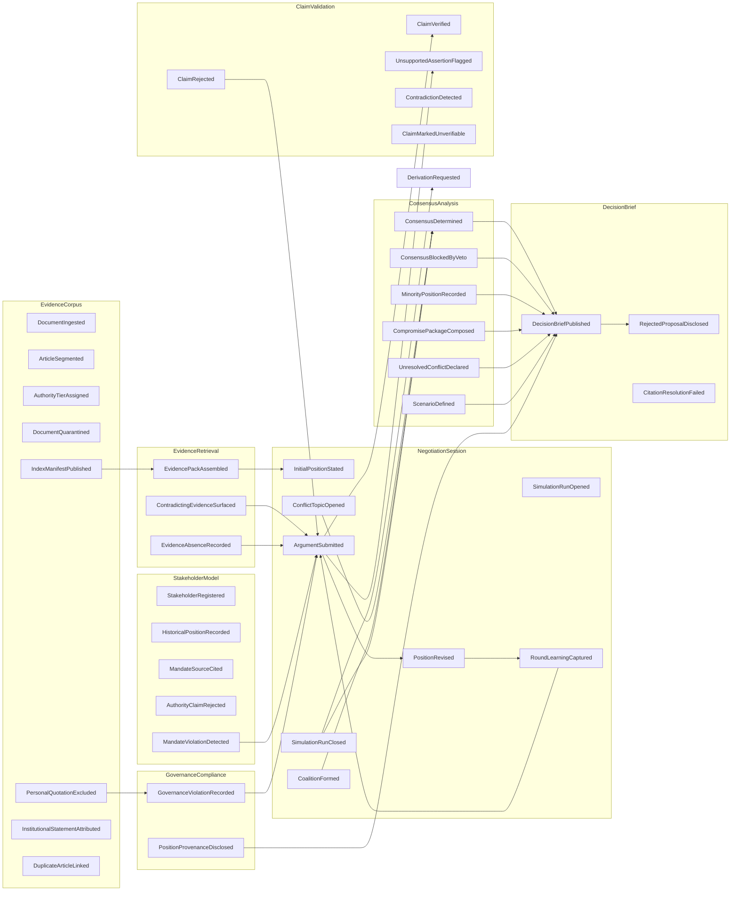

# Domain Event Flow

**Context:** how domain events travel between bounded contexts. Events are facts in the past tense,
persisted through a transactional outbox, and replayed for audit (ADR-003).

## Event flow across contexts

## Event classes

| Class | Meaning | Examples | Persistence |
|---|---|---|---|
| **Corpus facts** | The archive changed in a way that affects citations | `DocumentIngested`, `IndexManifestPublished`, `PersonalQuotationExcluded` | Outbox + corpus log |
| **Negotiation facts** | Something happened in the room | `InitialPositionStated`, `ArgumentSubmitted`, `PositionRevised`, `CoalitionFormed` | Outbox + append-only run log |
| **Derivation facts** | Analysis was computed from the record | `ConsensusDetermined`, `CompromisePackageComposed`, `ImpactAssessed` | Outbox |
| **Guard facts** | A rule refused or rewrote output | `GovernanceViolationRecorded`, `CitationResolutionFailed` | Outbox + violation table |
| **Metering facts** | A call was made and cost money | `AgentInvocationRecorded`, `RunBudgetExhausted` | Invocation table |

## Delivery guarantees

- **At-least-once.** Handlers are idempotent, keyed on `event_id`.
- **Ordered per aggregate.** Outbox sequence preserves order within an aggregate id.
- **Replayable.** `ReplaySimulationHistory` reads the run log; derived artefacts can be rebuilt.
- **Bounded payloads.** Ids plus minimal data; consumers re-read for detail.

## Explicit non-events (ADR-008 triage)

These exist as logs or return values, **not** as published domain events:
passage indexing writes, score computation, recency weight application, query rewriting,
phase bookkeeping, brief section completion. They fail all three triage questions.

---

*Generated from session: 87433e56-b1a2-4464-a232-2dc4fe6f9dfd · Date: 2026-11-05*
