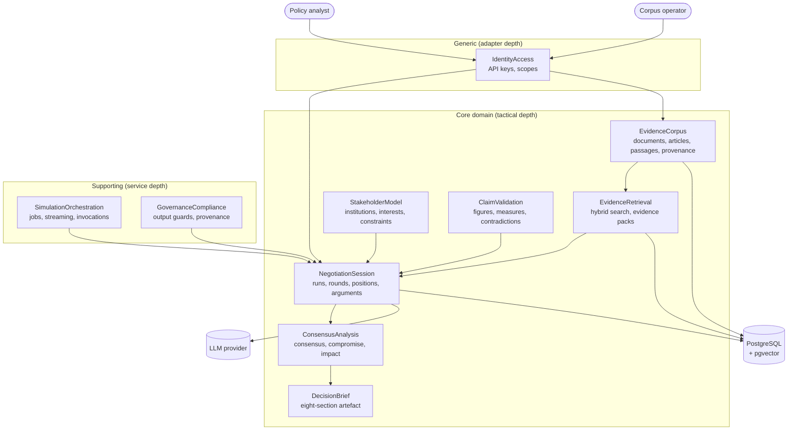

# System Context Diagram

**Context:** HealthPolicy Simulator — a multi-agent negotiation simulator for Austrian healthcare
policy, backend only. Institutional agents argue over a policy question, cite press-archive
evidence, revise positions and produce an auditable decision brief.

**Session:** 87433e56-b1a2-4464-a232-2dc4fe6f9dfd

## Actors

| Actor | Type | Interaction |
|---|---|---|
| Policy analyst | Human | Creates a run from a policy question, watches the negotiation, reads the brief |
| Corpus operator | Human | Triggers ingestion, curates source authority and institutional allowlist |
| Stakeholder agent | Software (LLM) | Represents one institution: forms positions, argues, revises |
| Moderator agent | Software (LLM) | Frames the mandate, selects stakeholders, arbitrates, closes the run |
| LLM provider | External system | Reasoning backend, invoked through a provider-independent port |

## Bounded Contexts

## Context Map (authoritative)

| From | To | Relationship | Contract |
|---|---|---|---|
| EvidenceCorpus | EvidenceRetrieval | **open-host** | Published language: `PassageView`, `ProvenanceView`. Retrieval never reads corpus tables |
| EvidenceRetrieval | NegotiationSession | **anticorruption-layer** | `EvidencePack` mapped to `ClaimEvidence` refs; raw hits never enter the domain |
| StakeholderModel | NegotiationSession | **partnership** | `StakeholderProfileView`; positions must reference declared interests/constraints |
| NegotiationSession | ConsensusAnalysis | **open-host** | Session events are the published contract for derivation |
| ConsensusAnalysis | DecisionBrief | **conformist** | Brief projects consensus records plus history |
| ClaimValidation | NegotiationSession | **partnership** | Verdicts gate argument acceptance |
| GovernanceCompliance | NegotiationSession | **anticorruption-layer** | Guards agent output before persistence |
| SimulationOrchestration | NegotiationSession | **anticorruption-layer** | Invokes domain commands; graph state is never the source of truth |

## External Integrations

| System | Purpose | Boundary |
|---|---|---|
| LLM provider (OpenAI-compatible / local) | Agent and moderator reasoning | `LLMClient` port; provider chosen by config; every call metered (ADR-006) |
| Press archive (local files) | Evidence corpus | Ingested once; source files addressed by content hash |
| PostgreSQL 16 + pgvector | Application state, full-text and vector search | One database, schema-per-context (ADR-002) |

---

*Generated from session: 87433e56-b1a2-4464-a232-2dc4fe6f9dfd · Date: 2026-11-05*
