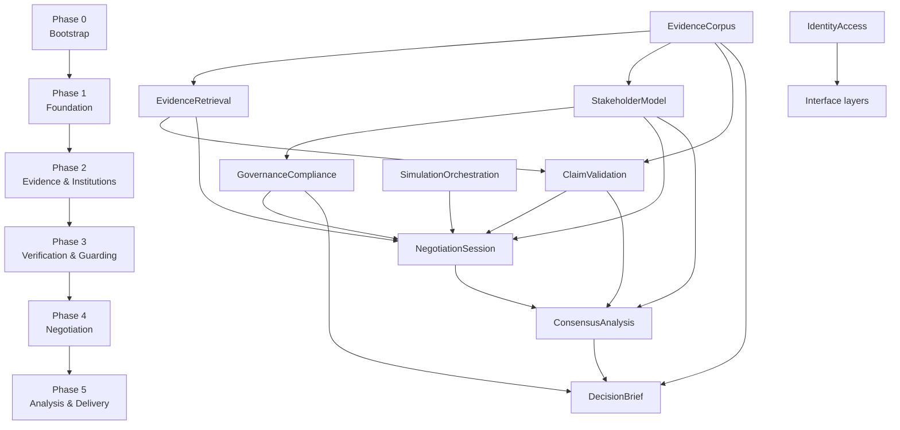

# Implementation Roadmap

<!--
@canonical .pi/architecture/implementation-roadmap.md
Status: Proposed (Phase 0 implemented)
Date: 2026-11-05
Session: 87433e56-b1a2-4464-a232-2dc4fe6f9dfd
-->

## Overview

Ten bounded contexts delivered in six phases. Ordering follows the context map: evidence before
retrieval, retrieval before negotiation, negotiation before derivation, derivation before the brief.

**Format conventions**
- `## Phase 0: Project Bootstrap` is MINIMUM project setup — no bounded contexts, no context folders
- Each bounded context appears in exactly ONE phase's `### Modules` table (its build phase)
- Modules a phase merely *uses* appear under `### Dependencies` with what they provide
- `### Database Migrations` lists Alembic revisions created in that phase

**Known cycle (documented, not hidden):** `SimulationOrchestration ↔ NegotiationSession` are mutual
anticorruption layers in the exploration. Resolved by direction of flow: orchestration owns the
*invocation/job contract* and is built in Phase 3; the negotiation domain is built in Phase 4;
graph nodes that call negotiation commands are wired in Phase 4 against the Phase 3 contract.
Within Phase 3 the internal order is `ClaimValidation → SimulationOrchestration → GovernanceCompliance`.

---

## Phase 0: Project Bootstrap (Days 0–0.5)

**Status:** ✅ Implemented (2026-11-05)

**Goal:** Minimal project setup per `/project create` — toolchain, shared kernel, config, error
envelope, migration tooling, CI and validators, test harness, entrypoint. No bounded contexts.

### Modules

Bootstrap only — no bounded contexts.

### Dependencies

- None

### Database Migrations

- `0000_bootstrap`: enables extensions only (`pgvector`, `pg_trgm`); creates `shared_event_outbox`
  and `shared_audit` — no context tables

### Acceptance Criteria

- [x] `pyproject.toml` with FastAPI, SQLAlchemy 2.x, asyncpg, Alembic, pydantic-settings, pytest, ruff, mypy
- [x] Package layout `src/shared/` (errors, enums, ids, clock, outbox writer) — no context folders yet
- [x] Config via pydantic-settings; `.env.example` committed; missing required env fails fast
- [x] Error envelope `{code, message, details, trace_id}` + structured JSON logging
- [x] Alembic configured, `0000_bootstrap` applies cleanly to an empty database
- [x] `GET /healthz` and `GET /readyz` respond; readiness checks DB connectivity
- [x] pytest runs with zero tests, ruff + mypy clean
- [x] CI runs lint, typecheck, unit tests, architecture validators (including ADR-008 depth check)

**Implementation notes**

- Verification: `0000_bootstrap` applied, reverted and re-applied against PostgreSQL 16 + pgvector
  (`docker compose up -d db`), and `pytest -m integration` covers the round trip plus an outbox row.
- Table naming follows the ADR-002 rule `<context_snake>_<entity>` as prefixed tables in the
  `public` schema (`shared_event_outbox`, `shared_audit`); splitting into per-context schemas is
  deferred until a second context exists and is a rename-only migration.
- The ADR-008 depth check is implemented deterministically:
  `.pi/scripts/ci/check_modeling_depth.py` reads `.pi/architecture/modeling-depth.json` and fails on
  undeclared contexts, missing/forbidden layers, empty required layers, and module documents without
  a declared depth.
- uvicorn's own access log is disabled: `shared.http.middleware` emits one structured access line
  per request carrying the trace id.
- `.pi/scripts/ci/check_ddd_structure.sh` was patched to skip `__pycache__` (bytecode directory is a
  `src/` child after running tests, and was reported as a module missing all four layers).

---

## Phase 1: Foundation (Days 0.5–3)

**Goal:** The corpus can be ingested with citation-grade provenance, and the API can authenticate a caller.

### Modules

| Module | Deliverables | Architecture Doc |
|--------|-------------|------------------|
| EvidenceCorpus | Document/Article/Passage aggregates, extraction (native + OCR), segmentation, speaker classification, authority rubric, snapshot pinning, `tsvector` + pgvector indexing | `.pi/architecture/modules/evidence-corpus.md` |
| IdentityAccess | `Principal` ACL, API keys + scopes, `require_scope` dependency, demo-mode guard, key admin endpoints | `.pi/architecture/modules/identity-access.md` |

### Dependencies

- Phase 0: shared kernel (ids, errors, outbox writer), migration tooling, `/healthz`

### Database Migrations

- `0101_evidence_corpus_documents`: `evidence_corpus_document`, `_publication`, `_article`, `_passage`
- `0102_evidence_corpus_index`: `_indexed_passage` (`tsvector` + GIN), `_index_manifest`
- `0103_evidence_corpus_snapshots`: `_snapshot`, `_snapshot_document`, `_ingestion_run`
- `0104_identity_access`: `_api_key`

### Acceptance Criteria

- [x] A press-style PDF with a native text layer is ingested end-to-end and
      `GET /api/v1/passages/{id}` returns text whose offsets reproduce the exact source slice —
      `tests/integration/test_corpus_persistence.py::test_boot_wiring_and_restart_round_trip`
      (passage text equals `source_text[start:end]` after a restart)
- [x] A scanned document without a text layer routes to OCR and yields acceptable quality —
      `test_scanned_pdf_without_text_layer_probes_as_ocr_candidate` and
      `test_scanned_document_routes_to_ocr_and_labels_the_quality` (asserts `is_acceptable()`)
- [x] Person-attributed quotations are excluded; institution-attributed statements remain citable —
      `test_person_attributed_quotation_is_excluded_with_its_span` and
      `test_institution_attributed_statement_is_citable_and_attributed`
- [x] Unknown source types cannot be promoted to authoritative —
      `test_classify_source_authority.py::test_unknown_source_type_is_refused` (domain + handler)
- [x] Snapshot pinning: re-ingesting afterwards does not change passages visible through the old
      snapshot — `test_snapshot_manifest_survives_a_second_ingestion` and
      `test_pin_corpus_snapshot.py::test_reingestion_does_not_change_the_pinned_snapshot`
- [x] Anonymous mutating requests return `401` in strict mode; analyst key is refused `corpus:write`
      — `tests/unit/identity-access/anonymous-rejection` and `scope-enforcement`

---

## Phase 2: Evidence Consumption & Institutions (Days 3–5.5)

**Goal:** A claim can be turned into a balanced, inspectable evidence pack, and nine institutions exist with grounded authority.

**Verified:** 2026-11-06 — AC 1–7 checked against the tests named below; migration scope recorded truthfully.

### Modules

| Module | Deliverables | Architecture Doc |
|--------|-------------|------------------|
| EvidenceRetrieval | Hybrid search (prefix-aware `tsvector`/`ts_rank` lexical + feature-hashing dense), reciprocal-rank fusion, reranking, stance classification, `EvidencePack` aggregate, absence recording, inspectable score breakdown, recency exemptions | `.pi/architecture/modules/evidence-retrieval.md` |
| StakeholderModel | `Stakeholder` + `AgentBinding` aggregates, 9 persona YAMLs, interests/constraints/red lines, `MandateSource` grounding for vetoes and budget, historical positions with attribution strength | `.pi/architecture/modules/stakeholder-model.md` |

### Dependencies

- EvidenceCorpus (Phase 1): `PassageView`, `ProvenanceView`, authority rubric, index manifest
- Phase 0: outbox writer for corpus events

### Database Migrations

- `0201_evidence_retrieval`: `evidence_retrieval_pack` — frozen pack JSONB payload; candidates and
  retrieval trace are embedded in the payload, not separate tables
- `0202_stakeholder_model`: **not delivered** — deferred as **D-001** in
  `.pi/architecture/DEFERRED.md`; stakeholder profiles, history and bindings run in memory

### Acceptance Criteria

- [x] A German compound query (`Kassenstellen`) returns hits a naive term query misses —
  `tests/integration/test_index_writer.py` (compound, adapter parity, monotone recall) and
  `tests/integration/test_evidence_retrieval_hybrid_search.py` (trace records the rewrite)
- [x] A claim with no contradicting evidence returns `absence != null` and HTTP 2xx (`201 Created` for
  pack creation) — never an empty list or an error —
  `tests/integration/test_evidence_retrieval_e2e.py`
- [x] Every candidate exposes authority / lexical / semantic / recency / directness components —
  `tests/integration/test_evidence_retrieval_score_derivation.py` + `/packs/{id}/scores`
- [x] A statute from 1995 keeps full recency weight; a press report from 1995 does not —
  `tests/integration/test_evidence_retrieval_score_derivation.py`
- [x] All 9 personas load with ≥1 interest and ≥1 constraint, institutions only —
  `tests/unit/stakeholder-model/persona-cards/test_persona-cards.py`
- [x] A veto right without a `MandateSource` is refused with `AuthorityClaimRejected` —
  `tests/unit/stakeholder-model/unsourced-authority/test_unsourced-authority.py` and
  `tests/integration/test_stakeholder_wiring.py`
- [x] A mention-only source yields a history entry with `usable = false` —
  `tests/unit/stakeholder-model/weak-attribution/test_weak-attribution.py` and
  `tests/integration/test_stakeholder_wiring.py`

---

## Phase 3: Verification, Orchestration Contract, Guarding (Days 5.5–8)

**Goal:** Numbers are checkable, LLM calls are metered and traceable, and no person-level output can reach persistence.

**Phase 3 re-verified:** 2026-11-06 on `df61791`, after the correction batch (#271) and the metering/SSE
batch (#276).

- ClaimValidation: tolerance, provenance, escalation, causal and qualitative paths hold; measure identity,
  contradiction production and German parsing are wired and verified through the API. Unit normalisation is
  case-, whitespace- and idempotence-clean (`Count`/`COUNT`/` count ` → `count`; unknown units pass through
  lowercased).
- SimulationOrchestration: budget guard, pause/resume, retries, recovery, worker liveness hold. Metering now
  reads the provider response (model, tokens, latency) and is idempotent on a derived invocation id; zero
  pricing is permissive by default but reported by `/readyz` as `simulation_pricing: zero`. SSE validates
  `Last-Event-ID` before streaming and replays gap-free. Liveness verified on `6db19f5`: no idle cutoff,
  `: ping` heartbeats, every server close carries `run.stream_closed` with a reason (`run.completed` /
  `run.failed` / `max_idle`), heartbeats and the idle cap are configurable, and a client disconnect cancels
  polling and is counted.
- GovernanceCompliance: GC-001 detects honourific-free names from the curated list, GC-002 resists
  relabelling via the person detector, GC-005 rejects a contradicted figure end-to-end, and the adversarial
  corpus now contains the real attack strings. Provenance remains a visible 422 (`governance_provenance:
  deferred`) until Phase 4 records positions.

The remaining gaps are recorded in the acceptance list below rather than in a status line, so "closed" is
not read as "verified".

### Modules

| Module | Deliverables | Architecture Doc |
|--------|-------------|------------------|
| ClaimValidation | `Claim` aggregate, claim-type verification paths, measure normalisation, tolerance bands, curated reference figures, contradiction detection, expert review, honest unverifiable verdicts | `.pi/architecture/modules/claim-validation.md` |
| SimulationOrchestration | Job + progress + `AgentInvocation` tables, budget guard, SSE with `Last-Event-ID`, pause/resume contract, LLM provider port, prompt template registry | `.pi/architecture/modules/simulation-orchestration.md` |
| GovernanceCompliance | Two-stage guard (`GC-001`…`GC-005`), institutional allowlist, rewrite/reject verdicts, violation persistence, provenance disclosure assembler | `.pi/architecture/modules/governance-compliance.md` |

### Dependencies

- EvidenceCorpus + EvidenceRetrieval (Phases 1–2): authoritative passages, candidate evidence
- StakeholderModel (Phase 2): institutional allowlist — the guard's source of truth
- Phase 0: outbox + audit tables

### Database Migrations

- `0301_claim_validation`: `_claim`, `_verification`, `_reference_figure`, `_contradiction_finding`, `_expert_review`
- [x] `0302_simulation_orchestration`: `_job`, `_invocation`, `_progress`, `_prompt`
- [x] `0303_simulation_lease`, `0304_simulation_pause_reason`: crash recovery and pause reason
- [x] `0305_governance_compliance`: `_violation`, `_provenance`, `_allowlist`

### Acceptance Criteria

- [x] `3.2 Mrd` vs `3.25 Mrd` is **not** a contradiction; `3.2 vs 4.1` is —
  `tests/unit/claim-validation/tolerance` and `real-contradiction`
- [x] A causal claim is never marked verified; a qualitative claim is recorded unverifiable, not
  dropped — `tests/unit/claim-validation/causal-never-verified` + `unverifiable-retained`
- [x] A press-tier `ReferenceFigure` is refused —
  `tests/unit/claim-validation/reference-provenance`
- [x] Every LLM call writes exactly one `agent_invocation` row with model, `prompt@version`, tokens, cost
  — verified 2026-11-06 on `df61791`: nodes call `LLMClient.complete` and record the response's
  model/tokens/latency; the invocation id is derived from `(run, round, node, purpose)` so re-execution
  writes one row (both adapters upsert); cost is computed from the price table, which is `0.0` by default
  — visible as `simulation_pricing: zero` in `/readyz`. `prompt@version` is recorded but not yet resolved
  against the prompt registry
- [x] Exceeding the run budget pauses the run (`RunBudgetExhausted`) without persisting a partial argument
  — verified 2026-11-06 on `e9973aa`: `max_invocations=1` → job `paused`, `run.budget_exhausted`
  published, usage `1`; the "no partial argument" half is untestable until NegotiationSession persists
  arguments (Phase 4)
- [x] "Dr. Müller sagte…" never returns `accept` from the guard — returns `rewrite` / `person_named`.
  The honourific is doing all the work: title-less forms (`Sebastian Kurz`, `Kurz`, `DR. KURZ`) still
  return `accept` (#266), so the AC is true for the string and false for the class
- [x] ≥30 adversarial compliance strings classified correctly in CI — verified on `df61791`: the corpus
  gained title-less names, ALL-CAPS honourifics, relabelled personal quotes and a contradicted-figure case,
  and the guard now rejects every one through the public API (GC-005 proven end to end with a registered
  reference figure and a `CONTRADICTED` claim)
- [x] SSE reconnect with `Last-Event-ID` replays without gaps or duplicates — verified on `df61791`:
  resume after event 1 returns exactly the remaining events, after the last returns nothing, unknown or
  foreign ids return `400 UNKNOWN_LAST_EVENT_ID` **before** the stream opens, and a completed run closes
  with `run.completed` and a `run.stream_closed` frame carrying the reason. A paused run stays open until
  `SIMULATION_STREAM_IDLE_S` (default 3600 s) and emits `: ping` heartbeats meanwhile

---

## Phase 4: Negotiation (Days 8–11)

**Goal:** Nine institutional agents argue, revise positions with recorded reasons, form coalitions and close under an explicit condition — streamed live.

**Verified 2026-11-06 on the `#404–#409` branch:** the aggregate, round, revision, coalition and replay
rules are implemented and unit-tested (138 contract checks). The write-side API now opens and closes
rounds (`POST /runs/{id}/rounds`, `POST /runs/{id}/rounds/{n}:close`), PostgreSQL adapters back
`0401`/`0402`, and `SimulationRunClosed` reaches ConsensusAnalysis. D-008 and D-009 are closed.

### Modules

| Module | Deliverables | Architecture Doc |
|--------|-------------|------------------|
| NegotiationSession | `SimulationRun` aggregate with phase machine, rounds and turn discipline, positions with supersede lineage, arguments with evidence, conflicts, coalitions with offers, `RoundLearning` carry-forward, stopping conditions, event log + replay, LangGraph graph wiring | `.pi/architecture/modules/negotiation-session.md` |

### Dependencies

- EvidenceRetrieval (Phase 2): `EvidencePackView` → `ClaimEvidence` (ACL)
- StakeholderModel (Phase 2): `StakeholderProfileView` (partnership)
- ClaimValidation (Phase 3): verdicts gating claims
- GovernanceCompliance (Phase 3): pre-persistence guard
- SimulationOrchestration (Phase 3): job/invocation contract, LLM port, SSE broker

### Database Migrations

- `0401_negotiation_session`: `_run`, `_mandate`, `_round`, `_position`, `_argument`, `_conflict`, `_coalition`, `_coalition_offer`, `_round_learning`
- `0402_negotiation_session_log`: append-only `_event_log` with per-run sequence

### Acceptance Criteria

- [x] A round cannot close until every bound stakeholder has a turn or a recorded abstention —
  domain-tested (`Round.assert_everyone_accounted_for`); **not reachable from the API** (#404)
- [x] A revision without a cited argument or pack id emits `PositionRevisionRejected` and changes nothing —
  domain-tested (109 revision/lineage tests)
- [x] One open position per (stakeholder, topic); revision supersedes — domain-tested
- [x] An argument carries evidence or an explicit unsupported flag — tested; the API resolves real
  evidence-pack ids and refuses unknown ones (`EVIDENCE_PACK_NOT_FOUND`)
- [x] `round_cap` reached forces terminal evaluation; phase never regresses — domain-tested
- [x] Folding the event log to round N equals live state at round N — tested (replay-equivalence)
- [x] A live run streams positions, arguments and revisions; reconnect replays without gaps — API
  round lifecycle + SSE replay verified (#404)
- [x] Killing the worker mid-round neither duplicates arguments nor loses rounds — aggregate snapshot and
  append-only log survive restart (#405, D-008 closed)

---

## Phase 5: Analysis & Delivery (Days 11–13.5)

**Goal:** The negotiation becomes a decision artefact: consensus with veto awareness, compromise packages, honest impact, and an eight-section brief.

**Verified 2026-11-06 on `adafc3b` (live API walkthrough, not only tests):** derivation, veto precedence,
packages, scenarios and the eight-section brief are implemented and tested. The run log, mandate threshold
and veto classes are bound at runtime; `HandleRunClosed` is subscribed; consensus rows persist through
`0501`; the brief's history/consensus/provenance gates are bound and `0502` persists published versions.

**The chain runs end to end** — nine evidenced positions, nine turns, round close, derivation without an
extra API call, `201` on `POST /runs/{id}/brief`, one listed version — **with two caveats that are now
issues, not prose:**

| Caveat | Issue |
|---|---|
| On `PERSISTENCE=postgres`, `POST /evidence/packs` 500s (retrieval adapter does not await the postgres index writer), so the walkthrough only runs in the memory family | #411 |
| Publication needs one manual `POST /positions/{id}/provenance` per position; nothing in the round lifecycle writes the disclosure the gate requires | #412 |

### Modules

| Module | Deliverables | Architecture Doc |
|--------|-------------|------------------|
| ConsensusAnalysis | `ConsensusRecord` with veto precedence, majority/minority, unresolved conflicts, `CompromisePackage`, `Scenario` + `ImpactAssessment` with estimate basis, scenario comparison, projection rebuild | `.pi/architecture/modules/consensus-analysis.md` |
| DecisionBrief | `DecisionBrief` aggregate, eight mandated sections, citation resolution, rejected-proposal disclosure, publication gate, brief versioning, JSON renderer | `.pi/architecture/modules/decision-brief.md` |

### Dependencies

- NegotiationSession (Phase 4): published events + run log (the only derivation input)
- StakeholderModel (Phase 2): veto classes and negotiating power
- ClaimValidation (Phase 3): verified reference figures as derivation inputs
- GovernanceCompliance (Phase 3): provenance disclosure required before publication
- EvidenceCorpus (Phase 1): citation resolution

### Database Migrations

- `0501_consensus_analysis`: `_consensus_record`, `_majority`, `_minority`, `_package`, `_scenario`, `_impact`
- `0502_decision_brief`: `_brief`, `_section`, `_cited_statement`, `_citation`, `_rejected_proposal`

### Acceptance Criteria

- [x] 7/9 support for a vetoed proposal class yields `VetoBlockedOutcome`, never consensus — domain-tested
  (134 contract checks) and reached through the API on a closed run
- [x] An impact figure labelled `derived` without inputs is refused (`UnbackedEstimateBlocked`) — tested
- [x] An illustrative documentation value cannot be persisted as a run outcome — tested
- [x] Every disapproving stakeholder appears in a recorded minority position — tested
- [x] Publishing a brief with 7 sections raises `IncompleteBrief` — tested
- [x] An unresolved citation blocks publication (`CitationResolutionFailed`) — tested with the real
  EvidenceCorpus resolver
- [x] A run with a rejected proposal whose brief omits it is blocked (`DisclosureMissing`) — tested
- [x] Regenerating a brief from the run log reproduces it (narrative wording excepted) — tested
  (`ReproductionCheck`)
- [x] A veto-blocked topic renders as blocked, never as a recommendation — tested

**System status:** the chain is reachable end to end: a run opens/closes through the API, the close
subscriber derives from the stored run log, and a closed run with disclosures can publish a versioned
brief. D-007, D-008 and D-009 are closed; remaining deferrals are D-001 (stakeholder durability) and
D-002–D-005.

---

## Cross-Cutting: Wiring Definition of Done

A module is **not complete** when its tests pass. It is complete when it is reachable from
`src/shared/app.py` and its data survives a restart. Every module doc carries a `## Wiring Contract`
section; this is the phase-level checklist that applies to each `### Modules` row.

| # | Gate | Fails when |
|---|---|---|
| W1 | Router registered in `create_app` | the module is testable in isolation but absent from `app.routes` |
| W2 | Composition root builds adapters from settings | an in-memory adapter is the silent default outside tests |
| W3 | Migrations own every table the repositories query | a repository queries a table no migration created |
| W4 | Events leave through `shared_event_outbox` | a `LoggingEventPublisher`-style stub is still wired |
| W5 | Cross-context access uses ports/published language | a context imports another context's repositories or tables |
| W6 | Missing upstream dependency fails closed | a guard/gate silently degrades to permissive |
| W7 | Boot test asserts registration + adapter selection | deleting a router registration leaves CI green |
| **W8** | **Every injected collaborator is invoked on the production path, and its effect is observable from outside** (API field, persisted row, emitted event, metric). A policy object, guard, parser, resolver or normaliser that is constructed, injected and unit-tested but never called is **not wired**. Proof: a call site outside `composition.py`/tests **and** a test that drives a public entry point and asserts the effect — a unit test of the collaborator is never proof. Adapters that implement the same port must be proven equal for the same input | the collaborator exists in the container and nothing reads it; the gate is "green" because proofing checks shapes (`class X exists`, `method names`) instead of call sites |
| **W9** | **Any monotonic counter, sequence or ordinal is allocated atomically by the store**, not computed as `max + 1` in application code, and a concurrency test proves no duplicates and no loss | a `UNIQUE(run_id, sequence)` constraint is the only guard, so the second concurrent writer raises `IntegrityError` and the event is silently lost |
| **W10** | **Liveness of every background task started by lifespan is observable**: `/readyz` reports it and it degrades when the task dies; a restart/died counter exists in metrics | readiness reports `ok` from container presence while the worker task is dead, so the demo advertises green and does nothing |

**EvidenceCorpus — W1–W7 evidence (276c4cc):**

- [x] W1 router registered in `src/shared/app.py` — `tests/unit/evidence_corpus/test_wiring.py::test_app_registers_every_corpus_route`
- [x] W2 composition selects adapters by settings — `test_memory_settings_select_the_in_memory_family` and `test_postgres_settings_select_the_sqlalchemy_family`
- [x] W3 migration for every queried table; upgrade head on an empty DB — `tests/integration/test_corpus_persistence.py::test_alembic_round_trip_creates_every_repository_table`
- [x] W4 events via `shared_event_outbox` in the aggregate transaction — `test_aggregate_write_and_outbox_event_roll_back_together`
- [x] W5 no cross-context repository/table access — `test_domain_layer_never_imports_infrastructure` plus the published-language port review
- [x] W6 missing dependency fails closed — `test_postgres_without_a_database_is_refused`
- [x] W7 restart round-trip proven by an integration test — `test_boot_wiring_and_restart_round_trip` (also `test_outbox_relay_dispatches_each_row_once`, `test_snapshot_manifest_survives_a_second_ingestion`)

**IdentityAccess — W1–W7 evidence (epic #30):**

- [x] W1 router registered in `src/shared/app.py` — `tests/unit/identity-access/wiring/test_wiring.py::test_app_exposes_the_container_and_admin_routes`
- [x] W2 composition selects adapters by settings — memory/postgres container tests in `test_wiring.py`
- [x] W3 migration for every queried table; upgrade head on an empty DB — `tests/integration/test_identity_access_e2e.py` (migrated fixture) and `test_identity_access_keys.py`
- [x] W4 events via `shared_event_outbox` in the aggregate transaction — `tests/integration/test_identity_access_attribution.py` asserts the actor on outbox rows
- [x] W5 no cross-context repository/table access — `tests/unit/identity-access/acl-isolation/test_acl-isolation.py` (repo-wide AST check)
- [x] W6 missing dependency fails closed — `test_postgres_without_a_database_is_refused`; admin store missing → `503 KEY_STORE_UNAVAILABLE`
- [x] W7 runtime round-trip proven — `test_wired_identity_access_runs_end_to_end` (issue → read → revoke → 401); `validate-runtime-wiring.sh` exit 0

Phase 1's W1–W7 pass for both EvidenceCorpus and IdentityAccess.

**Mechanical enforcement:** W8 is checked by
`.pi/scripts/ci/check_collaborator_reachability.py` — any attribute assigned as `self._x` in `__init__`
and never read fails CI. W9 and W10 are checked by the module integration tests they name.

**Why W8–W10 exist (retroactive evidence)**

The first four epics passed W1–W7 while shipping collaborators with no runtime call site. Each of these
was found by probing the running app, not by the proofing scripts, which check shapes and therefore
cannot see a missing call site:

| Gate | Failure | Where it was found |
|---|---|---|
| W8 | `BudgetGuard.evaluate`, `RetryPolicy`, `list_resumable`, `PauseBoundary` inputs — injected, never invoked; `max_invocations=1` did not stop a run and `budget_used` stayed zero | #237 (fixed in #242) |
| W8 | `PauseBoundary.resolve(..., turn_committed=True)` hardcoded → the "discard in-flight turn" branch unreachable; pause could not interrupt a run, resume never re-queued | #236 (fixed in #241) |
| W8 | `ResolveMeasureIdentity` only called by its unit test → `kassenstellen` vs `Kassenstellen` silently `AMBIGUOUS` | #200 |
| W8 | `ContradictionDetector.finding_for` / `RecordContradiction` never called → `/contradictions` structurally always empty | #201 |
| W8 | `GermanNumberParser` invoked but never asserted on realistic input ("Im Jahr 2026 gibt es 3.200.000 …" → `CONTRADICTED`) | #202 |
| W8 | German compound rewrite applied to a `plainto_tsquery` adapter that ANDs the `OR` expansion → 0 hits; the memory adapter disagreed, so tests passed | #140 (fixed in #142) |
| W9 | `ProgressPublisher` used `latest_sequence + 1` → concurrent publishes raised `IntegrityError` and dropped events | #238 (fixed in #243) |
| W10 | One exception in `run()` ended the worker task for the process lifetime; `/readyz` still said `ok` | #235 (fixed in #240) |

Two consequences for every module below:

1. The proofing script must assert **reachability**, not shape: for each injected collaborator, a call
   site outside `composition.py` and a test that drives a public entry point and observes the effect.
2. A module doc's `## Wiring Contract` now carries a **Collaborator reachability (W8)** table naming, per
   collaborator, the entry point, the observable effect and the failure mode. A new collaborator without a
   row is a documentation defect, not a detail.

**Definition of Done template (append to each issue)**

```
- [ ] W1 router registered in create_app (boot test)
- [ ] W2 composition selects adapters by settings
- [ ] W3 migration for every queried table; upgrade head on empty DB
- [ ] W4 events via shared_event_outbox (same transaction as the aggregate write)
- [ ] W5 no cross-context repository/table access (architecture test)
- [ ] W6 missing dependency fails closed
- [ ] W7 restart round-trip proven by an integration test
- [ ] W8 every injected collaborator has a call site outside composition/tests, and a public-entry-point
      test asserting its effect (reachability, not shape); port adapters proven equal for the same input
- [ ] W9 counters/sequences allocated atomically by the store, proven by a concurrency test
- [ ] W10 background tasks report liveness in /readyz and metrics; a dead task is not "ok"
```

---

## Dependency Graph



**Cross-phase boundaries**

| Edge | Crosses |
|---|---|
| EvidenceCorpus → EvidenceRetrieval, StakeholderModel, ClaimValidation, DecisionBrief | P1 → P2, P3, P5 |
| StakeholderModel → GovernanceCompliance, NegotiationSession, ConsensusAnalysis | P2 → P3, P4, P5 |
| ClaimValidation → NegotiationSession, ConsensusAnalysis, DecisionBrief | P3 → P4, P5 |
| SimulationOrchestration → NegotiationSession | P3 → P4 |
| NegotiationSession → ConsensusAnalysis → DecisionBrief | P4 → P5 |

---

## Effort Estimates

| Module | Depth | Effort (person-days) | Risk |
|---|---|---|---|
| EvidenceCorpus | tactical | 2.5 | Extraction variance across PDF types; OCR quality |
| IdentityAccess | adapter | 0.5 | Low |
| EvidenceRetrieval | tactical | 2.0 | German retrieval quality; stance classification accuracy |
| StakeholderModel | tactical | 2.0 | Persona quality drives demo credibility |
| ClaimValidation | tactical | 2.5 | Number parsing from German prose |
| SimulationOrchestration | service | 2.5 | Async correctness, budget guard, SSE replay |
| GovernanceCompliance | service | 2.0 | NER false positives on institutional names |
| NegotiationSession | tactical | 3.0 | Highest complexity: 14 invariants, replay equivalence |
| ConsensusAnalysis | tactical | 2.0 | Veto precedence and honest estimation |
| DecisionBrief | tactical | 1.5 | Citation resolution completeness |
| **Total** | | **20.5** | Hackathon-critical path: P1 → P2 → P4 |

**Cut order if time runs out** (documented so it is a decision, not an accident):
number verification → scenario comparison → coalition offers granularity → brief versioning.
**Never cut:** provenance resolution, position-revision reasons, guard, SSE streaming.

---

## Key Milestones

| Milestone | Phase | Demonstrable outcome |
|---|---|---|
| M1 — Citation-grade corpus | 1 | Click a passage, land on the exact page text in the source file |
| M2 — Balanced evidence pack | 2 | Same claim shows supporting *and* contradicting passages, or a recorded absence |
| M3 — Nine grounded institutions | 2 | Every persona cites a legal/institutional source for its vetoes and budget |
| M4 — Trustworthy numbers | 3 | A fabricated figure is flagged live; rounding is not flagged |
| M5 — Guarded output | 3 | A person-named output is rewritten or rejected before persistence |
| M6 — Live negotiation | 4 | Nine positions stream in; an agent changes its mind with a stated reason |
| M7 — Honest result | 5 | A veto-blocked proposal appears as blocked, not as consensus |
| M8 — Auditable brief | 5 | Eight sections, every claim resolves to a page, rejected proposals disclosed |

---

*Generated from session: 87433e56-b1a2-4464-a232-2dc4fe6f9dfd · Date: 2026-11-05*

---

## Deferred Work

Items accepted as incomplete, with the decision and cost already recorded: see
[`.pi/architecture/DEFERRED.md`](DEFERRED.md).

- **D-001** StakeholderModel durable persistence (~3 h) — trigger: first negotiation run that cites a
  `HistoricalPosition` as evidence
- D-002 persona legal citations unverified · D-003 retrieval eval set lacks paraphrase cases ·
  D-004 `semantic` is a hashing encoder, not a neural one

A phase is not blocked by these, but no epic may silently inherit them: each has a named trigger.
