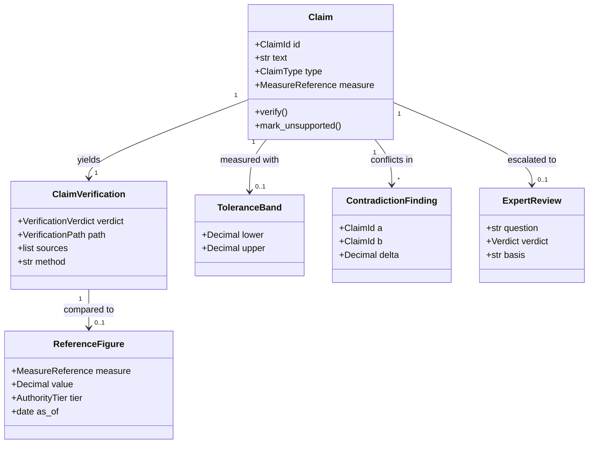
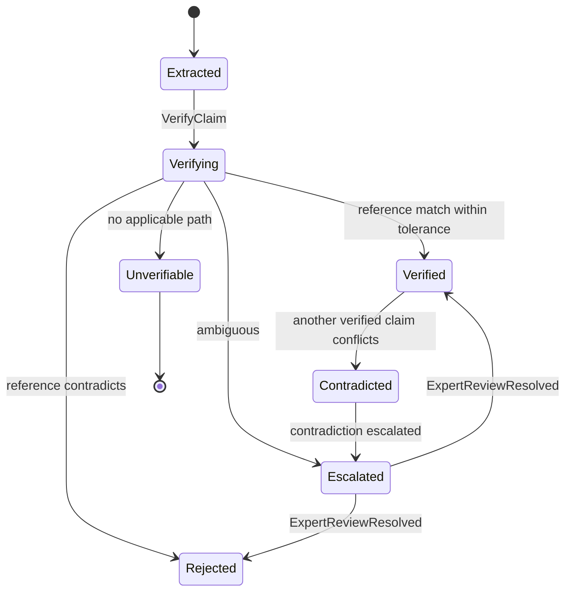
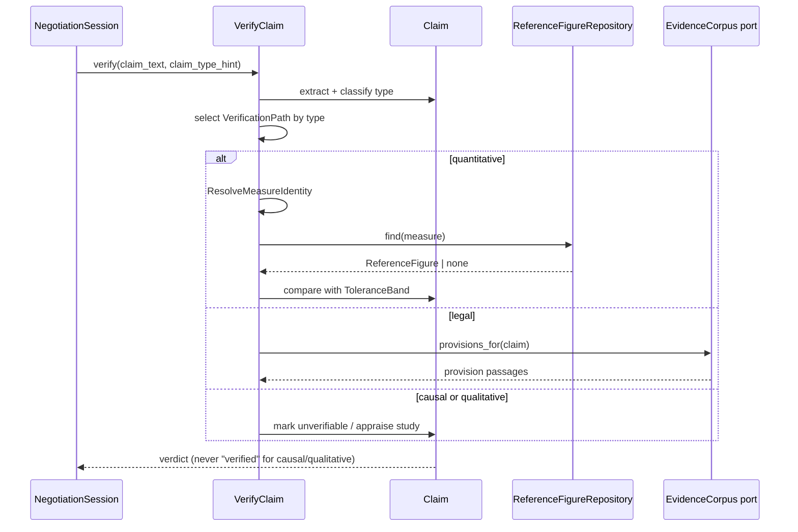

# ClaimValidation

## Module Status

**Status:** Implemented (2026-11-06) — runtime integration via ADR-012
**Depends:** EvidenceCorpus (authoritative passages, source tiers), EvidenceRetrieval (candidate passages for verification)
**Last reviewed:** 2026-11-06
**Source session:** 87433e56-b1a2-4464-a232-2dc4fe6f9dfd

## Description

Verifies quantitative and legal claims against authoritative sources, detects contradictions between
agents' figures and flags unsupported assertions. Differentiates verification by claim type and
admits when a claim cannot be verified.

**Modeling Depth:** tactical (core domain)
**Subdomain Rationale:** Requirement that figures must not contradict each other and must be substantiated.
**Context Map:** partnership → NegotiationSession (verdicts gate argument acceptance).


## Contract Freeze (issue #164)

Interfaces, DTOs, events, error codes, repository ports and the HTTP surface are frozen. Every
stub names its implementing issue and raises until that issue lands.

| Contract | Location |
|---|---|
| Values, enums, reference figure, evidence | `domain/values.py` |
| `Claim` aggregate surface | `domain/claim.py` |
| Verification record, contradiction, expert review | `domain/entities.py` |
| 10 event payloads + union | `domain/events.py` |
| Error codes | `domain/errors.py` |
| Repository ports | `domain/repositories.py` |
| Pure domain services | `domain/services.py` |
| Application ports, requests, results | `application/` |
| German number adapter | `infrastructure/number_parser.py` |
| Published `ClaimVerdictView` | `interfaces/published.py` |
| 7 routes + scopes + bodies | `interfaces/http/` |

Contract tests inspect structure only (`tests/unit/claim-validation/**`); behaviour tests are added by
the implementation issues.

## Architecture

| Layer | Responsibility | Path |
|-------|--------------|------|
| **Domain** | `Claim` aggregate, verification paths, tolerance, reference figures, escalation | `src/claim_validation/domain/` |
| **Application** | `VerifyClaim`, `FlagUnsupportedAssertion`, `ResolveMeasureIdentity` | `src/claim_validation/application/` |
| **Infrastructure** | SQLAlchemy repositories, number parser, provision matcher, LLM appraisal adapter | `src/claim_validation/infrastructure/` |
| **Interfaces** | REST routers, `ClaimVerdictView` consumed by NegotiationSession | `src/claim_validation/interfaces/` |

## Runtime Integration

| Concern | Implementation |
|---|---|
| Entry path | `shared.app.create_app` → `claim_validation.composition.build_container` → router |
| Persistence | Migration `0301_claim_validation`; JSONB aggregate payloads + measure keys |
| Reference data | registered through `POST /api/v1/reference-figures`; empty table ⇒ `AMBIGUOUS` |
| Downstream | `ClaimVerdictView` only; no ORM/vector leakage |
| Legacy path | none; pre-wiring `NotImplementedError` bodies removed |
| Proof | `tests/integration/test_claim_validation_wiring.py`, `test_claim_validation_persistence.py` |

## Related ADRs

| ADR | Relevance |
|---|---|
| ADR-002 Data Storage Strategy | `ReferenceFigure` table is curated, versioned reference data |
| ADR-003 Cross-Context Communication | Verdicts published to NegotiationSession (partnership) |
| ADR-006 Cost Tracking | Causal appraisal and expert review are metered calls |
| ADR-007 Compliance Engine | Figure contradiction is a deterministic compliance check |
| ADR-012 ClaimValidation Runtime Integration | Composition root, persistence and downstream view |

## Diagrams

### Data Flow

```mermaid
flowchart LR
    A[Argument text] --> B[Extract claims]
    B --> C{Claim type}
    C -->|quantitative| D[ResolveMeasureIdentity<br/>measure, unit, period, geo]
    C -->|legal| E[Provision matcher]
    C -->|causal| F[Study appraisal]
    C -->|qualitative| G[Mark unverifiable]
    D --> H{ReferenceFigure exists?}
    H -->|yes| I[Compare with ToleranceBand]
    H -->|no| J[Escalate / ambiguous]
    I --> K[ClaimVerified | ClaimRejected | ContradictionDetected]
    E --> L[ClaimVerified | ClaimRejected]
    F --> M[CausalClaimAppraised]
    G --> N[ClaimMarkedUnverifiable]
    K & L & M & N --> O[(Verdicts → NegotiationSession)]
```

### Entity Relationship



### Aggregate State (Claim)



### Key Use Case Sequence — VerifyClaim



## Components

### Aggregate root — Claim

```python
# src/claim_validation/domain/claim.py
@dataclass
class Claim:
    id: ClaimId
    text: str
    type: ClaimType
    measure: MeasureReference | None
    verdict: VerificationVerdict = VerificationVerdict.PENDING
    verification: ClaimVerification | None = None
    events: list[DomainEvent] = field(default_factory=list)

    def verify(self, path: VerificationPath, evidence: VerificationEvidence) -> None:
        """Verification is type-directed. Causal and qualitative claims can never be 'verified'."""
        if self.type in (ClaimType.CAUSAL, ClaimType.QUALITATIVE):
            raise PathNotApplicable(self.id, self.type, path)

        if not evidence.sources:
            self.mark_unsupported("no evidence above threshold")
            return

        match self.type:
            case ClaimType.QUANTITATIVE:
                self._compare_figures(evidence)
            case ClaimType.LEGAL:
                self._compare_provisions(evidence)

    def _compare_figures(self, evidence: VerificationEvidence) -> None:
        reference = evidence.reference_figure
        if reference is None:
            self._escalate("no reference figure for measure")
            return
        if self.measure.band.contains(evidence.asserted_value, reference.value):
            self._settle(VerificationVerdict.SUPPORTED, evidence)
        else:
            self._settle(VerificationVerdict.CONTRADICTED, evidence)
            self.events.append(ClaimRejected(self.id, reference.id, evidence.asserted_value))

    def mark_unsupported(self, reason: str) -> None:
        """Never silently drop a claim; it becomes visibly low-confidence."""
        self.verdict = VerificationVerdict.UNSUPPORTED
        self.events.append(UnsupportedAssertionFlagged(self.id, reason))

    def _escalate(self, question: str) -> None:
        self.verdict = VerificationVerdict.AMBIGUOUS
        self.events.append(ClaimEscalatedForReview(self.id, question))
```

**Invariants:**

| # | Invariant | Illegal state prevented |
|---|---|---|
| 1 | A quantitative claim needs an authoritative-tier source to be verified | Press-only figures as verified facts |
| 2 | Two verified claims with incompatible values for the same measure/period cannot both stay verified | Contradictory numbers in one negotiation |
| 3 | A claim with no evidence above threshold is marked unsupported, never dropped | Unsupported assertions passing as facts |
| 4 | Verdicts record the source set and comparison method | Unauditable verdicts |
| 5 | A claim is contradicted only when the difference exceeds its tolerance band | Calling rounding a contradiction |
| 6 | A `ReferenceFigure` names its authoritative tier; press figures are never reference values | Baseline drifting to newspaper figures |
| 7 | An escalated claim stays unverified until an `ExpertReview` verdict exists | Ambiguity treated as settled |
| 8 | Verification path is selected by claim type (quantitative→reference, legal→provision, causal→study, qualitative→none) | Running causal claims through a number check |
| 9 | Causal and qualitative claims may be supported/contested/unverifiable, never verified fact | A suggestive study published as proven causation |
| 10 | Where no path applies, the verdict is explicitly ambiguous | Unverifiable claims vanishing from the trail |

**Domain-owned repository:**

```python
# src/claim_validation/domain/repositories.py
class ClaimRepository(Protocol):
    async def get(self, claim_id: ClaimId) -> Claim | None: ...
    async def save(self, claim: Claim) -> None: ...
    async def verified_for_measure(self, measure: MeasureReference) -> list[Claim]: ...

class ReferenceFigureRepository(Protocol):
    async def find(self, measure: MeasureReference) -> ReferenceFigure | None: ...
    async def register(self, figure: ReferenceFigure) -> None: ...
```

### Entities and value objects

| Concept | Kind | Justification |
|---|---|---|
| `Claim` | aggregate root | Identity persists across verification attempts and contradictions |
| `ClaimVerification` | entity | Verdict record with sources and method; immutable content |
| `ContradictionFinding` | entity | Durable record linking two claims with delta and provenance |
| `ExpertReview` | entity | Escalation with question, verdict and basis (mutable until resolved) |
| `ClaimType` | VO | quantitative / legal / causal / qualitative |
| `VerificationVerdict` | VO | supported / contradicted / unsupported / ambiguous |
| `VerificationPath` | VO | Type-directed route; prevents path/type mismatch |
| `MeasureReference` | VO | Normalised measure identity; equality enables comparison |
| `ToleranceBand` | VO | Admissible deviation per measure |
| `CausalSupport` | VO | Study appraisal: supported / contested / unaddressed |

### Service classification

| Service | Layer | Why |
|---|---|---|
| `VerifyClaim` | application | Orchestrates path selection + repositories |
| `FlagUnsupportedAssertion` | application | Records low-confidence claims |
| `ResolveMeasureIdentity` | domain service | Normalisation rules over units, periods, geographies |
| `FigureComparison` | domain service | Pure arithmetic with tolerance |
| `ProvisionMatcher` | domain service | Citation matching against legal provisions |
| `CausalAppraiser` | domain service | Study appraisal; LLM-assisted, verdict constrained to three values |
| Number parser, OCR-safe extractor | infrastructure | Text parsing |

## Domain Events

| Event | Description | Trigger | Payload | Published By |
|---|---|---|---|---|
| `ClaimExtracted` | A verifiable assertion extracted from an argument | `VerifyClaim` | `claim_id, claim_type, has_measure` | ClaimValidation |
| `ClaimVerified` | Claim confirmed against an authoritative source | `VerifyClaim` | `claim_id, reference_id, method, source_ids[]` | ClaimValidation |
| `ClaimRejected` | Claim contradicted by authoritative evidence | `VerifyClaim` | `claim_id, reference_id, asserted_value, reference_value, delta` | ClaimValidation |
| `UnsupportedAssertionFlagged` | Claim without adequate evidence, kept as low-confidence | `FlagUnsupportedAssertion` | `claim_id, reason` | ClaimValidation |
| `ContradictionDetected` | Two claims (or a claim and a figure) are incompatible | `VerifyClaim` | `claim_id_a, claim_id_b, measure, delta` | ClaimValidation |
| `ReferenceFigureRegistered` | Canonical authoritative value registered for a measure | `ResolveMeasureIdentity` | `figure_id, measure, value, tier, as_of` | ClaimValidation |
| `ClaimEscalatedForReview` | Claim the deterministic checks cannot settle | `VerifyClaim` | `claim_id, question` | ClaimValidation |
| `ExpertReviewResolved` | Escalated claim received a verdict with basis | `VerifyClaim` | `claim_id, verdict, basis` | ClaimValidation |
| `ClaimMarkedUnverifiable` | No applicable verification path; recorded as ambiguous | `VerifyClaim` | `claim_id, claim_type` | ClaimValidation |
| `CausalClaimAppraised` | Causal claim appraised against study evidence | `VerifyClaim` | `claim_id, support, study_ids[]` | ClaimValidation |

**ADR-008 triage:** all ten are expert-visible; `ClaimRejected`, `ContradictionDetected`,
`UnsupportedAssertionFlagged` and `ClaimMarkedUnverifiable` are audit-critical (they record refusals).

## API Endpoints

| Method | Path | Handler | Input | Output | Auth |
|---|---|---|---|---|---|
| POST | `/api/v1/claims:verify` | `verify_claim` | `{text, claim_type?}` | `{claim_id, verdict, path, sources[], delta?}` | `runs:write` |
| POST | `/api/v1/claims/{claim_id}:flag` | `flag_unsupported_assertion` | `{reason}` | `{verdict}` | `runs:write` |
| GET | `/api/v1/claims/{claim_id}` | `get_claim` | — | claim + verification + review | `runs:read` |
| POST | `/api/v1/reference-figures` | `register_reference_figure` | `{measure, value, tier, as_of, source_id}` | `201 {figure_id}` | `corpus:write` |
| GET | `/api/v1/reference-figures` | `list_reference_figures` | `?measure` | figures with tiers | `runs:read` |
| GET | `/api/v1/contradictions` | `list_contradictions` | `?run_id` | findings with deltas | `runs:read` |
| POST | `/api/v1/claims/{claim_id}/reviews` | `resolve_expert_review` | `{verdict, basis}` | `{claim verdict}` | `admin` |

## Ubiquitous Language

| Term | Definition | Aliases prohibited |
|---|---|---|
| Claim | Verifiable assertion typed by the verification it requires | fact, statement, assertion |
| Claim Verification | Audited verdict with source set and method | fact-check, validation |
| Verification Path | Type-specific route: reference / provision / study / none | check-type, how-verified |
| Unsupported Assertion | Claim with no adequate evidence, surfaced as low-confidence | unsourced-claim, guess |
| Unverifiable Claim | Claim with no applicable path, recorded as ambiguous | not-checkable, out-of-scope |
| Causal Support | Study appraisal: supported / contested / unaddressed | evidence-for-causation |
| Contradiction Finding | Detected incompatibility with delta and provenance | conflict-of-figures, inconsistency |
| Measure Reference | Normalised figure identity (measure, unit, period, geography) | metric-key, dimension |
| Tolerance Band | Admissible deviation below which figures are equal | epsilon, rounding-tolerance |
| Reference Figure | Canonical authoritative value with as-of date and tier | ground-truth-value, baseline |
| Expert Review | Escalation returning a verdict with its basis | manual-check, second-opinion |
| Authoritative Source | Source tier admissible for verification (not press) | ground-truth, official-data |

## Dependencies

**Depends On:**

| Module | What it provides |
|---|---|
| EvidenceCorpus | Authoritative passages and source tiers; provisions for legal claims |
| EvidenceRetrieval | Candidate passages when verifying against corpus evidence |

**Used By:**

| Consumer | What it provides |
|---|---|
| NegotiationSession | `ClaimVerdictView` gating argument acceptance (partnership) |
| ConsensusAnalysis | Verified `ReferenceFigure`s as derivation inputs |
| DecisionBrief | Statement confidence (`evidenced` / `unsupported`) |
| GovernanceCompliance | Figure contradiction findings for the publication gate |

## Implementation Sequence

1. `ClaimType`, `VerificationVerdict`, `VerificationPath`, `MeasureReference`, `ToleranceBand` VOs
2. `ResolveMeasureIdentity` with unit/period/geography normalisation tests
3. Number extraction from German prose (`3,2 Mrd. €`, `22 Prozent`, `1.204`)
4. `FigureComparison` with tolerance
5. `ReferenceFigure` curation: seed table of ~10 authoritative figures
6. `Claim.verify` type dispatch with path-not-applicable tests
7. `FlagUnsupportedAssertion` + `Unverifiable` path
8. Contradiction detection across a run's claims
9. `ExpertReview` escalation + resolution
10. `CausalAppraiser` (LLM-assisted, verdict constrained)
11. REST routers + contract tests

## Patterns & OOP Mapping

| Component | Pattern | Rationale |
|---|---|---|
| Type dispatch | **Strategy** (`QuantitativePath`, `LegalPath`, `CausalPath`, `NullPath`) | Four genuinely different verification procedures |
| Contradiction rules | **Specification** (`SameMeasure`, `SamePeriod`, `ExceedsTolerance`) | Combinable, individually testable |
| `Claim.verify` | **Rich aggregate / State** | Verdict transitions guarded; no external setter |
| Number parsing | **Adapter** | German numeric formats behind one port |
| Verdict exposure | **DTO** | `ClaimVerdictView` for NegotiationSession |

## Wiring Contract

| Wiring point | Requirement | Proof |
|---|---|---|
| Router | `app.include_router(claim_validation_router)` | boot test asserting registration |
| Composition | Verification paths bound to EvidenceCorpus (provisions, authoritative passages) and to the shared metered LLM client for causal appraisal | integration test: one claim per path |
| Seeded data | Migration `0301` seeds the curated `ReferenceFigure` set (~10 authoritative figures with tier + as_of); an empty table must make the verifier report `ambiguous`, never `supported` | integration test on an empty table |
| Downstream port | `ClaimVerdictView` exposed to NegotiationSession and ConsensusAnalysis | integration test: an argument with a contradicted claim is refused |
| Persistence | Migration `0301` applied; verdicts and contradictions survive restart | restart round-trip |
| Events | Verdicts and refusals published through the outbox | `ClaimRejected` / `UnsupportedAssertionFlagged` rows present |

## Acceptance Criteria

| # | Component | Criterion | Verify In |
|---|---|---|---|
| 1 | Type dispatch | A causal claim routed to the quantitative path raises `PathNotApplicable` | unit |
| 2 | Causal never verified | `CausalClaimAppraised` yields supported/contested/unaddressed; verdict is never `VERIFIED` | unit |
| 3 | Unverifiable retained | A qualitative claim yields `ClaimMarkedUnverifiable` and still appears in the API | unit + API |
| 4 | Tolerance | `3.2 Mrd` vs `3.25 Mrd` with band ±2% is NOT a contradiction | unit |
| 5 | Real contradiction | `3.2 Mrd` vs `4.1 Mrd` for the same measure/period yields `ContradictionDetected` | unit |
| 6 | Reference provenance | A `ReferenceFigure` with `tier=press_report` is refused | unit |
| 7 | Escalation | An escalated claim stays `AMBIGUOUS` until `ExpertReviewResolved` | unit |
| 8 | Unsupported not dropped | A claim with no evidence is `UNSUPPORTED` and returned in responses | integration |
| 9 | German number parsing | `1.204 Kassenstellen`, `3,2 Mrd. €`, `22 %` parse to correct values | unit |
| 10 | Measure identity | `Wartezeit` and `Wartezeit auf Facharzttermin` do not collapse into one measure | unit |
| 11 | Wiring | Router registered; empty `ReferenceFigure` table yields `ambiguous`, never `supported`; verdict port refuses contradicted claims downstream | integration |

**Verified:** 2026-11-06. AC 1–11 pass; public API and restart proofs:
`tests/integration/test_claim_validation_wiring.py`,
`tests/integration/test_claim_validation_persistence.py`.

## Modeling Depth Note (ADR-008)

Tactical depth because a wrong verdict silently discredits a correct argument. The **tolerance band**
and the **claim-type path** are the two details that separate a working verifier from a pedantic one.
