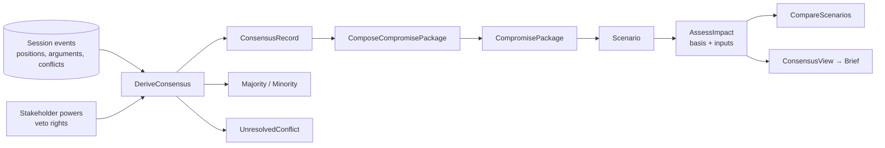
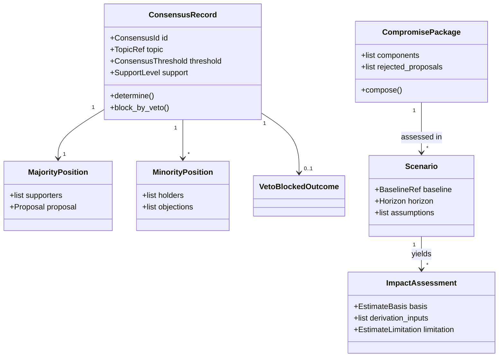
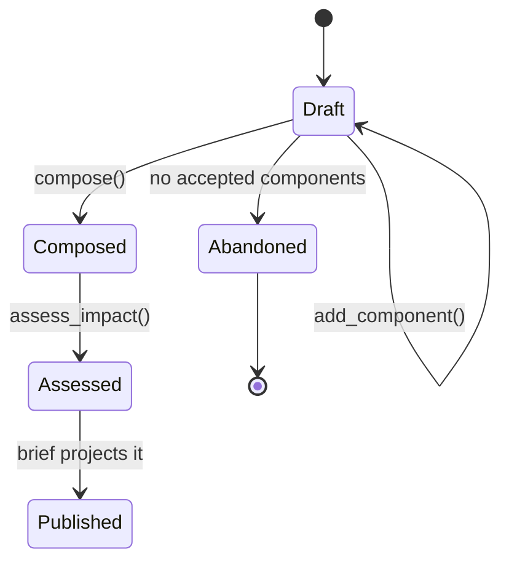
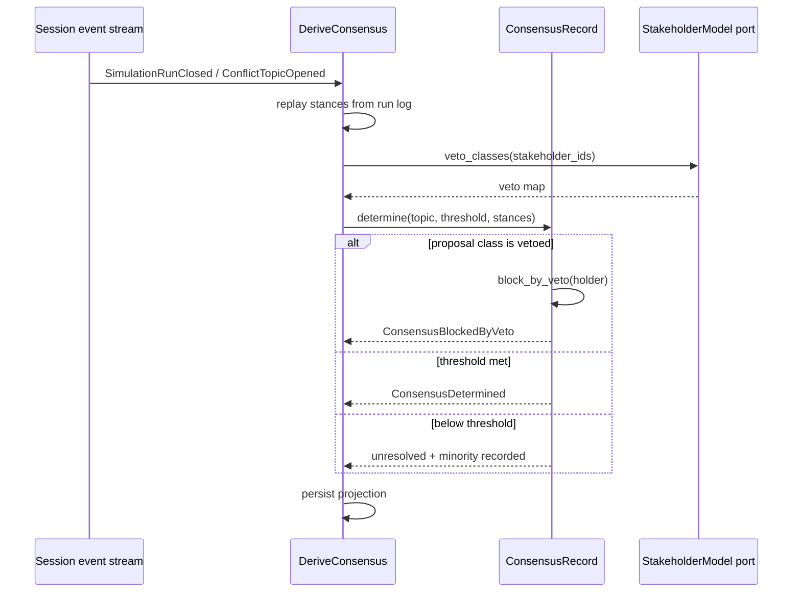

# ConsensusAnalysis

## Module Status

**Status:** Implemented (derivation fails closed until the run log is published)
**Depends:** NegotiationSession (open-host — published session events are the derivation input), StakeholderModel (veto rights and negotiating power)
**Last reviewed:** 2026-11-06
**Operational docs:** `docs/runbook-consensus-analysis.md`, `docs/dr-plan-consensus-analysis.md`
**Source session:** 87433e56-b1a2-4464-a232-2dc4fe6f9dfd

## Description

Derives the negotiation result from the recorded history: consensus, majority and minority
positions, unresolved conflicts, compromise packages and impact assessments. Never invents agreement.

**Modeling Depth:** tactical (core domain)
**Subdomain Rationale:** A negotiation result (not a single answer) is the required output product.
**Context Map:** NegotiationSession → open-host; conformist → DecisionBrief (brief projects consensus records plus history).

## Architecture

| Layer | Responsibility | Path |
|-------|--------------|--------------|
| **Domain** | `ConsensusRecord`, `CompromisePackage`, `Scenario` aggregates; thresholds, estimation basis | `src/consensus_analysis/domain/` |
| **Application** | `DeriveConsensus`, `ComposeCompromisePackage`, `AssessImpact`, `CompareScenarios` | `src/consensus_analysis/application/` |
| **Infrastructure** | SQLAlchemy repositories, event subscribers, projection tables | `src/consensus_analysis/infrastructure/` |
| **Interfaces** | REST routers, `ConsensusView` consumed by DecisionBrief | `src/consensus_analysis/interfaces/` |

**All artefacts here are derived.** They hold no input state; recalculation from the run log must
reproduce them (invariant 1). They exist as persisted projections so the brief can be rendered
without recomputation, not because they are authoritative.

## Contract Freeze (issue #305)

All public interfaces for this epic are frozen before implementation. The frozen surface lives in
`src/consensus_analysis/`:

| Surface | File |
|---|---|
| Ids, value objects, enums (`SupportLevel`, `ConsensusThreshold`, `VetoBlockedOutcome`, `UnresolvedConflict`, `EstimateBasis`, `DerivationInput`, `EstimateLimitation`, `FeasibilityRating`, `UncertaintyLabel`, `ConsensusOutcome`) | `domain/values.py` |
| Owned entities (`MajorityPosition`, `MinorityPosition`, `PackageComponent`, `RejectedProposal`, `ImpactAssessment`) | `domain/entities.py` |
| `ConsensusRecord` aggregate (`determine`, history assertion, digest) | `domain/consensus_record.py` |
| `CompromisePackage` aggregate (`add_component`, `compose` with documented rejections) | `domain/compromise_package.py` |
| `Scenario` aggregate (`define`, `assess`) | `domain/scenario.py` |
| Domain services: `ConsensusRule` (`NotVetoed` → `ThresholdMet` → `MajorityHolds`), `MinorityCapture`, `ComponentsCompatible`, `EstimateValidator`, `IllustrativeValueGuard`, `FeasibilityGuard` | `domain/services.py` |
| Nine domain events and the event union | `domain/events.py` |
| Eleven stable error codes | `domain/errors.py` |
| Repository and derivation ports (`ConsensusRepository`, `CompromisePackageRepository`, `ScenarioRepository`, `RunLogPort`, `StakeholderPowersPort`) | `domain/repositories.py` (re-exported by `infrastructure/repository/ports.py`) |
| Commands and result DTOs, local ACL records | `application/commands.py`, `application/dto.py` |
| Nine application services and `SERVICE_CLASSIFICATION` | `application/services.py` |
| ACL, metered estimation, rebuild and ranking ports | `application/ports.py` |
| Estimation strategies (`Measured`, `Derived`, `Modelled`, `Assumed`) | `application/estimators.py` |
| ACL mappers (veto map, reference figure) and the illustrative-value catalogue | `infrastructure/acl.py` |
| Concrete HTTP router and schemas | `interfaces/http/router.py`, `interfaces/http/schemas.py`, `interfaces/http/deps.py` |
| `ConsensusView` and the per-artefact views consumed by DecisionBrief | `interfaces/published.py` |
| Composition factory and container | `composition.py` |

**Frozen API:** `POST /api/v1/runs/{run_id}/analysis:derive`,
`GET /api/v1/runs/{run_id}/consensus`, `GET /api/v1/runs/{run_id}/conflicts/open`,
`POST /api/v1/runs/{run_id}/packages` (201), `GET /api/v1/runs/{run_id}/packages`,
`POST /api/v1/packages/{package_id}/scenarios` (201), `GET /api/v1/packages/{package_id}/comparison`.
Write routes require `runs:write`; read routes require `runs:read`.

**Error codes:** `STANCE_NOT_IN_HISTORY`, `UNBACKED_ESTIMATE`, `ILLUSTRATIVE_VALUE_REFUSED`,
`FEASIBILITY_CONTRADICTS_VETO`, `INCOMPATIBLE_COMPONENT`, `PACKAGE_NOT_COMPOSED`,
`PROJECTION_REBUILD_FAILED`, `CONSENSUS_NOT_FOUND`, `COMPROMISE_PACKAGE_NOT_FOUND`,
`SCENARIO_NOT_FOUND`, `CONSENSUS_ANALYSIS_UNAVAILABLE`.

**Domain purity:** the domain declares its own `ProposalClass` mirror and binds `StanceSnapshot`
with a `recorded` flag, so `domain/` imports no other context's layers. `infrastructure/acl.py` owns
the reconciliation with `StakeholderProfileView.veto_rights` and `ClaimVerdictView`.

**Reachability:** each use case publishes `collaborators()`, the frozen list of ports the
composition root must supply. It is what keeps the W8 gate meaningful while the bodies are stubs;
implementing issues replace it with real call sites.

**Freeze policy:** signatures, field names, enum values, event payloads, route paths and status
codes are additive-only. Renaming or removing a frozen member requires a new freeze entry. The 83
structural contract checks in `tests/unit/consensus-analysis/` pass at freeze time; behaviour is
proved by the implementing issues.

## Related ADRs

| ADR | Relevance |
|---|---|
| ADR-002 Data Storage Strategy | Derived projections in their own schema; rebuildable from the run log |
| ADR-003 Cross-Context Communication | Consumes session events; publishes to DecisionBrief (conformist) |
| ADR-006 Cost Tracking | `AssessImpact` may call an LLM; invocations are metered |
| ADR-008 Proportional Modeling Depth | Tactical: estimation provenance is an invariant |

## Diagrams

### Data Flow



### Entity Relationship



### Aggregate State (CompromisePackage)



### Key Use Case Sequence — DeriveConsensus



## Components

### Aggregate root — ConsensusRecord

```python
# src/consensus_analysis/domain/consensus_record.py
@dataclass
class ConsensusRecord:
    id: ConsensusId
    topic: TopicRef
    threshold: ConsensusThreshold
    stances: dict[StakeholderId, StanceSnapshot]
    vetoes: dict[StakeholderId, frozenset[ProposalClass]]
    proposal_class: ProposalClass
    events: list[DomainEvent] = field(default_factory=list)

    def determine(self) -> ConsensusOutcome:
        """Derive the outcome; never assume agreement that the record does not support."""
        self._assert_stances_exist_in_history()
        holders = [sid for sid, clause in self.vetoes.items() if self.proposal_class in clause]
        if holders:
            outcome = VetoBlockedOutcome(self.proposal_class, holders)
            self.events.append(ConsensusBlockedByVeto(self.id, self.topic, holders))
            return ConsensusOutcome.veto_blocked(outcome)

        support = SupportLevel.weighted(self.stances)
        if support.meets(self.threshold):
            self.events.append(ConsensusDetermined(self.id, self.topic, support.value))
            return ConsensusOutcome.consensus(support)

        minority = self._minority_positions()
        if minority:
            self.events.append(MinorityPositionRecorded(self.id, self.topic, len(minority)))
        return ConsensusOutcome.partial(support, minority)

    def _assert_stances_exist_in_history(self) -> None:
        unknown = [s for s in self.stances if not s.recorded]
        if unknown:
            raise StanceNotInHistory(unknown)
```

**Invariants:**

| # | Invariant | Illegal state prevented |
|---|---|---|
| 1 | Derived artefacts hold no input state; recalculation reproduces them; only derivation metadata is authoritative | Derived views drifting into competing sources of truth |
| 2 | A record cites only stances present in the closed run's history | Manufactured agreement |
| 3 | Consensus requires the mandate threshold; below it the outcome is partial or unresolved | Forced consensus |
| 4 | A minority position lists its holders and their arguments | Dissent disappearing from the result |
| 5 | A compromise package combines only individually accepted, mutually compatible components | Unimplementable bundles |
| 6 | Every impact figure declares an `EstimateBasis`; assumed figures are labelled and never presented as computed | LLM guesses published as calculations |
| 7 | A figure marked measured/derived enumerates its inputs; without inputs the basis must be assumed | Unbacked numbers labelled "derived" |
| 8 | Illustrative values from documentation can never appear as run outcomes | A demo figure (22%) reappearing as a result |
| 9 | An impact assessment references exactly one scenario and one package | Orphan headline numbers |
| 10 | A scenario marked feasible names the consenting institutions and confirms no veto | Feasibility asserted against a blocker |
| 11 | Consensus is never declared for a class covered by a bound stakeholder's veto right | Majority rule masquerading as consensus |

**Domain-owned repository:**

```python
# src/consensus_analysis/domain/repositories.py
class ConsensusRepository(Protocol):
    async def get(self, consensus_id: ConsensusId) -> ConsensusRecord | None: ...
    async def save(self, record: ConsensusRecord) -> None: ...
    async def for_run(self, run_id: RunId) -> list[ConsensusRecord]: ...

class StakeholderPowersPort(Protocol):
    async def veto_classes(self, stakeholder_ids: list[StakeholderId]) -> dict[StakeholderId, frozenset[ProposalClass]]: ...
```

### Entities and value objects

| Concept | Kind | Justification |
|---|---|---|
| `ConsensusRecord` | aggregate root | Per-topic outcome with identity and derivation lineage |
| `CompromisePackage` | aggregate root | Independently composed, versioned artefact |
| `Scenario` | aggregate root | Counterfactual with its own lifecycle (defined → assessed → compared) |
| `MajorityPosition` | entity | Immutable snapshot of a carried stance |
| `MinorityPosition` | entity | Immutable dissent record with holders |
| `ImpactAssessment` | entity | Per-scenario estimate with basis and limitations |
| `SupportLevel` | VO | Weighted measure, equal by value |
| `ConsensusThreshold` | VO | Rule parameters from the mandate |
| `EstimateBasis` | VO | measured / derived / modelled / assumed / not_estimated |
| `DerivationInput` | VO | Enumerated input reference (reference figure, passage, tally) |
| `EstimateLimitation` | VO | What the estimate ignores |
| `FeasibilityRating` | VO | Political / legal / administrative rating with basis |
| `UncertaintyLabel` | VO | evidenced / modelled / assumed |
| `ResolvedConflict` / `UnresolvedConflict` | VO | Terminal status with positions that remain apart |
| `VetoBlockedOutcome` | VO | Blocked class + holders |

### Service classification

| Service | Layer | Why |
|---|---|---|
| `DeriveConsensus` | application | Reads history, evaluates rules, persists projection |
| `ComposeCompromisePackage` | application | Transaction boundary for package assembly |
| `AssessImpact` | application | May call an LLM; validates basis before persisting |
| `CompareScenarios` | application | Ranks packages on cost/acceptance/feasibility |
| `ConsensusRule` | domain service | Pure threshold + veto evaluation |
| `EstimateValidator` | domain service | Rejects computed labels without inputs (invariant 6/7) |
| Projection rebuild | infrastructure | Replays run log into projections |

## Domain Events

| Event | Description | Trigger | Payload | Published By |
|---|---|---|---|---|
| `ConsensusDetermined` | Consensus level derived from recorded stances | `DeriveConsensus` | `run_id, topic, support, threshold, supporters[]` | ConsensusAnalysis |
| `ConsensusBlockedByVeto` | Threshold met but a blocking competence applies | `DeriveConsensus` | `run_id, topic, proposal_class, holder_ids[]` | ConsensusAnalysis |
| `MinorityPositionRecorded` | Dissenting stance recorded with holders | `DeriveConsensus` | `run_id, topic, holders[], objection_count` | ConsensusAnalysis |
| `UnresolvedConflictDeclared` | Conflict still open at run close | `DeriveConsensus` | `run_id, topic, positions[]` | ConsensusAnalysis |
| `CompromisePackageComposed` | Accepted components combined with rejected proposals documented | `ComposeCompromisePackage` | `package_id, component_ids[], rejected_count` | ConsensusAnalysis |
| `ScenarioDefined` | Baseline-versus-package scenario defined before any figure | `AssessImpact` | `scenario_id, baseline, horizon, assumption_count` | ConsensusAnalysis |
| `ImpactAssessed` | Impacts estimated for a package with basis and uncertainty | `AssessImpact` | `scenario_id, basis_counts{}, uncertainty` | ConsensusAnalysis |
| `UnbackedEstimateBlocked` | Figure refused for claiming a computed basis without inputs | `AssessImpact` | `scenario_id, field, claimed_basis` | ConsensusAnalysis |
| `FeasibilityRated` | Political/legal/administrative feasibility rated with basis | `AssessImpact` | `package_id, ratings{}, blockers[]` | ConsensusAnalysis |

**ADR-008 triage:** all nine are expert-visible; `ConsensusBlockedByVeto`, `UnbackedEstimateBlocked`
and `MinorityPositionRecorded` are audit-critical (they record refusals and dissent).

## API Endpoints

| Method | Path | Handler | Input | Output | Auth |
|---|---|---|---|---|---|
| POST | `/api/v1/runs/{run_id}/analysis:derive` | `derive_consensus` | `{topics?}` | `[{topic, outcome, support, blockers}]` | `runs:write` |
| GET | `/api/v1/runs/{run_id}/consensus` | `get_consensus` | — | records + majority + minority | `runs:read` |
| GET | `/api/v1/runs/{run_id}/conflicts/open` | `list_unresolved` | — | unresolved conflicts with positions | `runs:read` |
| POST | `/api/v1/runs/{run_id}/packages` | `compose_compromise_package` | `{component_ids[], rejected_ids[]}` | `201 {package_id}` | `runs:write` |
| GET | `/api/v1/runs/{run_id}/packages` | `list_packages` | — | packages with provenance | `runs:read` |
| POST | `/api/v1/packages/{package_id}/scenarios` | `assess_impact` | `{baseline, horizon, assumptions[]}` | `201 {scenario_id, figures[{value,basis,inputs}]}` | `runs:write` |
| GET | `/api/v1/packages/{package_id}/comparison` | `compare_scenarios` | — | ranked alternatives with cost/acceptance/feasibility | `runs:read` |

## Ubiquitous Language

| Term | Definition | Aliases prohibited |
|---|---|---|
| Consensus Record | Derived per-topic outcome statement of agreement level | agreement-summary, result |
| Consensus Threshold | Support level required by the mandate, adjusted for vetoes | quorum, majority-rule |
| Veto-Blocked Outcome | Proposal meeting threshold but not consensus due to a blocking competence | blocked, vetoed |
| Majority Position | Stance carried by most weight-bearing stakeholders | winning-view |
| Minority Position | Dissenting stance with holders and reasons | dissent, objection |
| Compromise Package | Bundle of individually accepted, compatible measures | deal, settlement |
| Rejected Proposal | Measure that did not reach support, documented as not carried | failed-proposal, discarded-option |
| Scenario | Counterfactual: package measures vs baseline, horizon, population, assumptions | case, what-if, variant |
| Impact Assessment | Scenario effect estimate with bias declared | forecast, projection |
| Estimate Basis | Provenance class of a figure: measured/derived/modelled/assumed | confidence, how-computed |
| Derivation Input | Enumerated input behind a derived figure | input, assumption-source |
| Assumed Estimate | Figure without enumerated inputs, publishable only with a label | guess, illustrative-value |
| Feasibility Rating | Political/legal/administrative implementability with basis | implementability, practicality |
| Uncertainty Label | Stated basis of an estimate | confidence, certainty |

## Dependencies

**Depends On:**

| Module | What it provides |
|---|---|
| NegotiationSession | Published events + run log (the only derivation input) |
| StakeholderModel | `veto_classes`, `negotiating_power` per bound stakeholder |
| ClaimValidation | Verified `ReferenceFigure`s usable as derivation inputs |

**Used By:**

| Consumer | What it provides |
|---|---|
| DecisionBrief | `ConsensusView`: consensus, majority, minority, unresolved, packages, impact |

## Implementation Sequence

1. `SupportLevel`, `ConsensusThreshold`, `VetoBlockedOutcome`, `UnresolvedConflict` VOs
2. `ConsensusRecord.determine` with veto precedence + history assertion
3. `DeriveConsensus` projection from the run log + rebuild-from-log test
4. `CompromisePackage` + compatibility rules + rejected-proposal capture
5. `EstimateBasis`, `DerivationInput`, `EstimateLimitation` + `EstimateValidator`
6. `Scenario` + `AssessImpact` (no LLM first: modelled figures only)
7. `FeasibilityRating` + veto-aware feasibility check
8. `CompareScenarios` ranking
9. REST routers + contract tests

## Patterns & OOP Mapping

| Component | Pattern | Rationale |
|---|---|---|
| `ConsensusRule` | **Specification** (`ThresholdMet`, `NotVetoed`, `MajorityHolds`) | Rules combine and are individually testable/reportable |
| Estimation | **Strategy** (`MeasuredEstimator`, `DerivedEstimator`, `ModelledEstimator`, `AssumedEstimator`) | Four real bases with different validation; one interface, honest labels |
| Package assembly | **Composite** | Components accepted individually, composed upward |
| Projection | **Event folding** | Derived state is rebuilt, never hand-edited |
| `EstimateValidator` | **Guard / invariant enforcer** | Blocks the specific failure of an unbacked number |
| Views | **DTO** | `ConsensusView` for the brief |

## Wiring Contract

| Wiring point | Requirement | Proof |
|---|---|---|
| Router | `app.include_router(consensus_analysis_router)` | boot test asserting registration |
| Event subscription | Handler **subscribed** to `SimulationRunClosed` / `ConflictTopicOpened`; consuming manually is not sufficient | integration test: closing a run produces consensus rows without an explicit API call |
| Composition | Veto classes read from StakeholderModel port; reference figures from ClaimValidation port | integration test: veto-blocked outcome reproduced |
| Persistence | Migration `0501` applied; derived rows rebuildable | rebuild-from-log equality test |
| Events | Consensus, veto blocks and blocked estimates published through the outbox | `ConsensusBlockedByVeto` row present |
| Estimation | `AssessImpact` uses the shared metered LLM client, never a direct provider SDK call | usage report shows the invocation |

**Runtime state (ADR-016).** The router and container are mounted. Reads answer from the projection.
Derivation refuses with `503 CONSENSUS_ANALYSIS_UNAVAILABLE` and names the missing input while
NegotiationSession publishes no run-log read model, no per-run mandate threshold and no bulk veto map
— each of those three defaults would manufacture agreement. `ProjectionRebuilder` is reachable
through `RebuildProjections`, which verifies a replay against the persisted rows before writing.


### Collaborator reachability (W8)

Every row is a call-site obligation, not a description: the collaborator must be invoked from the named entry point, and its effect must be visible from outside the module. A collaborator with no row here is a defect in this document. A unit test of the collaborator is never proof of wiring — the proof drives the entry point and reads the effect. Enforced mechanically by
`.pi/scripts/ci/check_collaborator_reachability.py`, which fails CI when a collaborator is assigned in
`__init__` and never read.

| Collaborator | Invoked from | Observable effect | Fails when |
|---|---|---|---|
| mandate threshold | `DeriveConsensus` | `partial` / `unresolved` below the threshold | a default threshold is used |
| veto precedence | `DeriveConsensus` | `blocked_by_veto` at any support level | the veto is stored but never evaluated |
| `EstimateBasis` | `AssessImpact` | the estimate carries its basis and the invocation id, and is metered | an estimate without provenance or cost |
| event subscriber | subscription registered in composition | rows appear with no API call | the handler is implemented but never subscribed |
| projection rebuild | operator command | a rebuild reproduces the rows exactly | the rebuild reads live state instead of the log |

### Atomic allocation (W9)

Projection rows are keyed by the log position they were derived from, not by insertion order, so a rebuild
is order-independent and reproducible. Proof: rebuild from the log twice → identical rows and ordinals.

## Acceptance Criteria

| # | Component | Criterion | Verify In |
|---|---|---|---|
| 1 | Veto precedence | 7/9 support for a vetoed proposal class yields `VetoBlockedOutcome`, never consensus | unit |
| 2 | Threshold | Support below threshold returns partial + minority, not consensus | unit |
| 3 | History assertion | A stance not present in the run log raises `StanceNotInHistory` | unit |
| 4 | Rebibuildability | Rebuilding projections from the run log yields byte-identical records | integration |
| 5 | Unbacked estimate | `basis=derived` with zero inputs raises and emits `UnbackedEstimateBlocked` | unit |
| 6 | Assumed label | An assumed figure persists with the label and cannot be rendered as computed | unit + API |
| 7 | Illustrative-value guard | A figure equal to a documentation example cannot be persisted as an outcome | unit |
| 8 | Minority capture | Every disapproving stakeholder appears in a recorded minority position | unit |
| 9 | Rejected proposals | Every proposal without threshold support appears in `rejected_proposals` | unit |
| 10 | Feasibility veto check | A feasible scenario naming a veto-holding institution as consenting raises | unit |
| 11 | Comparison | Alternative packages are ranked with all three dimensions present | integration |
| 12 | Wiring | Subscribed to `SimulationRunClosed`; closing a run produces consensus rows with no explicit API call; derived rows rebuild from the log | integration |

## Modeling Depth Note (ADR-008)

Tactical depth, but **derived by construction**: this context owns no negotiation state. Its
aggregates exist because consensus, packages and scenarios have their own identity and lifecycle
(a scenario can be re-assessed without touching the run), not because they are sources of truth.
