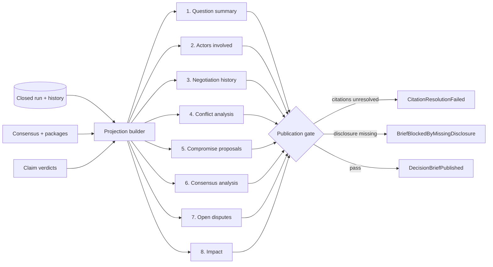
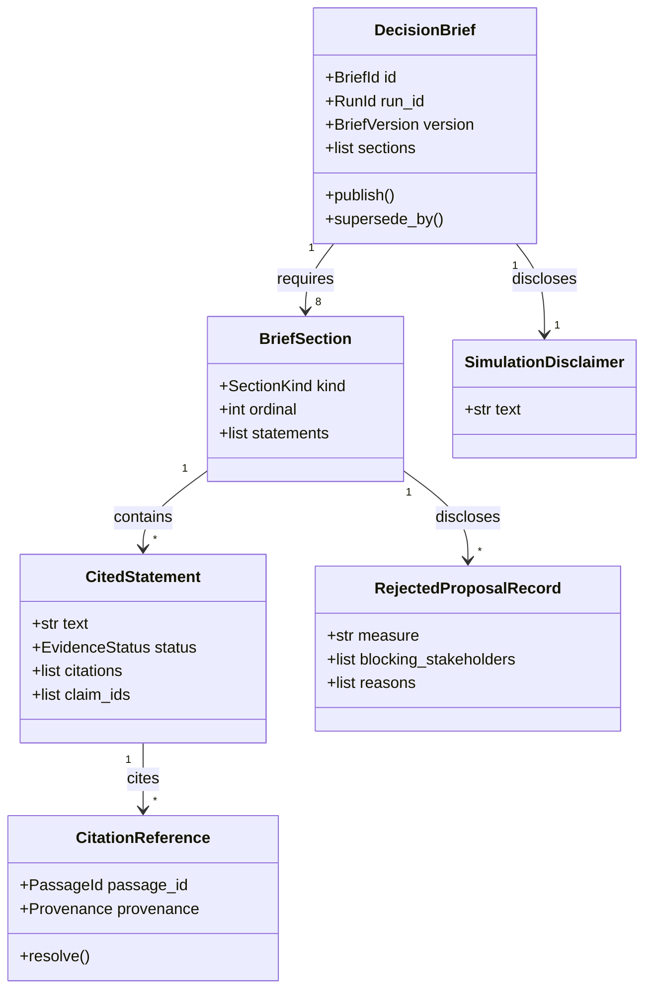
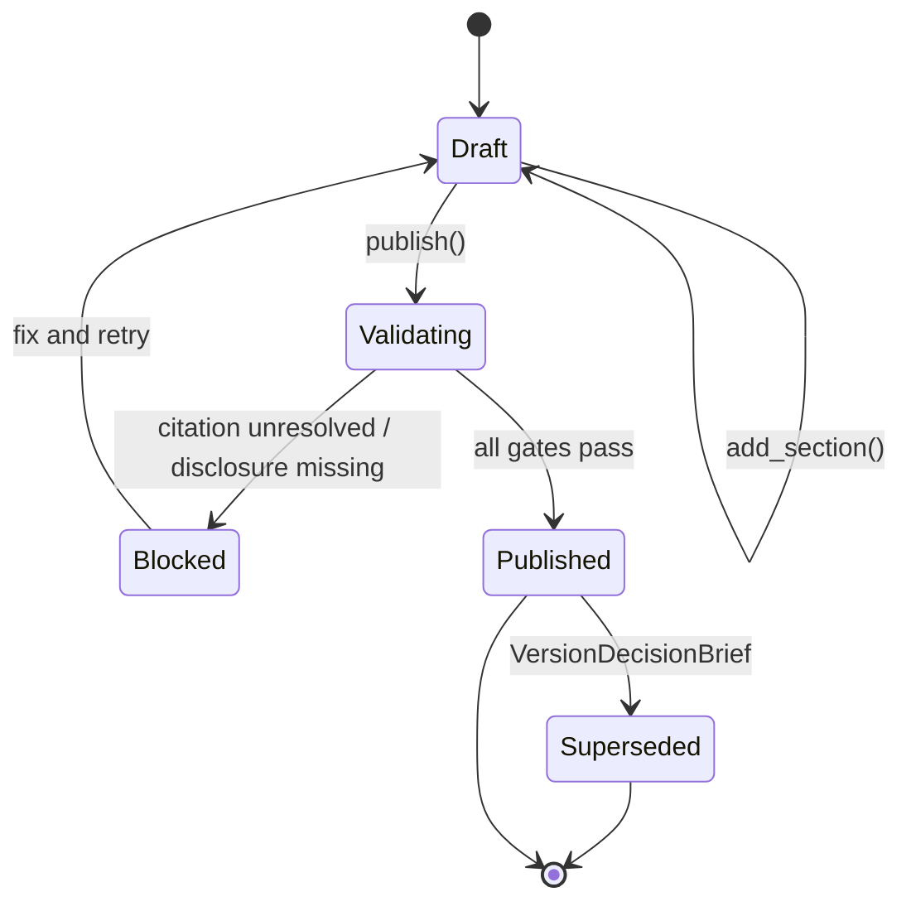
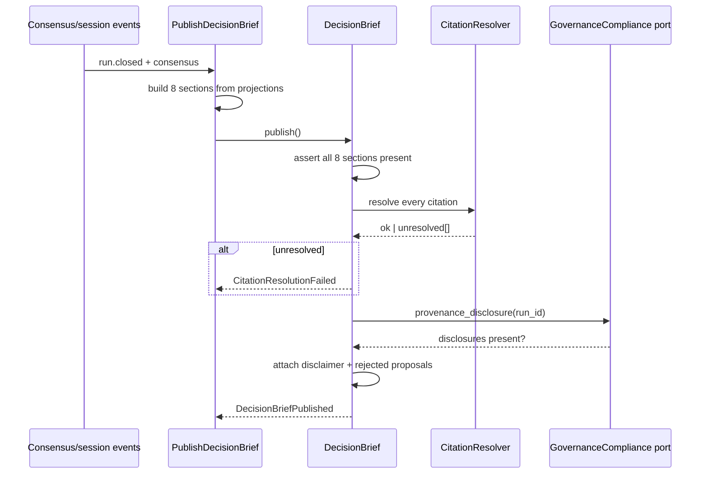

# DecisionBrief

## Module Status

**Status:** Implemented and wired (contract frozen #331; history/consensus/provenance gates bound #407;
`0502` SQLAlchemy repository and shared-outbox publication; D-007 closed)
**Depends:** ConsensusAnalysis (conformist — consensus records + derived artefacts), NegotiationSession (run history), EvidenceCorpus (provenance resolution), GovernanceCompliance (provenance disclosure)
**Last reviewed:** 2026-11-06
**Source session:** 87433e56-b1a2-4464-a232-2dc4fe6f9dfd

## Description

Projects a closed run into the publishable, jury-facing artefact with all eight required
components and resolvable citations. A generated projection, but a first-class versioned artefact.

**Modeling Depth:** tactical (core domain)
**Subdomain Rationale:** The jury-facing deliverable and the artefact that proves transparency.
**Context Map:** ConsensusAnalysis → conformist (brief projects consensus records plus history).

**Read-model vs aggregate — resolved.** The brief is a *projection* (it holds no input state; regeneration
from the run log reproduces it) and an *aggregate root* (it has identity, immutable published versions and
citation integrity that must be enforced transactionally at publication). It is generated, then frozen.

## Architecture

| Layer | Responsibility | Path |
|-------|--------------|--------------|
| **Domain** | `DecisionBrief` aggregate, sections, cited statements, disclosure rules | `src/decision_brief/domain/` |
| **Application** | `PublishDecisionBrief`, `VersionDecisionBrief` | `src/decision_brief/application/` |
| **Infrastructure** | Projection builder, citation resolver, repositories | `src/decision_brief/infrastructure/` |
| **Interfaces** | REST routers, brief renderer (JSON + optional PDF) | `src/decision_brief/interfaces/` |

## Related ADRs

| ADR | Relevance |
|---|---|
| ADR-003 Cross-Context Communication | Conformist to ConsensusAnalysis; consumes session history |
| ADR-004 API Design | Publication is atomic; `POST /briefs` returns the frozen version |
| ADR-007 Compliance Engine | Publication gate: no brief without disclosures |
| ADR-008 Proportional Modeling Depth | Tactical: eight-section completeness is an invariant |

## Diagrams

### Data Flow



### Entity Relationship



### Aggregate State (DecisionBrief)



### Key Use Case Sequence — PublishDecisionBrief



## Components

### Aggregate root — DecisionBrief

```python
# src/decision_brief/domain/decision_brief.py
REQUIRED_SECTIONS = frozenset({
    SectionKind.QUESTION, SectionKind.ACTORS, SectionKind.HISTORY, SectionKind.CONFLICTS,
    SectionKind.COMPROMISES, SectionKind.CONSENSUS, SectionKind.OPEN_DISPUTES, SectionKind.IMPACT,
})

@dataclass
class DecisionBrief:
    id: BriefId
    run_id: RunId
    version: BriefVersion
    sections: dict[SectionKind, BriefSection]
    rejected_proposals: list[RejectedProposalRecord] = field(default_factory=list)
    disclaimer: SimulationDisclaimer | None = None
    status: BriefStatus = BriefStatus.DRAFT
    events: list[DomainEvent] = field(default_factory=list)

    def publish(self) -> None:
        missing = REQUIRED_SECTIONS - self.sections.keys()
        if missing:
            raise IncompleteBrief(sorted(missing))
        unresolved = [c for s in self.sections.values() for st in s.statements
                      for c in st.citations if not c.is_resolved()]
        if unresolved:
            self.events.append(CitationResolutionFailed(self.id, len(unresolved)))
            raise UnresolvedCitation(self.id, unresolved[0].passage_id)
        if not self.rejected_proposals:
            raise DisclosureMissing(self.id, "rejected_proposals")
        if self.disclaimer is None:
            raise DisclosureMissing(self.id, "simulation_disclaimer")
        self.status = BriefStatus.PUBLISHED
        self.events.append(DecisionBriefPublished(self.id, self.run_id, self.version))

    def assert_statement_evidence(self, statement: CitedStatement) -> None:
        if not statement.citations and statement.status is EvidenceStatus.EVIDENCED:
            raise StatementWithoutCitation(statement.text)
```

**Invariants:**

| # | Invariant | Illegal state prevented |
|---|---|---|
| 1 | Publication requires all eight sections | Incomplete artefact |
| 2 | Every citation resolves to an existing passage provenance at publication time | Broken citations in the deliverable |
| 3 | Published briefs are immutable; revisions create a new version referencing the prior one | Silent post-publication edits |
| 4 | The brief states the probabilistic nature of the simulation | Simulated reasoning as deterministic fact |
| 5 | Every cited statement carries a citation or is explicitly narrative/unsupported | Bare assertions that look evidenced |
| 6 | Every rejected proposal recorded in the run is disclosed | A tidy result hiding refusals |
| 7 | The brief is a projection: no state that is not derived; regeneration reproduces it | A second, competing source of truth |
| 8 | Ambiguous or veto-blocked outcomes are stated, never smoothed into a recommendation | Honest "blocked" rewritten as consensus |

**Domain-owned repository:**

```python
# src/decision_brief/domain/repositories.py
class DecisionBriefRepository(Protocol):
    async def get(self, brief_id: BriefId) -> DecisionBrief | None: ...
    async def save(self, brief: DecisionBrief) -> None: ...
    async def versions_for_run(self, run_id: RunId) -> list[DecisionBrief]: ...
```

### Entities and value objects

| Concept | Kind | Justification |
|---|---|---|
| `DecisionBrief` | aggregate root | Versioned artefact with identity and immutable published state |
| `BriefSection` | entity | Ordinal identity within a brief; content immutable once published |
| `CitationReference` | entity | Resolvable pointer with resolution state |
| `RejectedProposalRecord` | entity | Disclosed measure with blockers and reasons |
| `CitedStatement` | VO | Text + citations + evidence status; equal by content |
| `ActorSummary` | VO | Institution, goals, constraints, adopted positions |
| `PositionTimeline` | VO | Stance trajectory for the change visualisation |
| `BriefVersion` | VO | Version marker tying brief to run + snapshot + generation time |
| `SimulationDisclaimer` | VO | Fixed disclosure text |
| `BriefComponentSlot` | VO | Ordinal + completion state of a mandated component |

### Service classification

| Service | Layer | Why |
|---|---|---|
| `PublishDecisionBrief` | application | Transaction boundary; runs all gates then freezes |
| `VersionDecisionBrief` | application | Creates a successor, preserving lineage |
| Projection builder | domain service | Pure assembly from projections, no I/O in the mapping rules |
| Citation resolver | infrastructure | Talks to EvidenceCorpus port |
| Renderer (JSON/PDF) | interfaces | Output format, not domain |

## Domain Events

| Event | Description | Trigger | Payload | Published By |
|---|---|---|---|---|
| `DecisionBriefPublished` | Complete, citation-resolved brief published | `PublishDecisionBrief` | `brief_id, run_id, version, section_count, citation_count` | DecisionBrief |
| `DecisionBriefVersioned` | Successor version produced for the same run | `VersionDecisionBrief` | `brief_id, previous_version, reason` | DecisionBrief |
| `CitationResolutionFailed` | Citation could not be resolved; publication blocked | `PublishDecisionBrief` | `brief_id, unresolved_count, first_passage_id` | DecisionBrief |
| `RejectedProposalDisclosed` | Rejected proposal disclosed with blockers and reasons | `PublishDecisionBrief` | `brief_id, measure, blocker_ids[]` | DecisionBrief |
| `BriefBlockedByMissingDisclosure` | Publication refused for a missing required disclosure | `PublishDecisionBrief` | `brief_id, missing[]` | DecisionBrief |

**ADR-008 triage:** all five pass (expert cares; disclosures cross into the UI/API boundary;
`CitationResolutionFailed` and `BriefBlockedByMissingDisclosure` are audit-critical because they
prove the gate works).

## API Endpoints

| Method | Path | Handler | Input | Output | Auth |
|---|---|---|---|---|---|
| POST | `/api/v1/runs/{run_id}/brief` | `publish_decision_brief` | `{}` (built from projections) | `201 {brief_id, version, sections[], citations}` | `briefs:publish` |
| GET | `/api/v1/briefs/{brief_id}` | `get_decision_brief` | — | full brief | `runs:read` |
| GET | `/api/v1/runs/{run_id}/briefs` | `list_brief_versions` | — | versions with lineage | `runs:read` |
| POST | `/api/v1/briefs/{brief_id}:version` | `version_decision_brief` | `{reason}` | `201 {brief_id, version}` | `briefs:publish` |
| GET | `/api/v1/briefs/{brief_id}/citations` | `list_citations` | `?section` | citation list with resolution state | `runs:read` |

## Ubiquitous Language

| Term | Definition | Aliases prohibited |
|---|---|---|
| Decision Brief | Complete published artefact with eight sections and resolvable citations | report, result-page, answer |
| Brief Section | One of the eight mandated components | chapter, block |
| Cited Statement | Statement + citations + source claim ids + evidence status | sentence, bullet, assertion |
| Citation Reference | Resolvable pointer from a statement to a passage provenance | source-note, footnote |
| Rejected Proposal Record | Measure that failed to gather support, with blockers | failed-motion, not-implemented |
| Simulation Disclaimer | Statement that results are probabilistic reasoning over a pinned corpus | caveat, note |
| Actor Summary | Institution, goals, constraints and adopted positions | agent-card, participant-profile |
| Position Timeline | Stance trajectory across rounds | evolution-chart, stance-history |

## Dependencies

**Depends On:**

| Module | What it provides |
|---|---|
| ConsensusAnalysis | `ConsensusView`: consensus, majority, minority, unresolved, packages, impact |
| NegotiationSession | Run history: rounds, arguments, revisions, conflicts, coalitions |
| EvidenceCorpus | Provenance resolution for every citation |
| GovernanceCompliance | `PositionProvenanceDisclosed` records required before publication |
| ClaimValidation | Verdicts rendered as statement confidence |

**Used By:** external clients (the jury-facing UI). No module depends on the brief.

## Implementation Sequence

1. `SectionKind`, `EvidenceStatus`, `CitedStatement`, `CitationReference` VOs
2. `DecisionBrief.publish()` gates with incomplete-citation-disclosure tests
3. Projection builder for sections 1–4 from run history
4. Sections 5–8 from `ConsensusView`
5. Citation resolver against EvidenceCorpus port
6. Rejected-proposal disclosure wiring
7. `VersionDecisionBrief` lineage
8. Renderer JSON; REST routers + contract tests

## Patterns & OOP Mapping

| Component | Pattern | Rationale |
|---|---|---|
| Projection builder | **Builder** | Eight sections assembled incrementally, then validated as a whole |
| Publication gates | **Specification** chain | Each disclosure/citation rule is a named, individually testable spec |
| Versioning | **Memento-like immutable successor** | Prior version preserved; new version references it |
| Renderer | **Strategy** (JSON, PDF) | Two outputs from one artefact |
| Revealed state | **Read model** | The brief is a projection with enforced immutability — not an entity that accumulates edits |

## Wiring Contract

| Wiring point | Requirement | Proof |
|---|---|---|
| Router | `app.include_router(decision_brief_router)` | boot test asserting registration |
| Composition | citation resolver bound to EvidenceCorpus port; provenance port bound to GovernanceCompliance — a missing port must block publication, not skip the gate | negative test: unwired provenance port ⇒ publication fails |
| Persistence | Migration `0502` applied; published briefs immutable across restart | restart test: brief retrievable, `POST :version` creates successor |
| Events | Publication, versioning and every blocked publication published through the outbox | `CitationResolutionFailed` row present |
| Auth | `briefs:publish` enforced (ADR-005), not merely declared in OpenAPI | 403 test with an analyst key |


### Collaborator reachability (W8)

Every row is a call-site obligation, not a description: the collaborator must be invoked from the named entry point, and its effect must be visible from outside the module. A collaborator with no row here is a defect in this document. A unit test of the collaborator is never proof of wiring — the proof drives the entry point and reads the effect. Enforced mechanically by
`.pi/scripts/ci/check_collaborator_reachability.py`, which fails CI when a collaborator is assigned in
`__init__` and never read.

| Collaborator | Invoked from | Observable effect | Fails when |
|---|---|---|---|
| `CitationResolver` | publication | 422 + `CitationResolutionFailed` | a citation is stored unresolved |
| provenance gate | publication | publication blocked when the port is missing | the gate is skipped so publishing can succeed |
| section completeness | publication | 422 listing the missing sections | a partial brief is published |
| `briefs:publish` scope | publish route | 403 with an analyst key | the scope is declared in OpenAPI only |
| version creation | `POST :version` | the prior version is unchanged and still retrievable | the brief is updated in place |

## Acceptance Criteria

| # | Component | Criterion | Verify In |
|---|---|---|---|
| 1 | Eight sections | Publishing with 7 sections raises `IncompleteBrief` naming the missing kind | unit |
| 2 | Citation gate | An unresolved citation blocks publication and emits `CitationResolutionFailed` | unit + integration |
| 3 | Rejected proposals | A run with ≥1 rejected proposal whose brief omits it raises `DisclosureMissing` | unit |
| 4 | Disclaimer | A brief without disclaimer cannot publish | unit |
| 5 | Statement evidence | A statement marked `evidenced` with no citation raises `StatementWithoutCitation` | unit |
| 6 | Immutability | Mutating a published brief raises; a new version is required | unit |
| 7 | Lineage | `VersionDecisionBrief` produces version N+1 referencing N with a reason | integration |
| 8 | Reproduction | Regenerating from the run log yields identical sections except narrative wording | integration |
| 9 | Blocked outcome honesty | A veto-blocked topic renders as blocked, never as a recommendation | integration |
| 10 | Probabilistic disclaimer | Brief JSON contains the disclaimer and the model/prompt version reference | API contract |
| 11 | Wiring | Router registered; unwired provenance port blocks publication (gate cannot be skipped); `briefs:publish` enforced with 403 for analyst | integration |

## Modeling Depth Note (ADR-008)

Tactical depth, with a deliberate dual nature: the brief is a **projection** (regeneration from the run
log reproduces it) that is also an **aggregate root** (published versions are immutable and citation
integrity is enforced transactionally). Resolved in ADR-008's aggregate-boundary rule: identity and
lifecycle justify the root; derivation justifies the reproduction invariant.
