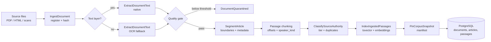
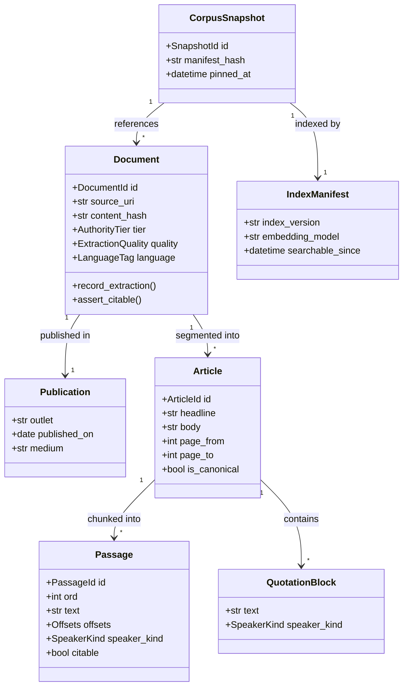
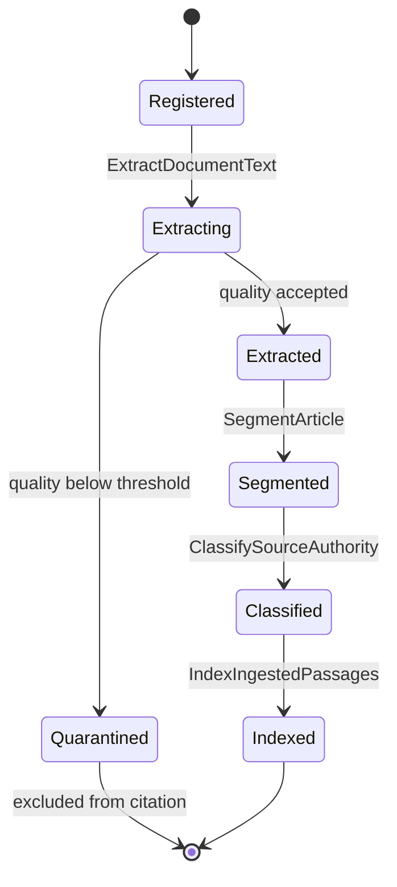
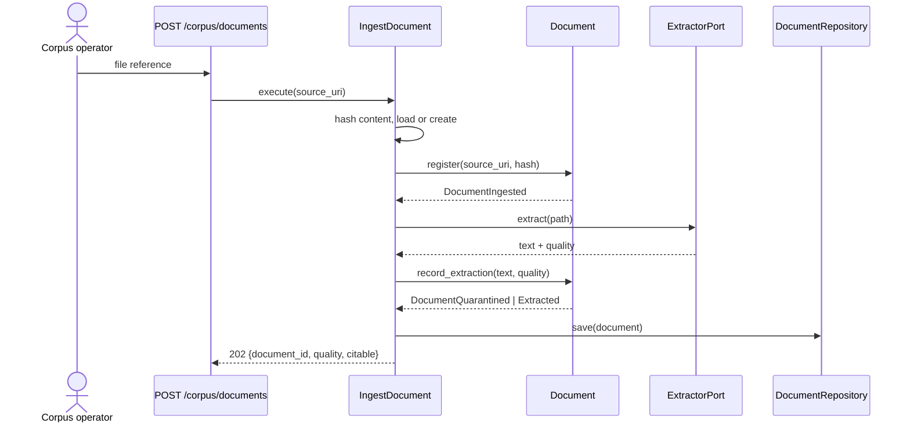

# EvidenceCorpus

## Module Status

**Status:** Implemented — contract frozen and behaviour delivered 2026-11-05
**Depends:** — (foundation context, no upstream module)
**Last reviewed:** 2026-11-05
**Source session:** 87433e56-b1a2-4464-a232-2dc4fe6f9dfd

## Description

Owns the authoritative document corpus: ingestion, extraction, article segmentation, passage
chunking and citation-grade provenance. Publishes passages as an open host for retrieval.

**Modeling Depth:** tactical (core domain)
**Subdomain Rationale:** Traceable evidence is the differentiator that makes the simulation credible rather than a chatbot.
**Context Map:** open-host → EvidenceRetrieval (Corpus publishes indexed passages with provenance; retrieval consumes as published language.)

## Architecture

| Layer | Responsibility | Path |
|-------|--------------|------|
| **Domain** | Aggregates, entities, value objects, domain services, repository interfaces | `src/evidence_corpus/domain/` |
| **Application** | Application services (catalog below), DTOs, ports consumed | `src/evidence_corpus/application/` |
| **Infrastructure** | SQLAlchemy repositories, Docling/PyMuPDF extractors, OCR client, index writer | `src/evidence_corpus/infrastructure/` |
| **Interfaces** | FastAPI routers, event subscribers, OpenAPI models | `src/evidence_corpus/interfaces/` |

Layers depend inward only. `domain/` imports neither SQLAlchemy nor FastAPI.

### Implementation status (2026-11-05)

| Area | State | Notes |
|---|---|---|
| Aggregates and invariants | implemented | `Document`, `IngestionRun`, `CorpusSnapshot`; 7 invariants enforced in behaviour |
| Extraction | implemented | PyMuPDF native probe/extract, Tesseract OCR fallback, quality gate |
| Segmentation | implemented | single-article and clipping-digest strategies |
| Authority and duplicates | implemented | claim-type rubric, duplicate detection, canonical linking |
| Indexing | implemented | PostgreSQL `tsvector` (German, GIN) + published index manifest |
| Snapshots | implemented | document set + index version, hashed manifest |
| API | implemented | 8 endpoints, uniform envelope, scopes published as `x-required-scope` |
| Persistence | partially deferred | documents/articles/passages are held in memory (`infrastructure/memory.py`); the SQLAlchemy adapters in `infrastructure/repository/sqlalchemy.py` still raise. The search index **is** persisted (migration `0102`). Re-ingestion is therefore required after a restart — recorded as the next persistence slice. |
| Embeddings | deferred | `passage_embedding` (pgvector) lands with EvidenceRetrieval, which owns the model choice |

### Frozen contract (2026-11-05)

The public surface below is frozen; implementation issues fill in bodies and may not rename fields,
change enum members, add rubric entries or alter route paths without re-opening the contract.

| Artifact | Path |
|---|---|
| Value objects, enums, authority rubric data | `src/evidence_corpus/domain/values.py` |
| Aggregates and entities (stub behaviour) | `src/evidence_corpus/domain/entities.py` |
| Domain events (payloads) | `src/evidence_corpus/domain/events.py` |
| Error codes | `src/evidence_corpus/domain/errors.py` |
| Repository ports (domain-owned) | `src/evidence_corpus/domain/repositories.py` |
| Domain services (CitabilitySpec, NativeVsOcrSelection, ArticleBoundaryStrategy) | `src/evidence_corpus/domain/services.py` |
| Published language (`PassageView`, `ProvenanceView`) | `src/evidence_corpus/domain/published.py` |
| Use-case interfaces + request DTOs + response DTOs | `src/evidence_corpus/application/{services,commands,dto}.py` |
| Ports consumed by the application | `src/evidence_corpus/application/ports.py` |
| Concrete router + OpenAPI schemas | `src/evidence_corpus/interfaces/http/{router,schemas}.py` |
| Adapter stubs (persistence, extraction, index) | `src/evidence_corpus/infrastructure/` |
| Executable contract tests | `tests/unit/evidence_corpus/` |

Frozen behaviour decisions recorded in the contract:

- `AUTHORITY_RULES` is data: press reporting ranks second-to-last for every claim type, and
  `SourceType.UNKNOWN` is absent from every rule (it can never be promoted).
- `ExtractionQuality.is_acceptable` defaults to `DEFAULT_MINIMUM_CONFIDENCE = 0.85`; the gate may be
  called with an explicit threshold but the default is contract.
- `CITABLE_SPEAKER_KINDS == {SpeakerKind.INSTITUTION}`: person- and anonymous-attributed quotations
  are excluded at segmentation, not filtered later.
- Endpoints answer `501 ENDPOINT_NOT_IMPLEMENTED` (with the standard envelope) until wired, so a
  client never mistakes a stub for working ingestion.
- Required scopes are published as `x-required-scope` per operation; Phase 1 IdentityAccess supplies
  the enforcing dependency.

## Related ADRs

| ADR | Relevance |
|---|---|
| ADR-001 Architecture Pattern | Module layout, layer isolation |
| ADR-002 Data Storage Strategy | Per-file aggregate boundaries, `tsvector` + pgvector, content-hash addressing |
| ADR-003 Cross-Context Communication | Publishes `PassageView`/`ProvenanceView` as open host; emits corpus events |
| ADR-007 Compliance Engine | `speaker_kind` decided here; personal quotations excluded at segmentation |
| ADR-008 Proportional Modeling Depth | Tactical depth: invariants + events required |

## Diagrams

### Data Flow



### Entity Relationship



### Aggregate State (Document)



### Key Use Case Sequence — IngestDocument



## Components

### Aggregates

#### Document (aggregate root)

A physical source file with its extraction state, authority classification and citable passages.
Owns `Article`, `Passage` and `QuotationBlock`.

**Behaviour (tell, don't ask — no setters):**

```python
# src/evidence_corpus/domain/document.py
from __future__ import annotations
from dataclasses import dataclass, field
from datetime import datetime

@dataclass
class Document:
    id: DocumentId
    source_uri: str
    content_hash: str
    publication: Publication
    tier: AuthorityTier | None
    quality: ExtractionQuality | None
    language: LanguageTag
    articles: list[Article] = field(default_factory=list)
    events: list[DomainEvent] = field(default_factory=list)

    def record_extraction(self, text: str, quality: ExtractionQuality) -> None:
        """Assign extraction outcome once; a document may not be re-extracted in place."""
        if self.quality is not None:
            raise AlreadyExtracted(self.id)
        self.quality = quality
        if not quality.is_acceptable():
            self.events.append(DocumentQuarantined(self.id, quality))
            return
        self.events.append(DocumentIngested(self.id, self.source_uri, self.content_hash))

    def add_article(self, headline: str, body: str, page_from: int, page_to: int) -> Article:
        """Segment a new article; boundaries are supplied by the segmentation strategy."""
        if not self.is_citable():
            raise DocumentNotCitable(self.id)
        article = Article.new(self.id, headline, body, page_from, page_to, self.language)
        self.articles.append(article)
        self.events.append(ArticleSegmented(self.id, article.id, article.passage_count()))
        return article

    def classify(self, tier: AuthorityTier) -> None:
        """Authority is assigned once and frozen (invariant)."""
        if self.tier is not None:
            raise AuthorityAlreadyAssigned(self.id)
        self.tier = tier
        self.events.append(AuthorityTierAssigned(self.id, tier))

    def is_citable(self) -> bool:
        return self.quality is not None and self.quality.is_acceptable()

    def publishable_passages(self) -> list[Passage]:
        """Only citable passages leave this aggregate."""
        return [p for a in self.articles for p in a.publishable_passages()]
```

**Invariants (from exploration — enforced in code, not in the database):**

| # | Invariant | Illegal state prevented |
|---|---|---|
| 1 | A Passage can never exist without a resolvable parent Article and Document with a source URI | Orphan citation that cannot be traced to a physical page |
| 2 | A Document's authority tier and extraction quality are assigned at ingestion and immutable thereafter | Retroactive authority inflation of weak sources |
| 3 | Passage offsets must lie within the parent Article text bounds and must not overlap sibling passages | A citation pointing at the wrong sentence |
| 4 | A Document below the extraction quality threshold cannot produce citable Passages | Citing garbled OCR output as evidence |
| 5 | A QuotationBlock attributed to a natural person must never enter an EvidencePack; an institution-attributed quotation is retained and citable with its attribution | Quoting real persons, or losing legitimate institutional statements |
| 6 | Authority is evaluated per claim type (legislation for legal, statistics for quantitative, studies for causal) | A press statement outranking a statute on one global scale |
| 7 | A Document must record its source type explicitly enough to be placed in a claim-type authority rule; unknown types cannot be promoted to authoritative | Unclassified material quietly becoming authoritative |

**Domain-owned repository interface:**

```python
# src/evidence_corpus/domain/repositories.py
from typing import Protocol

class DocumentRepository(Protocol):
    async def get(self, document_id: DocumentId) -> Document | None: ...
    async def get_by_hash(self, content_hash: str) -> Document | None: ...
    async def save(self, document: Document) -> None: ...
    async def next_documents(self, limit: int) -> list[DocumentId]: ...
```

#### IngestionRun (aggregate root)

One auditable batch execution: attempted, accepted, quarantined, failed counts and retry lineage.
Owns nothing else; it records outcomes, it does not contain documents.

```python
# src/evidence_corpus/domain/ingestion_run.py
@dataclass
class IngestionRun:
    id: IngestionRunId
    shard_label: str
    attempted: int = 0
    accepted: int = 0
    quarantined: int = 0
    failed: int = 0
    status: RunStatus = RunStatus.RUNNING
    events: list[DomainEvent] = field(default_factory=list)

    def record(self, outcome: IngestionOutcome) -> None:
        self.attempted += 1
        match outcome:
            case Outcome.ACCEPTED: self.accepted += 1
            case Outcome.QUARANTINED: self.quarantined += 1
            case Outcome.FAILED: self.failed += 1

    def complete(self) -> None:
        if self.status is not RunStatus.RUNNING:
            raise RunAlreadyClosed(self.id)
        self.status = RunStatus.COMPLETED
        self.events.append(IngestionRunCompleted(self.id, self.attempted, self.accepted,
                                                 self.quarantined, self.failed))
```

### Entities

| Entity | Context role | Owned by |
|---|---|---|
| `Article` | Editorial unit with headline, dateline, page range, canonical flag | Document |
| `Passage` | Smallest citable text span with offsets and `speaker_kind` | Article |
| `Publication` | Outlet, date, medium | Document |
| `CorpusSnapshot` | Manifest of documents + index version a run may search | own transaction |
| `IndexManifest` | Published index state for a snapshot | CorpusSnapshot |

### Value Objects (entity-vs-VO justification)

| Value object | Immutable | Equal by state | Why a VO, not an entity |
|---|---|---|---|
| `Provenance` | yes | yes | Locator bundle; no identity of its own — two identical locators are the same citation target |
| `ExtractionQuality` | yes | yes | Measurement (method, confidence, missing-glyph rate); reproducing it yields an equal value |
| `AuthorityTier` | yes | yes | Rubric position; identity is the tier name, not an instance |
| `LanguageTag` | yes | yes | `de-AT` is `de-AT`; no lifecycle |
| `SpeakerKind` | yes | yes | Attribution class, three values, no behaviour over time |
| `Offsets` | yes | yes | `(start, end)` pair; validated against parent bounds on construction |
| `ArticleSection` | yes | yes | Typed region label |
| `QuotationBlock` | yes | yes | Span + attribution; retained structurally, never promoted |
| `CanonicalArticleRef` | yes | yes | Pointer to the canonical article that owns citations |

### Service classification

| Service | Layer | Why |
|---|---|---|
| `ExtractDocumentText` orchestration | application | Coordinates ports, no business rule of its own |
| `NativeVsOcrSelection` | domain service | Decides extraction route from page-level facts; strategy with two variants |
| `ArticleBoundaryStrategy` | domain service | Two variants (clipping digest vs single article) → Strategy |
| `CitabilitySpec` | domain service | Combinable rule: `has_provenance AND quality_ok AND source_type_known` |
| Docling/PyMuPDF/OCR adapters | infrastructure | Vendor code, never imported by domain |

## Domain Events

| Event | Description | Trigger | Payload | Published By |
|---|---|---|---|---|
| `DocumentIngested` | Source file registered, extracted, quality accepted | `IngestDocument` | `document_id, source_uri, content_hash, quality_method` | EvidenceCorpus |
| `DocumentExtractionFailed` | Extraction could not complete; document excluded | `ExtractDocumentText` | `document_id, method, reason` | EvidenceCorpus |
| `DocumentQuarantined` | Quality gate rejected the document; excluded from citation but retained for diagnostics | `ExtractDocumentText` | `document_id, quality, threshold` | EvidenceCorpus |
| `ArticleSegmented` | Article boundaries and metadata resolved | `SegmentArticle` | `document_id, article_id, passage_count` | EvidenceCorpus |
| `AuthorityTierAssigned` | Source classified into the authority rubric | `ClassifySourceAuthority` | `document_id, tier` | EvidenceCorpus |
| `DuplicateArticleLinked` | Syndicated copy linked to canonical article | `ClassifySourceAuthority` | `article_id, canonical_article_id, similarity` | EvidenceCorpus |
| `QuotationBlockDetected` | Passage region classified as quoted/reported speech | `SegmentArticle` | `passage_id, speaker_kind` | EvidenceCorpus |
| `PersonalQuotationExcluded` | Person-attributed quotation marked non-citable | `SegmentArticle` | `passage_id, span` | EvidenceCorpus |
| `InstitutionalStatementAttributed` | Statement attributed to an institution; retained as citable | `SegmentArticle` | `passage_id, institution_identity` | EvidenceCorpus |
| `IngestionRunCompleted` | Batch finished with accepted/quarantined/failed counts | `IngestDocument` | `run_id, attempted, accepted, quarantined, failed` | EvidenceCorpus |
| `IndexManifestPublished` | A new index version became searchable for a snapshot | `IndexIngestedPassages` | `snapshot_id, index_version, embedding_model, passage_count` | EvidenceCorpus |
| `PassageRevertedFromIndex` | Passage withdrawn; no future argument may cite it | `IndexIngestedPassages` | `passage_id, reason` | EvidenceCorpus |

**ADR-008 triage**

| Event | Domain expert cares | Crosses boundary | Audit trail |
|---|---|---|---|
| `DocumentIngested` | yes | yes | yes |
| `DocumentQuarantined` | yes | yes | yes |
| `AuthorityTierAssigned` | yes | yes | yes |
| `DuplicateArticleLinked` | **yes** (duplicate coverage inflates support) | yes | yes |
| `PersonalQuotationExcluded` | yes | yes | yes |
| `InstitutionalStatementAttributed` | yes | yes | yes |
| `IndexManifestPublished` | yes | yes | yes |
| `PassageRevertedFromIndex` | yes | yes | yes |
| `ArticleSegmented` | no | yes | no |

## API Endpoints

| Method | Path | Handler | Input | Output | Auth |
|---|---|---|---|---|---|
| POST | `/api/v1/corpus/documents` | `ingest_document` | `{source_uri, publication}` | `202 {document_id, quality, citable}` | `corpus:write` |
| POST | `/api/v1/corpus/ingestion-runs` | `start_ingestion_run` | `{shard_label, paths[]}` | `202 {run_id}` | `corpus:write` |
| GET | `/api/v1/corpus/ingestion-runs/{run_id}` | `get_ingestion_run` | — | counts + status | `corpus:read` |
| GET | `/api/v1/documents/{document_id}` | `get_document` | — | document + articles | `corpus:read` |
| GET | `/api/v1/passages/{passage_id}` | `get_passage` | — | `{text, provenance{outlet,date,page,offsets}, speaker_kind, citable}` | `corpus:read` |
| POST | `/api/v1/corpus/snapshots` | `pin_corpus_snapshot` | `{document_ids?, label}` | `201 {snapshot_id, manifest_hash}` | `corpus:write` |
| GET | `/api/v1/corpus/snapshots/{snapshot_id}` | `get_snapshot` | — | manifest + index version | `corpus:read` |
| GET | `/api/v1/corpus/authority-rules` | `list_authority_rules` | `?claim_type` | tier ordering per claim type | `corpus:read` |

## Ubiquitous Language

| Term | Definition | Aliases prohibited in code |
|---|---|---|
| Document | A physical ingested source file before editorial segmentation | file, pdf, source-file |
| Article | One editorial unit segmented out of a Document, with headline, date and page | news-item, story, post |
| Passage | The smallest citable text span; the unit indexed, retrieved and cited | chunk, snippet, fragment |
| Authority Tier | Ranked credibility rubric owned by the corpus; retrieval never defines trust | trust-level, credibility |
| Extraction Quality | Measured confidence that a Document's text faithfully represents the source | ocr-confidence, parse-quality |
| Provenance | Immutable locator bundle resolving a citation to page and offsets | citation-locator, source-pointer |
| Corpus Snapshot | The versioned document set a run searched, frozen at run start | dataset-version, index-version |
| Article Section | Typed region (headline, standfirst, body, caption, quotation) | zone, block-type |
| Quotation Block | Quoted/reported speech span, retained but never promoted to evidence | quote, direct-speech |
| Canonical Article | The one article owning citable passages when syndicated copies exist | original, master-copy |
| Speaker Kind | Attribution class deciding citability: institution / person / anonymous | attributed-to, source-type |
| Authority Rule | Claim-type-specific source ordering replacing a global scale | ranking, precedence |
| Institutional Statement | Citable statement attributed to an institution | press-release, official-position |
| Quarantined Document | Document failing the quality gate; excluded from citation | rejected-file, bad-scan |
| Ingestion Run | One auditable batch execution with outcome counts | import-job, batch |
| Index Manifest | Published index version for a snapshot | index-state, vector-version |
| Retracted Passage | Passage withdrawn after retraction | removed-chunk, deleted-hit |

## Dependencies

**Depends On:** none. This is a foundation context.

**Used By:**

| Consumer | What it provides |
|---|---|
| EvidenceRetrieval | `PassageView`, `ProvenanceView`, `AuthorityTier` rubric, index manifest version |
| ClaimValidation | Authoritative source tier and passages for `ReferenceFigure` grounding |
| GovernanceCompliance | `speaker_kind` attribution so personal quotations are excluded upstream |
| DecisionBrief | `Provenance` resolution when publishing `CitedStatement` |
| SimulationOrchestration | Passage counts for progress display |

## Implementation Sequence

1. `Passage`, `Offsets`, `Provenance`, `AuthorityTier`, `SpeakerKind`, `LanguageTag` value objects + tests
2. `ExtractionQuality` gate + `Document.record_extraction` invariant tests
3. `Document` aggregate with article segmentation and citability spec
4. `ExtractionPort` with native extractor (PyMuPDF) → integration test on 5 real PDFs
5. OCR fallback adapter + quality comparison metric
6. `ArticleBoundaryStrategy` variants (single article, clipping digest)
7. `Passage` chunking with offsets + speaker classification (person vs institution)
8. `ClassifySourceAuthority` + canonical-article linking (content hash + similarity)
9. `IndexIngestedPassages`: `tsvector` writer + `passage_embedding` upserts
10. `PinCorpusSnapshot` manifest + `IndexManifest` publication
11. REST routers + OpenAPI contract tests

## Patterns & OOP Mapping

| Component | Pattern | Rationale |
|---|---|---|
| `ExtractDocumentText` | **Strategy** (`NativeExtractor`, `OcrExtractor`) | Two real variants with different cost/accuracy; selected per page by a quality probe |
| `Document.new_from_extraction()` | **Factory** | Construction requires several validated parts (publication, quality, language); a factory keeps invalid Documents unrepresentable |
| `CitabilitySpec` | **Specification** | Combinable rules (`has_provenance`, `quality_ok`, `source_known`) that grow without touching call sites |
| `ArticleBoundaryStrategy` | **Strategy** | Clipping digests need different boundary rules than single articles |
| Events | **Observer** via outbox | Downstream contexts react without the corpus importing them |
| VOs, DTOs | **Record / immutable value object** (`@dataclass(frozen=True)`) | Equal-by-state concepts with no lifecycle |
| `Document` | **Rich aggregate** | Behaviour lives on the root (`record_extraction`, `add_article`, `classify`); no setters |

**OOP constraints:** no anemic aggregate, no property setters on roots, command/query separation
(`submit_*` vs `is_citable`), tell-don't-ask from application services.

## Acceptance Criteria

| # | Component | Criterion | Verify In |
|---|---|---|---|
| 1 | `Document.record_extraction` | A second call on the same Document raises `AlreadyExtracted`; tier and quality are unchanged after reclassification attempt | `tests/unit/evidence_corpus/test_document_record_extraction.py` |
| 2 | Extraction quality gate | A document with confidence below threshold yields `DocumentQuarantined` and `publishable_passages()` returns `[]` | unit |
| 3 | `Passage.offsets` | Constructing offsets outside the parent article bounds raises; over-investigation guard: overlapping siblings rejected | unit |
| 4 | `SpeakerKind` classification | A person-attributed quotation produces `PersonalQuotationExcluded` and never reaches `publishable_passages()`; an institution-attributed statement remains citable | unit + integration |
| 5 | `ExtractDocumentText` | A scanned PDF without text layer routes to OCR and yields non-empty text with `quality.method == "ocr"` | integration |
| 6 | `SegmentArticle` | A 3-clipping digest yields exactly 3 articles with distinct headlines and page ranges | integration |
| 7 | Provenance resolution | `GET /api/v1/passages/{id}` returns outlet, date, page and offsets that reproduce the exact text slice from the source file | integration |
| 8 | `ClassifySourceAuthority` | Unknown source type is refused (`SourceTypeUnknown`); a press report never outranks a statute for a legal claim type | unit |
| 9 | `LinkCanonicalArticle` | Two identical texts link to one canonical article; citation counts do not double | integration |
| 10 | `PinCorpusSnapshot` | Snapshot pins documents + index version; re-running ingestion afterwards does not change passages visible through the old snapshot | integration |
| 11 | `IndexIngestedPassages` | Passages are searchable via `tsvector` within the same application run; re-indexing is idempotent | integration |
| 12 | API contract | All endpoints appear in generated OpenAPI and return the documented envelope; error paths use `{code,message,details,trace_id}` | contract test |

## Modeling Depth Note (ADR-008)

Tactical depth as a core subdomain: two aggregate roots (`Document` per file, `IngestionRun` per
batch), seven invariants enforced in behaviour, domain-owned repository protocols, value objects
with entity-vs-VO justification and triaged domain events.

**Boundary rule applied here:** `CorpusCollection` and `IndexManifest` are *manifests*, not
corpus-wide transaction roots — a document is the unit of consistency, never the archive.
