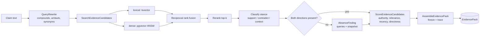
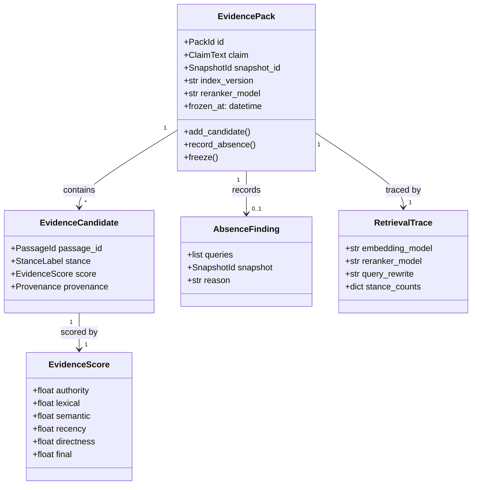
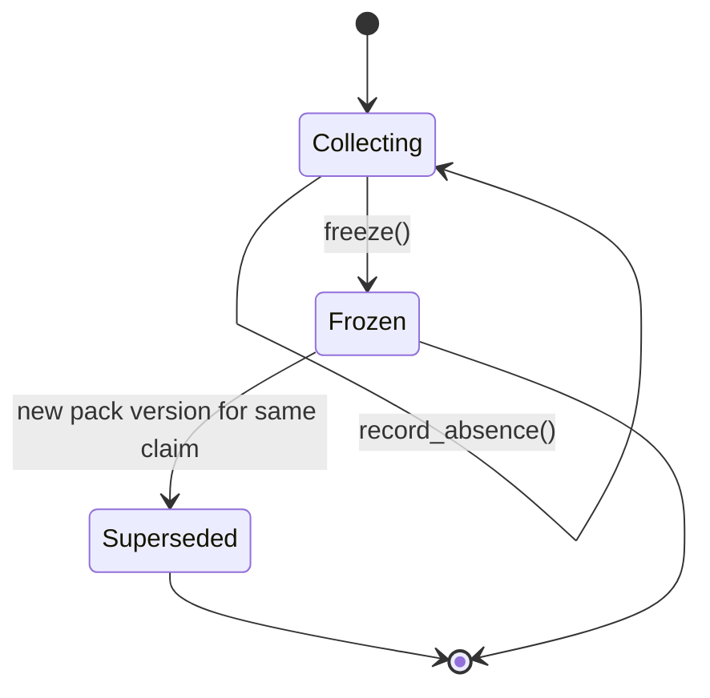
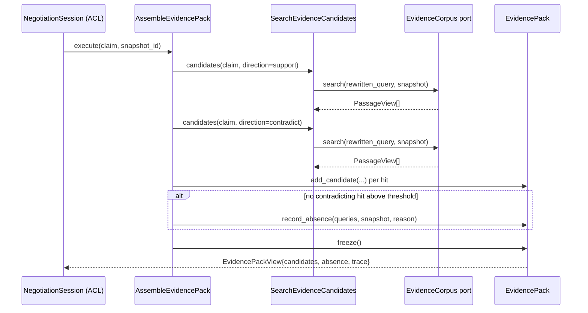

# EvidenceRetrieval

## Module Status

**Status:** Implemented (2026-11-05)
**Depends:** EvidenceCorpus (open-host — `PassageView`, `ProvenanceView`, `AuthorityTier` rubric, index manifest version)
**Last reviewed:** 2026-11-05
**Source session:** 87433e56-b1a2-4464-a232-2dc4fe6f9dfd

## Description

Turns a claim into a balanced, scored, inspectable evidence pack. Owns hybrid search, reranking,
stance classification and recency weighting. Never owns the corpus itself.

**Modeling Depth:** tactical (core domain)
**Subdomain Rationale:** Balanced supporting/contradicting evidence retrieval prevents one-sided argumentation.
**Context Map:** EvidenceCorpus → open-host; anticorruption-layer → NegotiationSession (Retrieval returns EvidencePacks; negotiation maps them to ClaimEvidence refs, never raw vector hits).

## Contract Freeze (2026-11-05)

The public contract is frozen before implementation. Names, fields, layers and method signatures
below are the review baseline; implementation issues fill the TODO bodies without renaming them.

| Contract | Location | Frozen names |
|---|---|---|
| Aggregate | `src/evidence_retrieval/domain/evidence_pack.py` | `EvidencePack`, `add_candidate`, `record_absence`, `freeze`, `assert_every_candidate_has_provenance` |
| Entities | `src/evidence_retrieval/domain/entities.py` | `EvidenceCandidate`, `RetrievalTrace` |
| Value objects | `src/evidence_retrieval/domain/values.py` | `PackId`, `ClaimText`, `SnapshotId`, `PassageId`, `StanceLabel`, `EvidenceScore`, `RecencyPolicy`, `AbsenceFinding`, `AuthorityWeight`, `QueryRewrite`, `RetrievalQuery`, `CoverageReport` |
| Domain services | `src/evidence_retrieval/domain/services.py` | `ScoreEvidenceCandidates`, `ApplyRecencyPolicy`, `ReciprocalRankFusion`, `StanceClassifier` |
| Repository ports | `src/evidence_retrieval/domain/repositories.py` | `EvidencePackRepository`, `PassageSearchPort` |
| Events | `src/evidence_retrieval/domain/events.py` | `EvidencePackAssembled`, `ContradictingEvidenceSurfaced`, `EvidenceAbsenceRecorded` |
| Errors | `src/evidence_retrieval/domain/errors.py` | `PackFrozen`, `AbsenceWithContradiction`, `CandidateWithoutProvenance`, `EvidencePackNotFound` |
| Use cases | `src/evidence_retrieval/application/services.py` | `SearchEvidenceCandidates`, `AssembleEvidencePack`, `GetEvidencePack`, `GetScoreBreakdown`, `ReweightEvidencePack` |
| Request/result DTOs | `src/evidence_retrieval/application/commands.py`, `src/evidence_retrieval/application/dto.py` | one request object per use case; candidate, pack, trace, score and readiness results |
| Vendor ports | `src/evidence_retrieval/application/ports.py` | `EmbeddingPort`, `RerankerPort`, `QueryRewritePort`, `RetrievalReadinessPort`, `Clock` |
| Evaluation | `src/evidence_retrieval/evaluation.py` | `EvaluationCase`, `RecallReport`, `EvaluationHarness` |
| API | `src/evidence_retrieval/interfaces/http/router.py`, `src/evidence_retrieval/interfaces/http/schemas.py` | five `/api/v1/evidence/*` routes with declared scopes |
| Published ACL | `src/evidence_retrieval/interfaces/published.py` | `EvidencePackView`, `EvidenceCandidateView`, `AbsenceView`, `RetrievalTraceView`, `ScoreBreakdownView` |
| Composition | `src/evidence_retrieval/composition.py` | `EvidenceRetrievalContainer`, `build_container` (TODO until wiring) |

**Frozen decisions:** IDs are `NewType` strings; `StanceLabel` has exactly four members; every
`EvidenceScore.final` equals the sum of its five components; `RecencyPolicy` defaults to a 365-day
half-life with legislation exempt; `EvidencePackView` carries references and provenance but never
passage text or vectors; `PassageSearchPort` is the only corpus access. The tactical layer keeps
`domain/` and `application/` free of ORM, FastAPI and vendor imports.

**Not mounted yet:** the router is concrete but is not included in `shared.app` until the wiring
issue; a TODO body must never answer a real request.

## Runtime Integration

**Entry path:** `shared.app.create_app` builds the EvidenceCorpus container, then
`evidence_retrieval.composition.build_container(settings, database, corpus=...)`, then mounts
`evidence_retrieval.interfaces.http.router`. The only public path is `/api/v1/evidence/*`.

**Corpus boundary:** `CorpusPassageSearch` consumes EvidenceCorpus' published ports only (index
writer, passage repository, snapshot repository, authority-rule repository). It never reads
`evidence_corpus_*` tables or imports corpus infrastructure.

**Proof:** `tests/integration/test_evidence_retrieval_e2e.py` indexes a passage, pins a snapshot,
searches candidates, assembles/reads/scores/reweights a pack through the public API.
`validate-runtime-wiring.sh` reports zero unwired services.

**Readiness:** `/readyz` reports `evidence_retrieval`; embeddings or reranker unreachable returns
`503 NOT_READY`. **Legacy path:** none existed; pre-wiring stubs were TODO-only and are retired.

**Decision:** ADR-010 (Accepted).

## Architecture

| Layer | Responsibility | Path |
|-------|--------------|------|
| **Domain** | `EvidencePack` aggregate, candidates, scoring, stance rules, repository interface | `src/evidence_retrieval/domain/` |
| **Application** | `SearchEvidenceCandidates`, `AssembleEvidencePack`, `ApplyRecencyPolicy`, `ScoreEvidenceCandidates` | `src/evidence_retrieval/application/` |
| **Infrastructure** | `tsvector` + pgvector adapters, reranker client, embedding client, SQLAlchemy repositories | `src/evidence_retrieval/infrastructure/` |
| **Interfaces** | REST routers, `EvidencePackView` published to NegotiationSession | `src/evidence_retrieval/interfaces/` |

## Related ADRs

| ADR | Relevance |
|---|---|
| ADR-002 Data Storage Strategy | `tsvector` + pgvector in one database; snapshot pinning makes packs reproducible |
| ADR-003 Cross-Context Communication | Consumes corpus as open host; publishes to NegotiationSession through an ACL |
| ADR-006 Cost Tracking | Embedding calls are metered like LLM calls |
| ADR-008 Proportional Modeling Depth | Tactical: invariants and triage apply |
| ADR-010 EvidenceRetrieval Runtime Integration | Router-mounted entry path, published corpus ports, readiness-red on embedding outage |

## Diagrams

### Data Flow



### Entity Relationship



### Aggregate State (EvidencePack)



### Key Use Case Sequence — AssembleEvidencePack



## Components

### Aggregate

#### EvidencePack (aggregate root)

The frozen, balanced bundle handed to an agent as justification for one claim.

```python
# src/evidence_retrieval/domain/evidence_pack.py
from dataclasses import dataclass, field

@dataclass
class EvidencePack:
    id: PackId
    claim: ClaimText
    snapshot_id: SnapshotId
    trace: RetrievalTrace
    candidates: list[EvidenceCandidate] = field(default_factory=list)
    absence: AbsenceFinding | None = None
    frozen: bool = False
    events: list[DomainEvent] = field(default_factory=list)

    def add_candidate(self, candidate: EvidenceCandidate) -> None:
        if self.frozen:
            raise PackFrozen(self.id)
        self.candidates.append(candidate)
        if candidate.stance is StanceLabel.CONTRADICTING:
            self.events.append(ContradictingEvidenceSurfaced(self.id, candidate.passage_id))

    def record_absence(self, queries: list[str], reason: str) -> None:
        """A stance produced nothing: record it as a fact, never pad the pack."""
        if any(c.stance is StanceLabel.CONTRADICTING for c in self.candidates):
            raise AbsenceWithContradiction(self.id)
        self.absence = AbsenceFinding(queries, self.snapshot_id, reason)
        self.events.append(EvidenceAbsenceRecorded(self.id, queries, reason))

    def freeze(self) -> None:
        self.assert_every_candidate_has_provenance()
        self.frozen = True
        self.events.append(EvidencePackAssembled(self.id, self.claim, len(self.candidates),
                                                 self.absence is not None))

    def assert_every_candidate_has_provenance(self) -> None:
        missing = [c.passage_id for c in self.candidates if c.provenance is None]
        if missing:
            raise CandidateWithoutProvenance(missing)
```

**Invariants:**

| # | Invariant | Illegal state prevented |
|---|---|---|
| 1 | A pack records its search coverage: queries run, stances found, and an `AbsenceFinding` for any stance with no result. A pack is never blocked for lacking contradicting evidence | One-sided packs from seeking only agreement, or packs rejected because no contradiction exists |
| 2 | Every candidate carries resolvable corpus `Provenance` | Unsourced evidence inside an argument |
| 3 | A weight breakdown (authority, relevance, recency, directness) exists for every candidate | Opaque single-number scoring |
| 4 | A frozen pack is immutable; re-retrieval creates a new version | Silent mutation of evidence after it justified an argument |
| 5 | A pack references the `IndexManifest` version and reranker model that produced it | Irreproducible evidence after re-indexing |
| 6 | Authority weight is looked up from the corpus rubric, never invented here | Two subsystems disagreeing about trust |
| 7 | Recency weighting excludes non-perishable sources (legislation, foundational studies, reference figures) | A 1995 statute outranked by a recent press mention |
| 8 | Absence must be truthful: it names the queries and snapshot searched | Padding with tangential material to appear balanced |

**Domain-owned repository interface:**

```python
# src/evidence_retrieval/domain/repositories.py
class EvidencePackRepository(Protocol):
    async def get(self, pack_id: PackId) -> EvidencePack | None: ...
    async def save(self, pack: EvidencePack) -> None: ...
    async def latest_for_claim(self, claim: ClaimText) -> EvidencePack | None: ...

class PassageSearchPort(Protocol):
    """Published language consumed from EvidenceCorpus — no corpus tables touched."""
    async def search(self, query: str, snapshot_id: SnapshotId, limit: int) -> list[PassageView]: ...
    async def authority_rule(self, claim_type: ClaimType) -> AuthorityRule: ...
```

### Entities and value objects

| Concept | Kind | Justification |
|---|---|---|
| `EvidenceCandidate` | entity | Identity persists within a pack (passage id + stance); it is annotated over time (rescored) |
| `RetrievalTrace` | entity | Immutable record attached to a pack; identity = pack id + attempt |
| `RetrievalQuery` | **value object** | Input to an operation; no lifecycle. The durable record is the `RetrievalTrace` on the pack |
| `EvidenceScore` | value object | Immutable measurement; equal by components |
| `StanceLabel` | value object | Four values, no lifecycle |
| `RecencyPolicy` | value object | Configurable decay + exemption list; equal by parameters |
| `CoverageReport` | value object | Derived measurement of availability |
| `AbsenceFinding` | value object | Negative result with its search basis |
| `AuthorityWeight` | value object | Numeric weight looked up from corpus rubric |
| `QueryRewrite` | value object | Deterministic expansion; reproducible from inputs |

### Service classification

| Service | Layer | Why |
|---|---|---|
| `SearchEvidenceCandidates` | application | Orchestrates two search adapters and fusion |
| `AssembleEvidencePack` | application | Transaction boundary: builds and freezes one aggregate |
| `ScoreEvidenceCandidates` | domain service | Pure scoring rules, no I/O |
| `ApplyRecencyPolicy` | domain service | Policy evaluation; exempts non-perishables |
| `ReciprocalRankFusion` | domain service | Algorithm with two variants (RRF vs weighted) → Strategy |
| `StanceClassifier` | domain service | Claim-relative classification; LLM-assisted but validated |
| pgvector / reranker / embedding clients | infrastructure | Vendor adapters behind ports |

## Domain Events

| Event | Description | Trigger | Payload | Published By |
|---|---|---|---|---|
| `EvidencePackAssembled` | A balanced, scored pack was frozen for a claim | `AssembleEvidencePack` | `pack_id, claim_hash, candidate_count, has_absence, index_version` | EvidenceRetrieval |
| `ContradictingEvidenceSurfaced` | Evidence opposing the requester's position was included | `AssembleEvidencePack` | `pack_id, passage_id, stance` | EvidenceRetrieval |
| `EvidenceAbsenceRecorded` | A stance produced no qualifying evidence; absence recorded with the failed searches | `AssembleEvidencePack` | `pack_id, queries[], snapshot_id, reason` | EvidenceRetrieval |

**ADR-008 triage:** `EvidencePackAssembled` (expert yes / boundary yes / audit yes),
`ContradictingEvidenceSurfaced` (yes/yes/yes), `EvidenceAbsenceRecorded` (yes/yes/yes).

*Not published as domain events:* fusion computation, score calculation, recency weight
application, query rewriting — these fail all three triage questions and remain log lines.

## API Endpoints

| Method | Path | Handler | Input | Output | Auth |
|---|---|---|---|---|---|
| POST | `/api/v1/evidence/candidates` | `search_evidence_candidates` | `{claim, claim_type, snapshot_id, limit}` | candidates with stance + score components | `runs:read` |
| POST | `/api/v1/evidence/packs` | `assemble_evidence_pack` | `{claim, claim_type, snapshot_id}` | `201 {pack_id, candidates[], absence?, trace}` | `runs:write` |
| GET | `/api/v1/evidence/packs/{pack_id}` | `get_evidence_pack` | — | pack + candidates + trace | `runs:read` |
| GET | `/api/v1/evidence/packs/{pack_id}/scores` | `get_score_breakdown` | — | per-candidate component weights | `runs:read` |
| POST | `/api/v1/evidence/packs/{pack_id}/reweight` | `apply_recency_policy` | `{policy}` | new pack version | `runs:write` |

## Ubiquitous Language

| Term | Definition | Aliases prohibited |
|---|---|---|
| Evidence Pack | Frozen, balanced, scored evidence set for one claim | context-bundle, rag-result, hits |
| Stance Label | Whether a passage supports, contradicts, contextualises or is tangential | polarity, sentiment |
| Recency Policy | Configured decay, with exemptions for non-perishable sources | freshness-boost, decay |
| Recency Exemption | Non-perishable source types keeping full weight | no-decay, timeless |
| Evidence Score | Inspectable multi-component weighting | confidence, relevance-score |
| Absence Finding | Auditable "searched, found nothing" record | no-results, negative-result |
| Directness | Whether a passage states the claim versus merely discussing the topic | specificity, explicitness |
| Authority Weight | Numeric weight derived from the corpus tier rubric | trust-score, credibility |
| Coverage Report | Derived counts per stance and best authority found | availability, hit-count |
| Query Rewrite | Deterministic German expansion: compounds, umlauts, institutional synonyms | query-expansion, normalisation |
| Retrieval Trace | Reproducibility record: index version, models, rewrite, stance counts | audit-log, provenance-of-retrieval |

## Dependencies

**Depends On:**

| Module | What it provides |
|---|---|
| EvidenceCorpus | `PassageView`, `ProvenanceView`, `AuthorityTier` → `AuthorityWeight`, `IndexManifest` version, `AuthorityRule` per claim type |

**Used By:**

| Consumer | What it provides |
|---|---|
| NegotiationSession | `EvidencePackView` → mapped by ACL to `ClaimEvidence` (raw hits never cross) |
| ClaimValidation | Candidate passages for claim verification |
| DecisionBrief | Evidence ids behind `CitedStatement` |

## Implementation Sequence

1. `PassageView` / `ProvenanceView` port + fake implementation (unblocks everything else)
2. `StanceLabel`, `EvidenceScore`, `RecencyPolicy`, `AbsenceFinding` value objects
3. `ReciprocalRankFusion` + `StanceClassifier` domain services with golden-case tests
4. `SearchEvidenceCandidates` against real `EvidenceCorpus` (`tsvector` + pgvector)
5. `ScoreEvidenceCandidates` with inspectable breakdown (assert components sum to `final`)
6. `ApplyRecencyPolicy` incl. exemptions
7. `EvidencePack` aggregate: freeze, absence, provenance assertion
8. `EvidencePackRepository` + pack views
9. REST routers + OpenAPI contract tests
10. Evaluation harness: manually labelled claims → recall report (no target numbers until measured)

## Patterns & OOP Mapping

| Component | Pattern | Rationale |
|---|---|---|
| Fusion | **Strategy** (`ReciprocalRankFusion`, `WeightedFusion`) | Two known variants; benchmark decides |
| Reranking | **Strategy** (`NoReranker`, `CrossEncoderReranker`) | Cheap mode for demos, quality mode for evaluation |
| Stance classification | **Strategy** + **Specification** | Lexical rule vs LLM-assisted; threshold as a spec |
| `AssembleEvidencePack` | **Builder** | Pack is assembled incrementally (candidates, absence, trace) then frozen once |
| Absence handling | **Null Object with evidence** | `AbsenceFinding` replaces an empty list so the client can display a truthful negative |
| Ports | **Adapter / Port** | Corpus, embeddings, reranker are vendor code behind domain interfaces |
| `EvidencePack` | **Rich aggregate, immutable once frozen** | Prevents the "evidence changed after the argument" audit failure |

## Wiring Contract

| Wiring point | Requirement | Proof |
|---|---|---|
| Router | `app.include_router(evidence_retrieval_router)` in `src/shared/app.py` | boot test asserting registration |
| Composition | `build_container(settings)` wires real `pgvector`/`tsvector` adapters, embedding client and reranker from settings | integration test: pack assembled against a real snapshot |
| Upstream port | `PassageSearchPort` adapter bound to EvidenceCorpus' published language; **no direct read of `evidence_corpus_*` tables** | architecture test forbidding cross-context repository imports |
| Persistence | Migration `0201` (pack, candidate, retrieval_trace, passage_embedding) is applied before the router is exposed | `alembic upgrade head` + pack persists across restart |
| Events | Packs and absences published through the outbox | `EvidencePackAssembled` row in `shared_event_outbox` |
| Degraded mode | If the embedding provider is unreachable the module must fail loudly (readiness red), never silently return lexical-only results labelled as hybrid | `/readyz` reflects embedding/reranker reachability |

## Acceptance Criteria

| # | Component | Criterion | Verify In |
|---|---|---|---|
| 1 | `EvidencePack.add_candidate` after freeze | Raises `PackFrozen`; the persisted pack is unchanged | unit |
| 2 | Absence recording | A claim with no contradicting hit produces `absence != None` and a `200`, not an error or empty list | unit + API |
| 3 | Absence with contradictory hit present | `record_absence` raises `AbsenceWithContradiction` | unit |
| 4 | Provenance assertion | A candidate without provenance blocks `freeze()` | unit |
| 5 | Score breakdown | `authority + lexical + semantic + recency + directness` are all present and `final` is reproducible from them | unit |
| 6 | Recency exemption | A statute from 1995 keeps `recency == 1.0`; a press report from 1995 does not | unit |
| 7 | Authority lookup | Authority weight comes from the corpus rule for the claim type; retrieval never stores its own rubric | integration |
| 8 | Hybrid search | A German compound query (`Kassenstellen`) returns hits that a naive term query misses | integration |
| 9 | Reproducibility | Re-freezing a pack for the same claim + snapshot yields identical candidate ids | integration |
| 10 | ACL boundary | `EvidencePackView` contains no raw vectors; NegotiationSession receives `ClaimEvidence` refs only | architecture test |
| 11 | Evaluation harness | A labelled set of ≥50 claims produces a recall report; no threshold asserted in code | manual + CI artifact |
| 12 | Wiring | Router registered; `PassageSearchPort` bound to EvidenceCorpus published language (no cross-context table reads); readiness red when embeddings unreachable | integration |

## Modeling Depth Note (ADR-008)

Tactical depth as a core subdomain: aggregate with invariants, domain-owned repository interface,
value objects with justification, triaged domain events. The *Evaluation* concern is deliberately
not modelled as a domain concept — it is a test harness.
