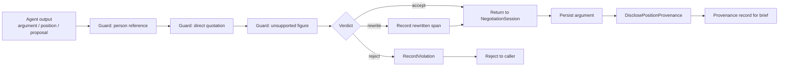
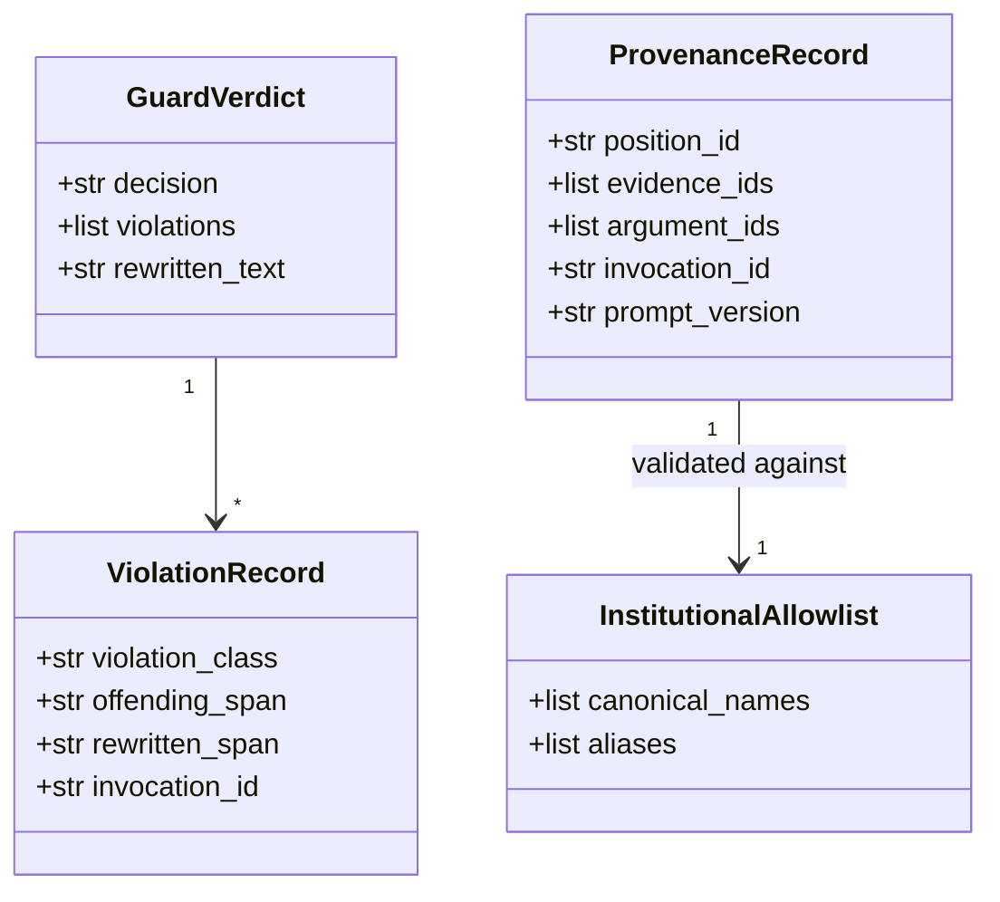
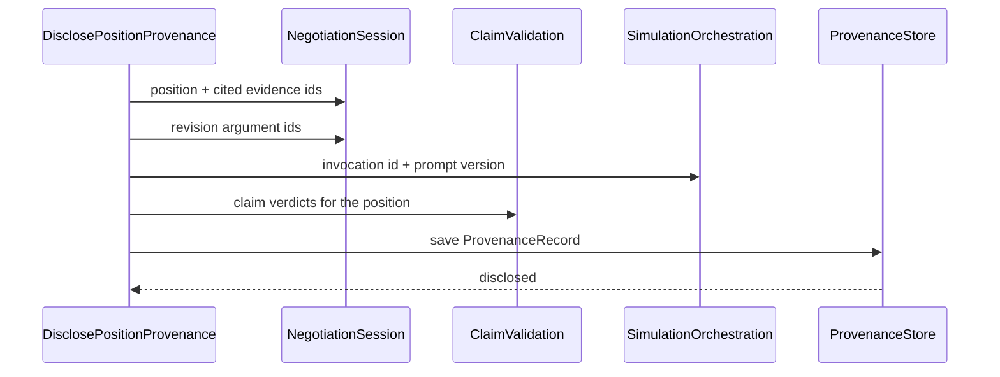
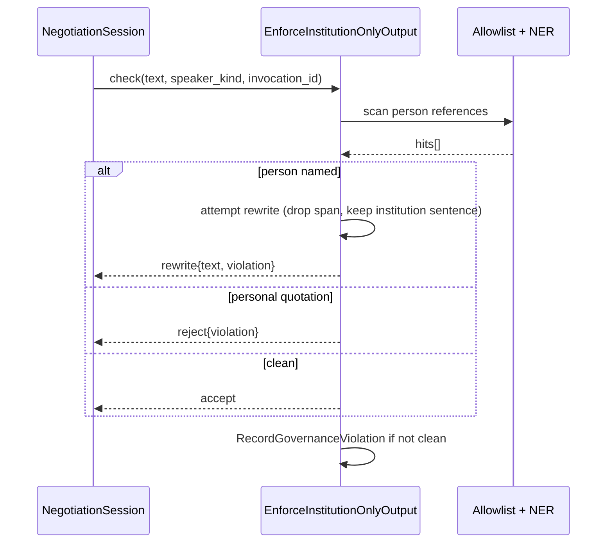

# GovernanceCompliance

## Module Status

**Status:** Planned
**Depends:** StakeholderModel (institutional allowlist), EvidenceCorpus (`speaker_kind` attribution), ClaimValidation (figure findings), SimulationOrchestration (invocation records)
**Last reviewed:** 2026-11-05
**Source session:** 87433e56-b1a2-4464-a232-2dc4fe6f9dfd

## Description

Enforces that only institutions are represented, that no real person is named or quoted, and that
every position can be explained by its sources, arguments and model invocation.

**Modeling Depth:** service (supporting subdomain)
**Subdomain Rationale:** Hard regulatory requirement from the challenge; enforcement must be explicit.
**Context Map:** anticorruption-layer → NegotiationSession (Guards agent output; rejects person-level references before persistence).

## Architecture

| Layer | Responsibility | Path |
|-------|--------------|------|
| **Domain** | — (none; ADR-008 forbids aggregates here) | `src/governance_compliance/domain/` |
| **Application** | `EnforceInstitutionOnlyOutput`, `DisclosePositionProvenance`, `RecordGovernanceViolation` | `src/governance_compliance/application/` |
| **Infrastructure** | NER adapter, rule engine, violation repository, provenance assembler | `src/governance_compliance/infrastructure/` |
| **Interfaces** | Guard port consumed by NegotiationSession; REST read endpoints | `src/governance_compliance/interfaces/` |

**Anti-corruption edge:** `GovernanceCompliance → NegotiationSession`. The guard is invoked *before*
any argument or position is persisted. It returns a verdict, never a mutated domain object.

## Related ADRs

| ADR | Relevance |
|---|---|
| ADR-007 Compliance Engine Architecture | Primary design: two-stage guard, deterministic checks, persisted violations |
| ADR-003 Cross-Context Communication | Guard sits in front of the negotiation write path |
| ADR-006 Cost Tracking | Rejected/rewritten outputs are still metered |
| ADR-008 Proportional Modeling Depth | Service depth: no aggregates, no domain events of its own |

## Diagrams

### Data Flow

### Entity Relationship

### Data Flow (provenance disclosure)

### Key Use Case Sequence — EnforceInstitutionOnlyOutput

## Service + Persistence Contract

| Operation | Reads | Writes | Idempotent |
|---|---|---|---|
| `EnforceInstitutionOnlyOutput` | allowlist, NER model, `speaker_kind` map | `governance_compliance_violation` | yes (keyed by `invocation_id` + span hash) |
| `DisclosePositionProvenance` | positions, arguments, invocations, verdicts | `governance_compliance_provenance` | yes (keyed by `position_id`) |
| `RecordGovernanceViolation` | — | `governance_compliance_violation` | yes (unique on `violation_hash`) |

**Persistence contract**

| Table | Columns (essential) | Ownership note |
|---|---|---|
| `governance_compliance_violation` | `id, violation_class, offending_span, rewritten_span, invocation_id, detected_at, rule_id` | Append-only; never updated |
| `governance_compliance_provenance` | `position_id, evidence_ids[], argument_ids[], invocation_id, prompt_version, model, disclosed_at` | Append-only; one per position per version |
| `governance_compliance_allowlist` | `canonical_name, kind, aliases[]` | Operator-curated, versioned |

## Components

**Service depth (ADR-008): no aggregates, no value objects, no domain events.** The module is
defined by its application services and its persistence contract above.

| Component | Layer | Responsibility |
|---|---|---|
| ``EnforceInstitutionOnlyOutput` / `DisclosePositionProvenance` / `RecordGovernanceViolation`` | application | Guard and provenance orchestration (catalog above) |
| `GuardRuleChain` (`GC-001`…`GC-005`) | domain (rules) | Deterministic rule evaluation returning accept / rewrite / reject |
| `ViolationStore`, `ProvenanceStore`, `AllowlistLoader` | infrastructure | Append-only persistence; keyed for idempotency |
| `require_scope` guarded routers | interfaces | Guard, violations, provenance, allowlist endpoints |

## Application Services (authoritative catalog)

| Service | Use case | Maps to FR |
|---|---|---|
| `EnforceInstitutionOnlyOutput` | Reject agent output that names or quotes real persons before it reaches persistence. | FR-025 |
| `DisclosePositionProvenance` | Produce the derivation record for each position: sources, arguments and model invocation reference. | FR-026 |
| `RecordGovernanceViolation` | Persist a rejected agent output with its violation class, the offending span and the rewrite that replaced it, so the transparency rule is provably enforced. | FR-025 |

**Additional helper (below the catalog, not a replacement):** `ValidateInstitutionalAllowlist` —
operator tool to check that all nine personas resolve to allowlist entries.

## Guard rules (service behaviour)

| Rule id | Check | Implementation | Verdict on hit |
|---|---|---|---|
| `GC-001` | Named person in agent output | NER `PERSON` + title patterns (`Dr.`, `Mag.`, `Prof.`, `Obmann`, `Präsident`) against allowlist | rewrite (drop span) |
| `GC-002` | Direct quotation attributed to a person | `speaker_kind == person` from corpus + quotation marks within ±3 sentences | reject |
| `GC-003` | Institution referenced by a person's name ("Minister X's ministry") | NER + institutional alias mapping | rewrite to canonical institution name |
| `GC-004` | Claim without citation presented as fact | absence of `passage_id` / `reference_figure_id` | rewrite to `unsupported` label |
| `GC-005` | Figure contradicted by `ReferenceFigure` | delegated to ClaimValidation verdict | reject figure |

**Deterministic by design.** Rule evaluation uses token rules + a fixed NER model. No LLM decides
compliance (ADR-007). Every verdict is reproducible for the same input.

## API Endpoints

| Method | Path | Handler | Input | Output | Auth |
|---|---|---|---|---|---|
| POST | `/api/v1/governance/check` | `enforce_institution_only_output` | `{text, speaker_kind, invocation_id}` | `{decision, violations[], rewritten_text?}` | `runs:write` |
| GET | `/api/v1/governance/violations` | `list_violations` | `?run_id&class` | violation records | `runs:read` |
| GET | `/api/v1/positions/{position_id}/provenance` | `get_position_provenance` | — | evidence + arguments + invocation + prompt version | `runs:read` |
| POST | `/api/v1/positions/{position_id}/provenance` | `disclose_position_provenance` | `{}` | `201 provenance record` | `runs:write` |
| GET | `/api/v1/governance/allowlist` | `list_allowlist` | — | institutions + aliases | `admin` |

## Ubiquitous Language

| Term | Definition |
|---|---|
| Institutional Representation | The rule that agents represent institutions, never natural persons |
| Guard Verdict | accept / rewrite / reject for one agent output |
| Violation Class | `person_named`, `personal_quotation`, `unsupported_fact`, `contradicted_figure` |
| Offending Span | Exact text fragment that triggered the guard |
| Rewritten Span | Replacement text when the verdict is rewrite |
| Institutional Allowlist | Curated set of legitimate institution names and aliases |
| Provenance Disclosure | Evidence + arguments + invocation behind one position |

## Dependencies

**Depends On:**

| Module | What it provides |
|---|---|
| StakeholderModel | Canonical institutional names and aliases — the allowlist source of truth |
| EvidenceCorpus | `speaker_kind` per passage, so personal quotations are identifiable |
| ClaimValidation | Figure verdicts for `GC-005` |
| SimulationOrchestration | `invocation_id`, model and prompt version for disclosure |

**Used By:**

| Consumer | What it provides |
|---|---|
| NegotiationSession | Pre-persistence guard + provenance disclosure gate |
| DecisionBrief | Disclosure presence required before publication |

## Implementation Sequence

1. Allowlist table + loader from StakeholderModel personas
2. `GC-001` rule + tests with a corpus of adversarial strings
3. `GC-002` quotation rule using `speaker_kind`
4. Rewrite path + `ViolationRecord` persistence
5. `EnforceInstitutionOnlyOutput` port for NegotiationSession (contract test)
6. `DisclosePositionProvenance` assembler
7. REST endpoints + read models
8. Adversarial regression suite (≥30 cases) run in CI

## Patterns & OOP Mapping

| Component | Pattern | Rationale |
|---|---|---|
| Guard rules | **Chain of Responsibility** | `GC-001 → GC-002 → …`; each rule may accept, rewrite or reject |
| Allowlist matching | **Specification** | `IsInstitutionName`, `HasPersonTitle`, `IsPersonAlias` combine cleanly |
| Guard output | **Result object** (`GuardVerdict`) | Explicit accept/rewrite/reject instead of exceptions as control flow |
| Provenance assembly | **Assembler / DTO** | Combines four sources into one immutable disclosure record |
| No aggregates | — | ADR-008 service depth: persistence contract instead of domain model |

**Explicitly rejected:** LLM-as-judge for compliance. It cannot be unit-tested, cannot be replayed
and can be argued with — three disqualifying properties for a compliance control.

## Wiring Contract

| Wiring point | Requirement | Proof |
|---|---|---|
| Router | `app.include_router(governance_compliance_router)` | boot test asserting registration |
| Composition | allowlist loaded from StakeholderModel at startup (fail fast if empty or containing a personal name); violation and provenance stores bound to their tables | startup test: empty allowlist aborts boot |
| Guard on the write path | `EnforceInstitutionOnlyOutput` is a **blocking** dependency of the negotiation write path; a missing guard must fail closed | negative test: guard unbound ⇒ argument write returns 5xx, never persists |
| Persistence | Migration `0303` applied; violations append-only and idempotent on `violation_hash` | restart + duplicate-retry test |
| Determinism | No LLM call in the guard path; rule version recorded per violation | unit test monkeypatching the LLM client to raise — guard must still work |
| Provenance | `DisclosePositionProvenance` reads invocations from SimulationOrchestration and verdicts from ClaimValidation | integration test: disclosure record complete for a real run |

## Acceptance Criteria

| # | Component | Criterion | Verify In |
|---|---|---|---|
| 1 | `GC-001` | "Dr. Müller sagte…" yields verdict `rewrite` or `reject`, never `accept` | unit |
| 2 | `GC-002` | A passage with `speaker_kind == person` inside quotation marks yields `reject` | unit |
| 3 | `GC-003` | "the minister's ministry" resolves to the canonical institution name or rejects | unit |
| 4 | `GC-004` | An uncited claim presented as fact is rewritten to `unsupported`, not accepted | unit |
| 5 | Determinism | Same input + same rule version yields the identical verdict (no model call in path) | unit |
| 6 | Violation persistence | Every non-accept verdict writes exactly one violation row, no duplicates on retry | integration |
| 7 | Provenance completeness | `DisclosePositionProvenance` fails if arguments, evidence or invocation are missing | integration |
| 8 | Adversarial suite | ≥30 adversarial strings all classified correctly; suite runs in CI | CI |
| 9 | Port contract | NegotiationSession cannot persist an argument without a guard verdict | integration |
| 10 | No domain model | Module contains no aggregates/VOs per ADR-008; validator passes | architecture |
| 11 | Wiring | Renamed guard is a blocking dependency of the negotiation write path; empty allowlist aborts boot; guard works with the LLM client patched to raise | integration |

## Modeling Depth Note (ADR-008)

This bounded context is a **supporting subdomain** — modelled at service/CRUD depth. Keep
implementation to application services + persistence. Do NOT introduce new aggregates, value
objects, or domain events beyond what this exploration captured.

**Anti-corruption edges:**
- GovernanceCompliance → NegotiationSession — guards agent output; rejects person-level references
  before persistence, and never returns a mutated domain object.
