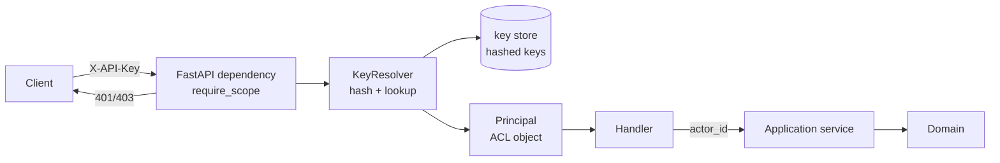
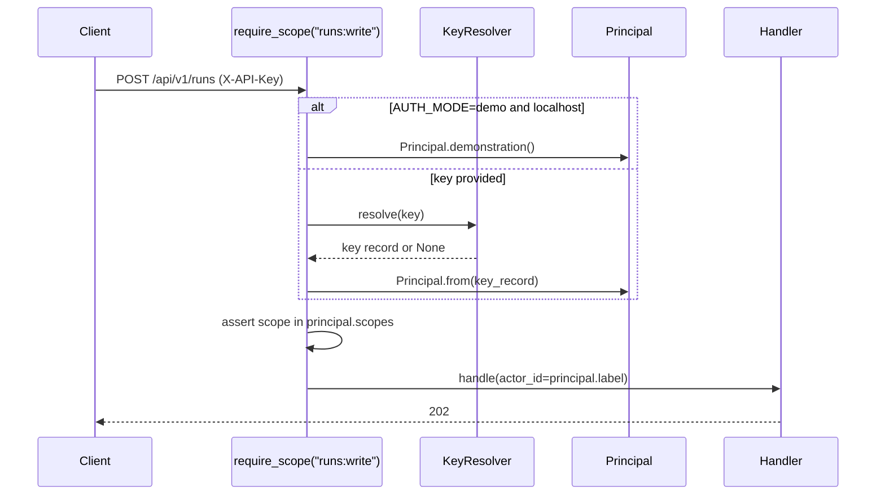
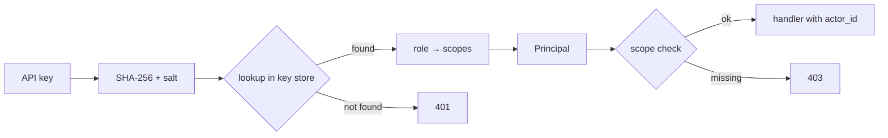
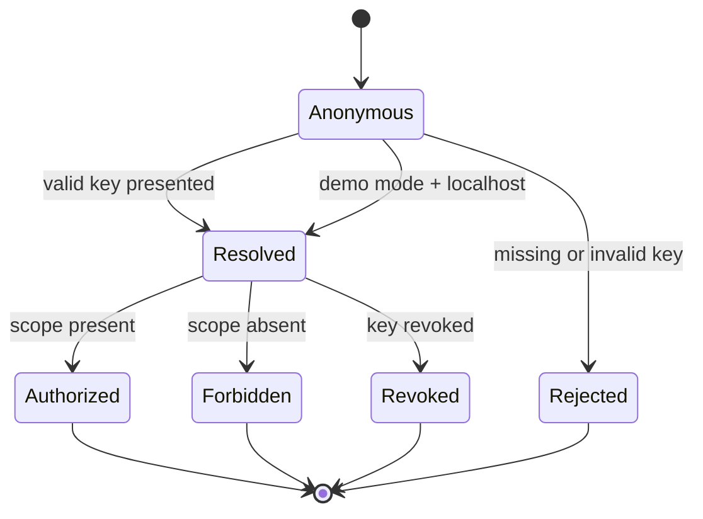

# IdentityAccess

## Module Status

**Status:** Contract frozen (2026-11-05)
**Depends:** — (none; generic adapter)
**Last reviewed:** 2026-11-05
**Source session:** 87433e56-b1a2-4464-a232-2dc4fe6f9dfd

## Description

Authentication and authorisation: API keys with scopes resolved to a principal, plus attribution of
commands to an actor.

**Modeling Depth:** adapter (generic subdomain)
**Subdomain Rationale:** Commodity capability, not a differentiator.
**Context Map:** — (generic; consumed as an infrastructure port by the API layer)

## Architecture

| Layer | Responsibility | Path |
|-------|--------------|------|
| **Domain** | — (adapter depth forbids domain modules) | `src/identity_access/domain/` (empty marker) |
| **Application** | — (adapter depth forbids application modules) | `src/identity_access/application/` (empty marker) |
| **Infrastructure** | Key hashing, key store, scope table, key resolver | `src/identity_access/infrastructure/` |
| **Interfaces** | Frozen ACL (`Principal`, `PrincipalPort`, DTOs, errors), `require_scope` contract, admin router | `src/identity_access/interfaces/` |

**Anti-corruption edge:** the auth layer produces a `Principal`; handlers translate it to an
`actor_id` string before calling any application service. No module ever imports API-key types.

## Related ADRs

| ADR | Relevance |
|---|---|
| ADR-005 Authentication & Authorization | Primary design: API keys + scopes + demo mode |
| ADR-006 Cost Tracking | Actor attribution on metered invocations |
| ADR-008 Proportional Modeling Depth | Adapter depth: no aggregates, no domain events |

## Diagrams

### Integration / ACL



### Sequence — authorised request in demo mode



## Components

**Adapter depth (ADR-008): no domain entities, no aggregates, no domain events.** The module is one
narrow port plus its adapters.

| Component | Layer | Responsibility |
|---|---|---|
| `PrincipalPort` / `Principal` | application (ACL) | The only published concept; resolves a credential to an actor |
| `KeyResolver` | infrastructure | Hash + lookup against the key store |
| `DemoResolver` | infrastructure | Localhost-only principal in `AUTH_MODE=demo` |
| `require_scope(...)` | interfaces | FastAPI dependency declaring the required scope per route |
| `ApiKeyStore` | infrastructure | Key generation, hashing, revocation |

### Data Flow — credential to actor



### Resolution State (not an aggregate — a request outcome)



## Interface + Anti-Corruption Layer

**Narrow interface the rest of the system consumes (only two things):**

```python
# src/identity_access/interfaces/types.py + ports.py (adapter depth; see ADR-008)
class PrincipalPort(Protocol):
    async def resolve(self, api_key: str | None) -> Principal: ...

@dataclass(frozen=True)
class Principal:
    label: str                 # actor identity used for attribution
    role: Role                 # analyst | operator | admin
    scopes: frozenset[str]
    is_demo: bool
```

**Translation (ACL):** the vendor/key-store shape (`key_id`, `key_hash`, `salt`, `scopes_csv`) never
leaves `infrastructure/`. `Principal` is the sole published concept.

| External concept | Internal concept | Translation rule |
|---|---|---|
| `X-API-Key` header | `api_key` argument | extracted by the FastAPI dependency |
| `key_record` row | `Principal` | label ← `key.label`, role/scopes parsed from the record |
| `AUTH_MODE` env | `Principal.is_demo` | `demo` + localhost ⇒ demo principal; otherwise 401 |
| Missing key | — | `401 unauthenticated`; mutating routes never default to anonymous |

**Vendor / implementation choice**

| Option | Decision | Rationale |
|---|---|---|
| Managed IdP (Keycloak, Auth0) | Deferred | Adds a service and a login UI the demo never shows (ADR-005) |
| Static hashed API keys in the database | **Adopted** | Zero external dependency, attribution works, swappable |
| `passlib`/`argon2` for hashing | Optional; SHA-256 + per-key salt is sufficient at this scope | Keys are high-entropy generated, not user-chosen passwords |
| OIDC later | Behind `PrincipalPort` | Replace only the adapter |

**Roles → scopes**

| Role | Scopes |
|---|---|
| `analyst` | `runs:read`, `runs:write`, `briefs:read` |
| `operator` | + `corpus:read`, `corpus:write`, `briefs:publish` |
| `admin` | `*` |

### Frozen contracts (2026-11-05)

The adapter-depth projection forbids Python modules in `domain/` and `application/`; the contract
lives in `interfaces/` and is implemented by `infrastructure/`. Fields are frozen — implementation
issues may fill bodies but must not rename or reshape these types.

| Contract | File | Frozen contents |
|---|---|---|
| Identity types | `src/identity_access/interfaces/types.py` | `Role` (analyst/operator/admin), `Scope` (7 values), `ROLE_SCOPES`, `ActorId`, `ResolutionState` (anonymous/resolved/authorized/forbidden/revoked/rejected), `Principal(label, role, scopes, is_demo; has_scope, actor_id)` |
| DTOs | `src/identity_access/interfaces/dto.py` | `ResolutionOutcome(state, principal, reason)`, `CreateApiKeyCommand(label, role)`, `IssuedApiKey(key_id, key[repr-hidden], label, role, created_at)`, `ApiKeySummary(key_id, label, role, created_at, revoked_at; is_active)`, `ReadinessCheck(name, ok, detail)`, `ReadinessReport(ready, checks)`, `LivenessReport(status, service, version)` |
| Attribution | `src/shared/attribution.py`, `src/identity_access/interfaces/http/dependencies.py` | `actor_scope`/`current_actor`; the guard binds `Principal.actor_id()` for the request and outbox writers prefer the request actor over `system` |
| Demo guard | `src/identity_access/interfaces/demo.py`, `src/identity_access/infrastructure/demo.py` | `is_loopback_host`, `demo_principal`, `LoopbackDemoPolicy.permits`; `AUTH_MODE=demo` + `ENV=production` is refused in `shared.config.Settings` |
| Resolution outcomes | `src/identity_access/interfaces/resolution.py` | `anonymous`, `resolved`, `authorized`, `forbidden(principal, scope)`, `revoked(reason)`, `rejected(reason)`; immutable request outcomes, never persisted |
| Ports | `src/identity_access/interfaces/ports.py` | `PrincipalPort.resolve(api_key)`, `ApiKeyAdminPort.create_key/list_keys/revoke_key`, `ReadinessPort.check`, `DemoModePolicy.permits(client_host)` |
| Errors | `src/identity_access/interfaces/errors.py` | `AUTHENTICATION_REQUIRED` → `UNAUTHENTICATED` (401), `SCOPE_REQUIRED` (403), `API_KEY_NOT_FOUND` (404) |
| HTTP | `src/identity_access/interfaces/http/dependencies.py`, `.../deps.py`, `.../schemas.py`, `.../router.py` | `require_scope(scope)` guard, `get_api_key_admin` dependency; `CreateApiKeyRequest`, `IssuedApiKeyResponse`, `ApiKeySummaryResponse`; admin routes below are implemented against `ApiKeyAdminPort` |
| Key store | `src/identity_access/infrastructure/keys.py`, `src/identity_access/infrastructure/key_store.py`, `src/identity_access/infrastructure/key_resolver.py`, `src/identity_access/infrastructure/repository/models.py`, `src/identity_access/infrastructure/repository/sqlalchemy.py`, `src/identity_access/infrastructure/repository/records.py`, `.../ports.py`, `src/identity_access/infrastructure/resolvers.py` | `Sha256ApiKeyFactory`/`hash_key`, `HashedApiKeyStore`, `KeyResolver`, `ApiKeyRow`/`SqlAlchemyApiKeyRepository`, `ApiKeyRecord`, `ApiKeyRepository`, `StaticPrincipalResolver`; migration `0104_identity_access` owns `identity_access_api_key`; only hash+salt persisted; secrets are `repr=False` |
| Composition | `src/identity_access/composition.py` | `IdentityAccessContainer(principal_port, api_key_admin, readiness, demo_policy)`; `build_identity_access_container(settings, database)` |

Resolution is a request outcome, not an aggregate: `ResolutionState` is never persisted and no
domain event is published (ADR-008). The only published concept is `Principal`; `ApiKeyRecord`,
`KeyMaterial` and the repository port are key-store types that never leave `infrastructure/`.

## Application Services (authoritative catalog)

None captured in the exploration (generic subdomain). The only application service is the narrow
`ResolvePrincipal` adapter implemented through `PrincipalPort`; it is deliberately not part of the
domain catalog.

## API Endpoints

| Method | Path | Handler | Input | Output | Auth |
|---|---|---|---|---|---|
| GET | `/healthz` | liveness | — | `{status}` | none |
| GET | `/readyz` | readiness (DB, LLM reachability) | — | `{status, service, checks{database, llm}}`; 503 envelope on failure | none |
| POST | `/api/v1/admin/keys` | `create_api_key` | `{label, role}` | `201 {key}` (shown once) | `admin` |
| GET | `/api/v1/admin/keys` | `list_api_keys` | — | `[{key_id, label, role, created_at}]` | `admin` |
| DELETE | `/api/v1/admin/keys/{key_id}` | `revoke_api_key` | — | `204` | `admin` |

## Ubiquitous Language

| Term | Definition |
|---|---|
| Principal | Resolved actor: label, role, scopes, demo flag |
| Scope | Permission token checked per route (`runs:write`, `corpus:read`, …) |
| Role | Named scope bundle (analyst / operator / admin) |
| Demo Mode | Localhost-only relaxation allowing an anonymous analyst principal |
| Actor Id | The label recorded on events and invocations for attribution |

## Dependencies

**Depends On:** none.

**Used By:** every module's interface layer (through `PrincipalPort`); SimulationOrchestration and
GovernanceCompliance for actor attribution.

## Implementation Sequence

1. `Principal`, `Role`, scope table
2. Key generation + hashing + `key` table
3. `PrincipalPort` adapter + `require_scope` dependency
4. Demo-mode guard with production refusal at startup
5. Admin endpoints for key lifecycle
6. Contract tests: every mutating route rejects without scope
7. Architecture test: no module imports `infrastructure` key types

## Patterns & OOP Mapping

| Component | Pattern | Rationale |
|---|---|---|
| `PrincipalPort` | **Port + Adapter** | Vendor swap without touching call sites |
| `require_scope(...)` | **Decorator / dependency injection** | Scope declared at the route, enforced centrally |
| `Principal` | **Immutable value object (ACL)** | Never mutated by handlers; equal by content |
| Key resolution | **Strategy** (`KeyResolver`, `DemoResolver`) | Two resolution modes behind one interface |
| No aggregates | — | ADR-008 adapter depth: no domain model |

## Wiring Contract

| Wiring point | Requirement | Proof |
|---|---|---|
| Dependency | `require_scope(...)` applied to **every non-health route** of every context; OpenAPI `x-required-scope` alone is documentation, not enforcement | meta-test: iterating `app.routes`, every `/api/v1/...` route declares a scope and rejects an unscoped principal |
| Composition | key store bound to migration `0104`; `AUTH_MODE` resolved once at startup | boot test for `strict` and `demo` |
| Demo guard | `AUTH_MODE=demo` + `ENV=production` refuses to boot | startup test |
| Attribution | `Principal.label` flows into every command's `actor` and into `agent_invocation` | integration test: event actor is non-empty |
| ACL isolation | no module outside `identity_access/infrastructure` imports key-store types | architecture test |

## Acceptance Criteria

| # | Component | Criterion | Verify In |
|---|---|---|---|
| 1 | Anonymous rejection | Without a key in `strict` mode, every mutating route returns `401` | contract test |
| 2 | Scope enforcement | An `analyst` key calling `POST /corpus/documents` returns `403` | contract test |
| 3 | Demo guard | `AUTH_MODE=demo` with `ENV=production` refuses to boot with a clear error | unit |
| 4 | Key secrecy | Keys are stored hashed; the plaintext is returned exactly once and never logged | unit |
| 5 | Attribution | Every command event carries a non-empty `actor` label | integration |
| 6 | ACL isolation | No module outside `identity_access/infrastructure` imports key-store types | architecture test |
| 7 | Revocation | A revoked key returns `401` immediately on the next request | integration |
| 8 | Health endpoints | `/healthz` and `/readyz` need no auth and report DB + LLM reachability | integration |
| 9 | Wiring | Meta-test: every `/api/v1` route declares a scope and rejects an unscoped principal; boot refuses `demo` + `production` | contract test |

## Modeling Depth Note (ADR-008)

This bounded context is a **generic subdomain** — model at adapter depth. Integrate an
off-the-shelf / vendor / OSS solution behind an anti-corruption layer. Do NOT write domain entities
or aggregates here.
