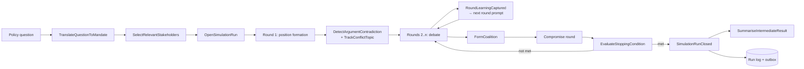
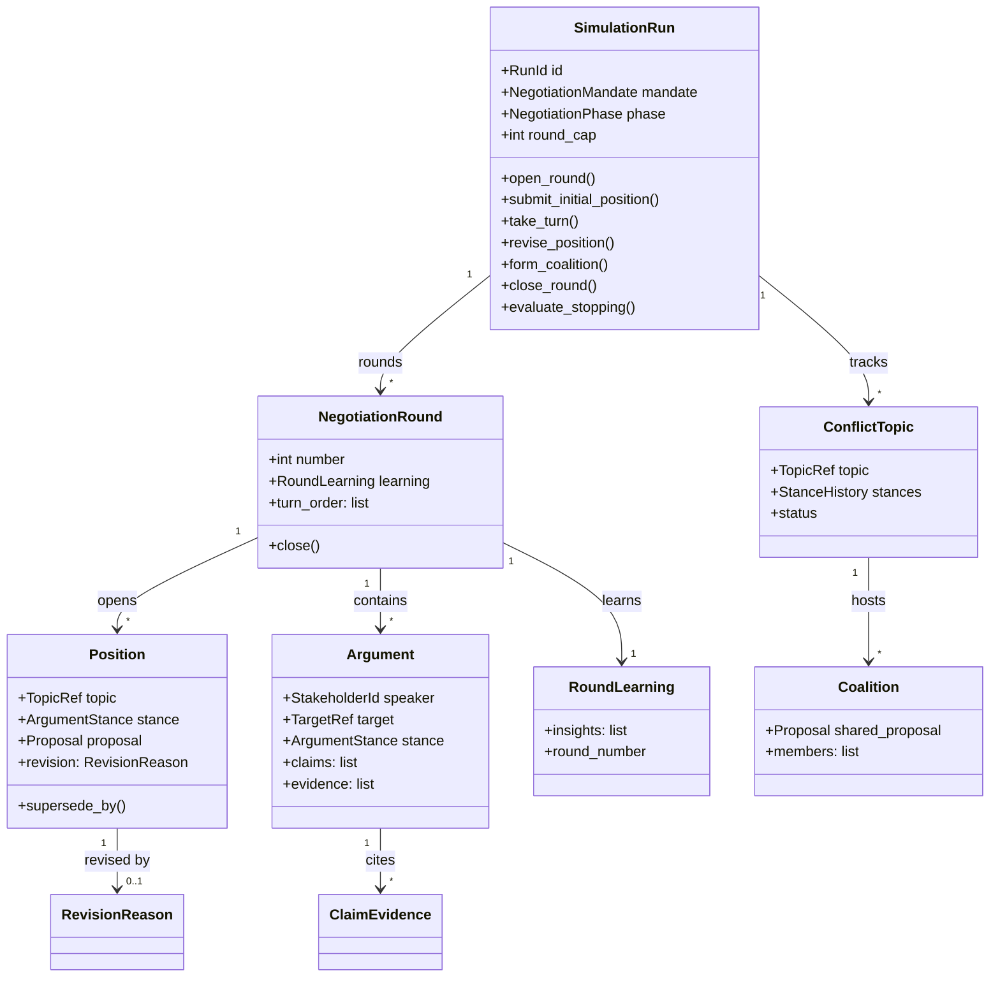
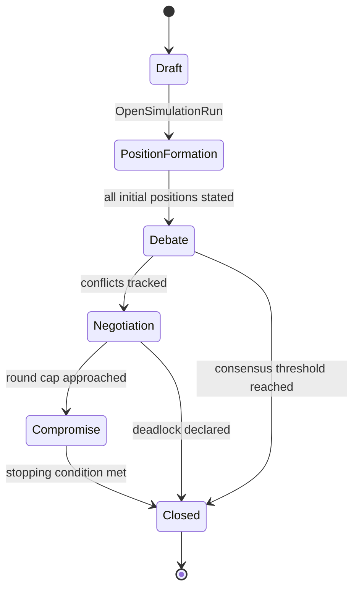
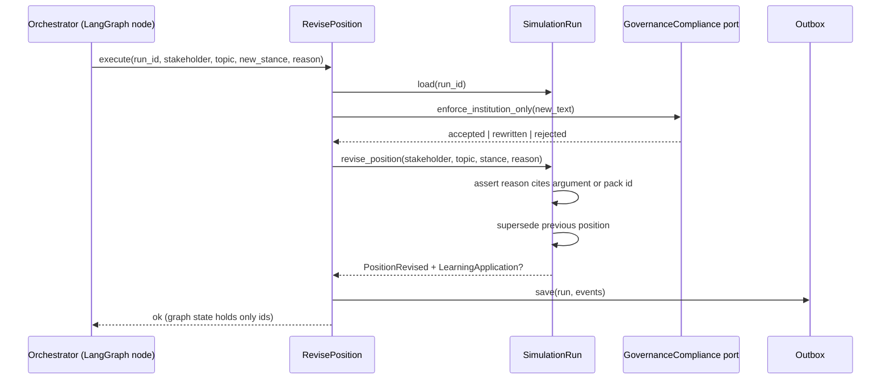

# NegotiationSession

## Module Status

**Status:** Contract Frozen (implementation pending)
**Depends:** EvidenceRetrieval (ACL — `EvidencePack` → `ClaimEvidence`), StakeholderModel (partnership — `StakeholderProfileView`), ClaimValidation (partnership — verdicts gate claims), GovernanceCompliance (ACL — output guard), SimulationOrchestration (ACL — command invocation)
**Last reviewed:** 2026-11-06
**Source session:** 87433e56-b1a2-4464-a232-2dc4fe6f9dfd

## Description

The heart of the domain: a policy question becomes a mandate, stakeholders take turns, argue with
evidence, revise positions, form coalitions and the run closes under an explicit stopping condition.

**Modeling Depth:** tactical (core domain)
**Subdomain Rationale:** The negotiation state machine and its invariants are the heart of the domain.
**Context Map:** EvidenceRetrieval → ACL; StakeholderModel → partnership; open-host → ConsensusAnalysis; ClaimValidation → partnership; GovernanceCompliance → ACL; SimulationOrchestration → ACL.

## Contract Freeze (issue #282)

All public interfaces for this epic are frozen before implementation. The frozen surface lives in:

| Surface | File |
|---|---|
| Value objects, enums, ids and the vector-free `ClaimEvidence` | `src/negotiation_session/domain/values.py` |
| Owned entities (`NegotiationMandate`, `Position`, `Argument`, `ConflictTopic`, `Coalition`, `CoalitionOffer`, `RoundLearning`, `NegotiationRound`) | `domain/entities.py` |
| `SimulationRun` aggregate commands and guards | `domain/simulation_run.py` |
| Domain services (`EvaluateStoppingCondition`, `DetectArgumentContradiction`, turn-order strategies) | `domain/services.py` |
| Domain events, `LoggedEvent` and the event union | `domain/events.py` |
| Stable error codes | `domain/errors.py` |
| Repository ports (`SimulationRunRepository`, `RunEventLog`) | `domain/repositories.py` (re-exported by `infrastructure/repository/ports.py`) |
| Commands and result DTOs / read projections | `application/commands.py`, `application/dto.py` |
| Service interfaces and classification | `application/services.py` (`SERVICE_CLASSIFICATION`) |
| ACL and technical ports | `application/ports.py` |
| SSE frame contract | `application/progress.py` |
| ACL mappers (evidence, stakeholder, claim verdict, guard) | `infrastructure/acl.py` |
| Concrete HTTP router and schemas | `interfaces/http/router.py`, `interfaces/http/schemas.py` |
| Published views for other contexts | `interfaces/published.py` |
| Composition factory and container | `composition.py` |

**Frozen API:** `POST /api/v1/runs` (202), `GET /api/v1/runs/{run_id}`,
`GET /api/v1/runs/{run_id}/events`, `GET /api/v1/runs/{run_id}/rounds`,
`POST /api/v1/runs/{run_id}/positions` (201), `POST /api/v1/runs/{run_id}/turns` (201),
`POST /api/v1/runs/{run_id}/positions/{position_id}:revise` (200),
`POST /api/v1/runs/{run_id}/abstentions` (204), `GET /api/v1/runs/{run_id}/conflicts`,
`POST /api/v1/runs/{run_id}/coalitions` (201), `GET /api/v1/runs/{run_id}/learning`,
`GET /api/v1/runs/{run_id}/stream` (SSE). Write routes require `runs:write`; read/stream routes
require `runs:read`.

**Error codes:** `SIMULATION_RUN_NOT_FOUND`, `POSITION_NOT_FOUND`, `ROUND_NOT_FOUND`,
`PHASE_REGRESSION`, `CLOSED_RUN_IMMUTABLE`, `ROUND_STILL_OPEN`, `ROUND_CLOSE_GUARD_VIOLATION`,
`ROUND_LEARNING_MISSING`, `REVISION_WITHOUT_CAUSE`, `ARGUMENT_WITHOUT_EVIDENCE`,
`TURN_NOT_AVAILABLE`, `DUPLICATE_TURN`, `ROUND_CAP_EXCEEDED`, `COALITION_WITHOUT_OFFER`,
`INVALID_COALITION_OFFER_TRANSITION`, `STAKEHOLDER_NOT_BOUND`, `CLAIM_VERDICT_REJECTED`,
`GOVERNANCE_GUARD_UNAVAILABLE`.

**ACL note:** the aggregate binds `StakeholderBinding` rather than importing
`StakeholderProfileView` directly, so `domain/` imports no other context's layers (the
`check_ddd_structure.sh` dependency-direction guard). `infrastructure/acl.py` owns both mappings:
`EvidencePackView → ClaimEvidence` and `StakeholderProfileView → StakeholderBinding`.

**Freeze policy:** signatures, field names, enum values, event payloads, route paths and status
codes are additive-only. Renaming or removing a frozen member requires a new freeze entry. Service,
entity and mapper bodies raise `NotImplementedError` naming their implementing issue until that
issue lands.

## Architecture

| Layer | Responsibility | Path |
|-------|--------------|------|
| **Domain** | `SimulationRun` aggregate, rounds, positions, arguments, conflicts, coalitions, learning | `src/negotiation_session/domain/` |
| **Application** | 12 catalog services (below) | `src/negotiation_session/application/` |
| **Infrastructure** | SQLAlchemy repositories, outbox writer, ACL mappers, LLM-invocation port consumer | `src/negotiation_session/infrastructure/` |
| **Interfaces** | REST routers, SSE publisher, `ClaimEvidence` ACL, event subscribers | `src/negotiation_session/interfaces/` |

**The run is the consistency boundary.** Every invariant below is enforced inside one aggregate
transaction; nothing in this module is eventually consistent with itself.

## Related ADRs

| ADR | Relevance |
|---|---|
| ADR-001 Architecture Pattern | Domain owns state; no framework types in `domain/` |
| ADR-002 Data Storage Strategy | One aggregate per transaction; append-only run log for replay |
| ADR-003 Cross-Context Communication | Graph orchestrates, domain decides; events published via outbox |
| ADR-004 API Design | `202` + SSE for live runs, `Last-Event-ID` replay |
| ADR-006 Cost Tracking | Arguments reference the `AgentInvocation` that produced them |
| ADR-007 Compliance Engine | Pre-persistence guard hook before any argument is stored |

## Diagrams

### Data Flow



### Entity Relationship



### Aggregate State (SimulationRun)



### Key Use Case Sequence — RevisePosition



## Components

### Aggregate root — SimulationRun

```python
# src/negotiation_session/domain/simulation_run.py
@dataclass
class SimulationRun:
    id: RunId
    mandate: NegotiationMandate
    phase: NegotiationPhase
    round_cap: int
    bound: dict[StakeholderId, StakeholderProfileView]
    rounds: list[NegotiationRound] = field(default_factory=list)
    conflicts: dict[TopicRef, ConflictTopic] = field(default_factory=dict)
    events: list[DomainEvent] = field(default_factory=list)

    def open_round(self) -> NegotiationRound:
        self._assert_can_advance()
        if self.rounds and not self.rounds[-1].is_closed:
            raise RoundStillOpen(self.id, self.rounds[-1].number)
        round_ = NegotiationRound.open(
            number=len(self.rounds) + 1,
            turn_order=self._turn_order(),
            learning=self._carry_learning(),
        )
        self.rounds.append(round_)
        self.events.append(RoundOpened(self.id, round_.number))
        return round_

    def submit_initial_position(self, stakeholder: StakeholderId, topic: TopicRef,
                                stance: ArgumentStance, proposal: Proposal,
                                evidence: list[ClaimEvidence]) -> Position:
        self._assert_phase(NegotiationPhase.POSITION_FORMATION)
        self._assert_bound(stakeholder)
        if not evidence:
            raise ArgumentWithoutEvidence(self.id, stakeholder)
        position = Position.initial(stakeholder, topic, stance, proposal, evidence)
        self._current_round().record_position(position)
        self.events.append(InitialPositionStated(self.id, stakeholder, topic, stance))
        return position

    def take_turn(self, stakeholder: StakeholderId, target: TargetRef,
                  stance: ArgumentStance, text: str,
                  claims: list[Claim], evidence: list[ClaimEvidence]) -> Argument:
        round_ = self._current_round()
        round_.assert_turn_available(stakeholder, target.topic)
        if not evidence and not claims_unverified(claims):
            raise ArgumentWithoutEvidence(self.id, stakeholder)
        argument = Argument.new(stakeholder, target, stance, text, claims, evidence)
        round_.record_argument(argument)
        self.events.append(ArgumentSubmitted(self.id, argument.id, stakeholder, stance,
                                             len(evidence)))
        return argument

    def revise_position(self, stakeholder: StakeholderId, topic: TopicRef,
                        stance: ArgumentStance, reason: RevisionReason) -> Position:
        self._assert_bound(stakeholder)
        if not reason.cites(self._arguments_and_packs()):
            self.events.append(PositionRevisionRejected(self.id, stakeholder, reason))
            raise RevisionWithoutCause(self.id, stakeholder)
        revised = self._open_position(stakeholder, topic).supersede(stance, reason)
        self.events.append(PositionRevised(self.id, stakeholder, topic, stance,
                                           reason.argument_ids, reason.pack_ids))
        return revised

    def close_round(self, learning: RoundLearning) -> None:
        round_ = self._current_round()
        round_.assert_everyone_accounted_for()      # turn or abstention recorded
        round_.attach_learning(learning)
        round_.close()
        self.events.append(RoundLearningCaptured(self.id, round_.number, len(learning.insights)))
        self.events.append(RoundClosed(self.id, round_.number))

    def evaluate_stopping(self, consensus: ConsensusLevel) -> StoppingCondition:
        condition = StoppingCondition.evaluate(
            consensus=consensus,
            rounds_done=len(self.rounds),
            round_cap=self.round_cap,
            deadlocked=self._is_deadlocked(),
        )
        if condition.fired:
            self.phase = NegotiationPhase.CLOSED
            self.events.append(SimulationRunClosed(self.id, condition.name, len(self.rounds)))
        return condition
```

**Invariants:**

| # | Invariant | Illegal state prevented |
|---|---|---|
| 1 | A round cannot close until every bound stakeholder took a turn or is recorded as abstaining | Silent skipping to manufacture consensus |
| 2 | A position cannot be revised without a reason citing at least one argument or pack id | Arbitrary opinion flips |
| 3 | An argument cites at least one evidence pack, or is marked unsupported and flagged | Evidence-free assertions as justified input |
| 4 | One open position per (stakeholder, topic); revision supersedes | Contradictory simultaneous stances |
| 5 | A closed run is immutable; further analysis is a projection | Post-hoc editing of outcomes |
| 6 | A coalition contains only stakeholders and publishes one explicit shared proposal | Vague bloc voting |
| 7 | Round count may not exceed the cap; exceeding forces terminal evaluation | Endless negotiation |
| 8 | One turn per stakeholder per round; no out-of-turn or duplicate turns on a topic | Turn-order manipulation |
| 9 | Phase transitions are monotonic | Looping back to erase commitments |
| 10 | A proposal component is quantified or declared unquantified; unquantified cannot enter impact | Figures built on uncosted measures |
| 11 | Coalition membership requires an accepted `CoalitionOffer` | Retroactive claims of support |
| 12 | Every round persists a `RoundLearning` before the next opens | Repeating failed arguments |
| 13 | A `LearningApplication` cites the `RoundLearning` it derives from | Invented lessons justifying revision |
| 14 | `RoundLearning` derives only from this run's arguments | Cross-run contamination |

**Domain-owned repositories:**

```python
# src/negotiation_session/domain/repositories.py
class SimulationRunRepository(Protocol):
    async def get(self, run_id: RunId) -> SimulationRun | None: ...
    async def save(self, run: SimulationRun) -> None: ...   # also writes outbox rows

class RunEventLog(Protocol):
    """Append-only; supports ReplaySimulationHistory."""
    async def append(self, run_id: RunId, events: list[DomainEvent]) -> None: ...
    async def read(self, run_id: RunId, until_round: int | None = None) -> list[DomainEvent]: ...
```

### Owned entities and value objects

| Concept | Kind | Justification |
|---|---|---|
| `NegotiationMandate` | entity | Identity persists (run's contract), immutable after `OpenSimulationRun` |
| `NegotiationRound` | entity | Numbered identity within the run |
| `Position` | entity | Identity persists across revisions; superseded rather than overwritten |
| `Argument` | entity | Immutable once submitted; identity = argument id |
| `ConflictTopic` | entity | Tracked across rounds with stance history |
| `Coalition` | entity | Members change while forming; identity persists |
| `CoalitionOffer` | entity | Invitation lifecycle (offered → accepted/declined) |
| `RoundLearning` | entity | Per-round identity; immutable content |
| `NegotiationPhase` | VO | Enum-like; monotonic state label |
| `TurnAssignment` | VO | Order + topic + outcome; equal by value |
| `Proposal` | VO | Structured measure bundle; comparable across agents |
| `ProposalComponent` | VO | One admissible part with its own support record |
| `ArgumentStance` | VO | support / oppose / qualify / conditional-accept |
| `RevisionReason` | VO | Cited argument ids + pack ids + stated driver |
| `StoppingCondition` | VO | Named terminal rule with its parameters |
| `LearningApplication` | VO | Link from later argument to insight applied |
| `LearningInsightType` | VO | Classification of the lesson |

### Service classification

| Service | Layer | Why |
|---|---|---|
| `OpenSimulationRun` | application | Transaction boundary; creates aggregate |
| `SubmitInitialPosition`, `TakeNegotiationTurn`, `RevisePosition` | application | Load-mutate-save per aggregate |
| `TrackConflictTopic`, `FormCoalition` | application | Orchestrate cross-entity changes inside the run |
| `EvaluateStoppingCondition` | domain service | Pure rule evaluation over run state |
| `RecordAbstention` | application | Records absence of a turn |
| `TranslateQuestionToMandate` | application | Moderator policy; LLM-assisted, validated |
| `SelectRelevantStakeholders` | application | Delegates to StakeholderModel |
| `DetectArgumentContradiction` | domain service | Claim comparison within/across arguments |
| `SummariseIntermediateResult` | application | Projects round state for the moderator |
| `ReplaySimulationHistory` | application | Folds the event log |
| Turn order policy | domain service | Strategy (round-robin, weighted by power, affected-first) |
| Outbox writer, ACL mappers | infrastructure | Technical concerns |

## Domain Events

| Event | Description | Trigger | Payload | Published By |
|---|---|---|---|---|
| `SimulationRunOpened` | Run created from a mandate with pinned snapshot and bound stakeholders | `OpenSimulationRun` | `run_id, mandate_hash, snapshot_id, stakeholder_ids[]` | NegotiationSession |
| `RoundOpened` | A round started with its turn order and carried learning | `TakeNegotiationTurn` | `run_id, round, turn_order[], phase` | NegotiationSession |
| `InitialPositionStated` | A stakeholder opened its evidenced starting position | `SubmitInitialPosition` | `run_id, round, stakeholder_id, topic, stance, evidence_ids[]` | NegotiationSession |
| `ArgumentSubmitted` | A stakeholder contributed an argument with stance, claims and citations | `TakeNegotiationTurn` | `run_id, round, argument_id, stakeholder_id, target, stance, evidence_ids[], invocation_id` | NegotiationSession |
| `PositionRevised` | A position changed with a recorded reason | `RevisePosition` | `run_id, stakeholder_id, topic, stance, reason{argument_ids, pack_ids}, from_stance` | NegotiationSession |
| `PositionRevisionRejected` | A change was refused for lack of causal reason | `RevisePosition` | `run_id, stakeholder_id, topic, reason_code` | NegotiationSession |
| `ConflictTopicOpened` | Divergence was formalised as a tracked conflict | `TrackConflictTopic` | `run_id, topic, stances{stakeholder→stance}` | NegotiationSession |
| `CoalitionFormed` | Stakeholders aligned behind one shared proposal | `FormCoalition` | `run_id, topic, coalition_id, members[], proposal` | NegotiationSession |
| `CoalitionOffered` | An institution invited another to join a shared proposal | `FormCoalition` | `run_id, coalition_id, invited_id, conditions` | NegotiationSession |
| `CoalitionOfferDeclined` | An invited institution refused, with reason | `FormCoalition` | `run_id, coalition_id, stakeholder_id, reason` | NegotiationSession |
| `RoundClosed` | All turns completed; convergence measured | `TakeNegotiationTurn` | `run_id, round, convergence, evidence_count` | NegotiationSession |
| `RoundLearningCaptured` | A round's outcomes were distilled for the next round | `TakeNegotiationTurn` | `run_id, round, insight_count, insight_types[]` | NegotiationSession |
| `LearningApplied` | A stakeholder explicitly applied a captured insight | `RevisePosition` | `run_id, stakeholder_id, insight_type, learning_round, argument_id` | NegotiationSession |
| `NegotiationPhaseAdvanced` | Run entered the next phase; admissible commands changed | `EvaluateStoppingCondition` | `run_id, from_phase, to_phase` | NegotiationSession |
| `SimulationRunClosed` | Run terminated because a stopping condition fired | `EvaluateStoppingCondition` | `run_id, condition, rounds, final_phase` | NegotiationSession |

**ADR-008 triage**

| Event | Expert cares | Crosses boundary | Audit | Verdict |
|---|---|---|---|---|
| `SimulationRunOpened` | yes | yes | yes | publish |
| `InitialPositionStated` | yes | yes | yes | publish |
| `ArgumentSubmitted` | yes | yes | yes | publish |
| `PositionRevised` | yes | yes | yes | publish (the transparency centrepiece) |
| `PositionRevisionRejected` | yes | no | yes | publish (proves the rule is enforced) |
| `ConflictTopicOpened` | yes | yes | yes | publish |
| `CoalitionFormed` | yes | yes | yes | publish |
| `CoalitionOffered` / `Declined` | yes | yes | yes | publish (consensus accounting) |
| `RoundLearningCaptured` / `LearningApplied` | yes | yes | yes | publish (required capability) |
| `SimulationRunClosed` | yes | yes | yes | publish |
| `RoundOpened` / `RoundClosed` | no | yes | yes | publish (UI + replay) |
| `NegotiationPhaseAdvanced` | yes | yes | yes | publish |

## API Endpoints

| Method | Path | Handler | Input | Output | Auth |
|---|---|---|---|---|---|
| POST | `/api/v1/runs` | `open_simulation_run` | `{question, round_cap?, stakeholder_ids?}` | `202 {run_id, mandate, bound[]}` | `runs:write` |
| GET | `/api/v1/runs/{run_id}` | `get_run` | — | run state, phase, round, cost summary | `runs:read` |
| GET | `/api/v1/runs/{run_id}/events` | `replay_simulation_history` | `?until_round` | ordered domain events | `runs:read` |
| GET | `/api/v1/runs/{run_id}/rounds` | `list_rounds` | `?cursor` | rounds + learning summaries | `runs:read` |
| POST | `/api/v1/runs/{run_id}/positions` | `submit_initial_position` | `{stakeholder_id, topic, stance, proposal, evidence_ids[]}` | `201 position` | `runs:write` |
| POST | `/api/v1/runs/{run_id}/turns` | `take_negotiation_turn` | `{stakeholder_id, target, stance, text, claims[], evidence_ids[]}` | `201 argument` | `runs:write` |
| POST | `/api/v1/runs/{run_id}/positions/{position_id}:revise` | `revise_position` | `{stance, reason{argument_ids[], pack_ids[], driver}}` | `200 revised position` or `422 revision_without_cause` | `runs:write` |
| POST | `/api/v1/runs/{run_id}/abstentions` | `record_abstention` | `{stakeholder_id, topic}` | `204` | `runs:write` |
| GET | `/api/v1/runs/{run_id}/conflicts` | `list_conflict_topics` | `?status` | conflicts + stances | `runs:read` |
| POST | `/api/v1/runs/{run_id}/coalitions` | `form_coalition` | `{topic, member_ids[], proposal}` | `201 coalition` | `runs:write` |
| GET | `/api/v1/runs/{run_id}/learning` | `list_round_learning` | — | per-round insights | `runs:read` |
| GET | `/api/v1/runs/{run_id}/stream` | SSE publisher | `Last-Event-ID` | `text/event-stream` | `runs:read` |

## Ubiquitous Language

| Term | Definition | Aliases prohibited |
|---|---|---|
| Simulation Run | One end-to-end negotiation over one policy question | session, job, simulation |
| Negotiation Mandate | Moderator framing: objective, constraints, actors, rules, stopping conditions | brief, task, setup |
| Negotiation Round | Numbered turn cycle closed by the moderator with a learning record | iteration, cycle |
| Negotiation Phase | Monotonic stage from position formation to closure | stage, step |
| Turn Assignment | A stakeholder's floor in a round: order, topic, outcome | slot, speaking-order |
| Position | A stakeholder's current evidenced stance on a conflict topic, with lineage | opinion, view, stance |
| Argument | One turn's reasoned contribution: stance, claims, citations | message, utterance, chat-line |
| Proposal | Structured measure bundle: measure, effect, population, cost | plan, option |
| Proposal Component | One admissible part of a proposal with its own support record | building-block, item |
| Conflict Topic | Formalised point of institutional disagreement tracked across rounds | issue, disagreement, gap |
| Coalition | Stakeholders aligned behind one explicit shared proposal | alliance, bloc |
| Coalition Offer | Recorded invitation with conditions and accept/decline outcome | invitation, ask |
| Revision Reason | Structured justification citing arguments and evidence that caused a change | explanation, rationale |
| Round Learning | Persisted digest of a round's outcomes consumed in the next round | reflection, memory, lessons |
| Learning Application | Explicit reference from a later turn to the insight that caused it | applied-lesson, adaptation |
| Stopping Condition | The named rule that terminated the run | exit-criterion, termination-rule |

## Dependencies

**Depends On:**

| Module | What it provides |
|---|---|
| EvidenceRetrieval | `EvidencePackView` → ACL-mapped `ClaimEvidence` (no raw hits, no vectors) |
| StakeholderModel | `StakeholderProfileView` (interests, constraints, red lines, persona version) |
| ClaimValidation | Verdicts gating claims before an argument is accepted |
| GovernanceCompliance | Pre-persistence guard for agent output |
| SimulationOrchestration | Command invocation from graph nodes; invocation ids for arguments |

**Used By:**

| Consumer | What it provides |
|---|---|
| ConsensusAnalysis | Published events: positions, arguments, conflicts, coalitions, closure |
| DecisionBrief | Full history for the eight sections |
| SimulationOrchestration | Phase/round state for sequencing decisions |
| GovernanceCompliance | Positions and arguments requiring provenance disclosure |

## Implementation Sequence

1. Value objects: `NegotiationPhase`, `ArgumentStance`, `Proposal`, `ProposalComponent`, `RevisionReason`, `StoppingCondition`, `TurnAssignment`
2. `SimulationRun` skeleton + phase monotonicity tests
3. Round lifecycle: `open_round`, turn availability, abstention, `close_round`
4. `Position` with supersede semantics + revision-without-cause rejection
5. `Argument` + evidence requirement + unsupported flag
6. `ConflictTopic` tracking with stance history
7. `Coalition` + `CoalitionOffer` accept/decline
8. `RoundLearning` capture + carry-forward + `LearningApplication`
9. `EvaluateStoppingCondition` (consensus, cap, deadlock) 
10. Repository + outbox + event log
11. ACL: `EvidencePackView` → `ClaimEvidence`; `ClaimValidation` verdict gate
12. REST routers + SSE publisher
13. `ReplaySimulationHistory` fold + equivalence test against live state

## Patterns & OOP Mapping

| Component | Pattern | Rationale |
|---|---|---|
| `StoppingCondition.evaluate` | **Strategy** + **Specification** | Named conditions (`consensus`, `round_cap`, `deadlock`) combined as specs |
| Turn order | **Strategy** (`RoundRobin`, `PowerWeighted`, `AffectedFirst`) | Three plausible policies; demo picks one, benchmark can compare |
| `Proposal` / `ProposalComponent` | **Composite** | A package is composed of accepted components; both support the same support/impact operations |
| `coalition.offer()/accept()/decline()` | **State** on `CoalitionOffer` | offered → accepted/declined; illegal transitions blocked |
| Aggregate events | **Observer** via outbox | Consensus/brief react without the session importing them |
| `SimulationRun` | **Rich aggregate / state machine** | Phase + round guards are behaviour, not a controller's `if`s |
| ACL mappers | **Adapter** | `EvidencePackView` → `ClaimEvidence`; the domain never sees retrieval types |
| `ReplaySimulationHistory` | **Event folding (projection)** | Rebuilds state from the log for audit |

**Explicit anti-patterns refused:** no anaemic run object with public setters; no business rules in
the LangGraph nodes; no cross-aggregate transaction joining a run with a corpus snapshot.

## Wiring Contract

| Wiring point | Requirement | Proof |
|---|---|---|
| Router + SSE | `app.include_router(negotiation_session_router)`; SSE endpoint shares the progress broker with SimulationOrchestration | boot test asserting both route and stream |
| Composition | ACL adapters wired to EvidenceRetrieval, StakeholderModel, ClaimValidation, GovernanceCompliance — none stubbed | integration test: a run executes with real ports |
| Persistence | Migrations `0401` (run … round_learning) and `0402` (append-only event log) applied before the router is exposed | run survives restart; `/events` replays |
| Event log | Every state change appends to the run log in the same transaction | replay fold equality test |
| Guard on the write path | No argument or position can be persisted without a GovernanceCompliance verdict; the port must not have a permissive default | negative test: guard unreachable ⇒ writes fail, not pass |
| Orchestrator hook | Graph nodes invoke these application services and hold only ids in graph state | architecture test: no graph state fields for positions/arguments |


### Collaborator reachability (W8)

Every row is a call-site obligation, not a description: the collaborator must be invoked from the named entry point, and its effect must be visible from outside the module. A collaborator with no row here is a defect in this document. A unit test of the collaborator is never proof of wiring — the proof drives the entry point and reads the effect. Enforced mechanically by
`.pi/scripts/ci/check_collaborator_reachability.py`, which fails CI when a collaborator is assigned in
`__init__` and never read.

| Collaborator | Invoked from | Observable effect | Fails when |
|---|---|---|---|
| `EnforceInstitutionOnlyOutput` | blocking dependency on the argument/position write path | 5xx when the guard is unbound; a violation row otherwise | the guard is constructed and the request path skips it |
| `AgentInvocation` reference | argument write | `invocation_id` present on every argument | nullable, so cost attribution silently disappears |
| debate / abstention policy | round close | abstention recorded for actors who did not speak | a silent skip manufactures quorum |
| run-log append | every command | replay fold equals live state | the log is written outside the aggregate transaction |

### Atomic allocation (W9)

Round and event ordinals are allocated by the store per run, never derived from "current count + 1" or
from insertion order. Proof: two concurrent commands for one run produce distinct, gap-free ordinals, and a
replay ordered by ordinal reproduces the live fold exactly.

## Acceptance Criteria

| # | Component | Criterion | Verify In |
|---|---|---|---|
| 1 | Phase monotonicity | Attempting `open_round` after `CLOSED` raises; phase never regresses | unit |
| 2 | Round close guard | `close_round` raises unless every bound stakeholder has a turn or an abstention | unit |
| 3 | Revision without cause | `revise_position` with a reason citing nothing emits `PositionRevisionRejected` and changes no state | unit |
| 4 | One open position | A second `submit_initial_position` for the same (stakeholder, topic) supersedes, never duplicates | unit |
| 5 | Evidence requirement | An argument with neither evidence nor an `unsupported` flag raises `ArgumentWithoutEvidence` | unit |
| 6 | Turn discipline | A duplicate turn on the same topic in one round is refused | unit |
| 7 | Round cap | With `round_cap=5`, the 6th `open_round` forces terminal evaluation | unit |
| 8 | Coalition offer | A coalition containing a stakeholder who never received an offer cannot be formed | unit |
| 9 | Learning | A round cannot close without `RoundLearning`; the next round's prompt receives it | unit + integration |
| 10 | Closed immutability | Mutating a closed run raises; `/events` still replays fully | unit |
| 11 | Replay equivalence | Folding the event log to round N equals the live state at round N | integration |
| 12 | ACL purity | No retrieval or vector types appear in `domain/` (import check) | architecture test |
| 13 | SSE | A live run emits ordered events; reconnecting with `Last-Event-ID` replays without gaps | integration |
| 14 | Wiring | Router + SSE registered; ACL ports bound to real upstream contexts; a run survives restart and `/events` replays; missing guard blocks writes (fails closed) | integration |

## Modeling Depth Note (ADR-008)

Tactical depth as a core subdomain — the deepest module in the system: one aggregate root
(`SimulationRun`) with thirteen owned concepts, fourteen invariants and fifteen triaged events.
A single consistency boundary is intentional: a round cannot close, a position cannot be revised and
a coalition cannot form outside the run's guard.

**Excluded by design:** `RoundOpened`/`RoundClosed` are published for UI and replay but carry no
domain rule; graph sequencing lives in SimulationOrchestration (ADR-003).
