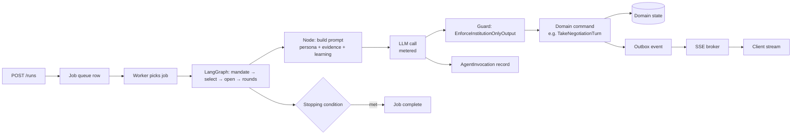
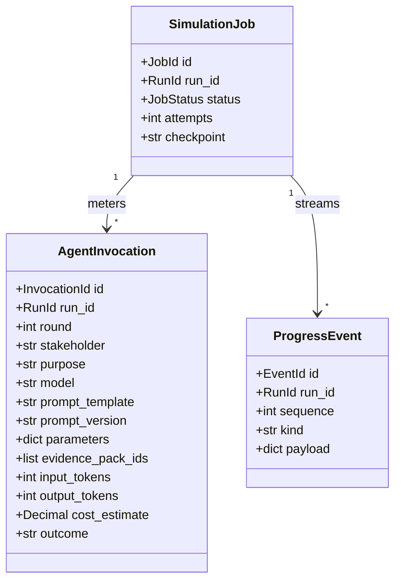
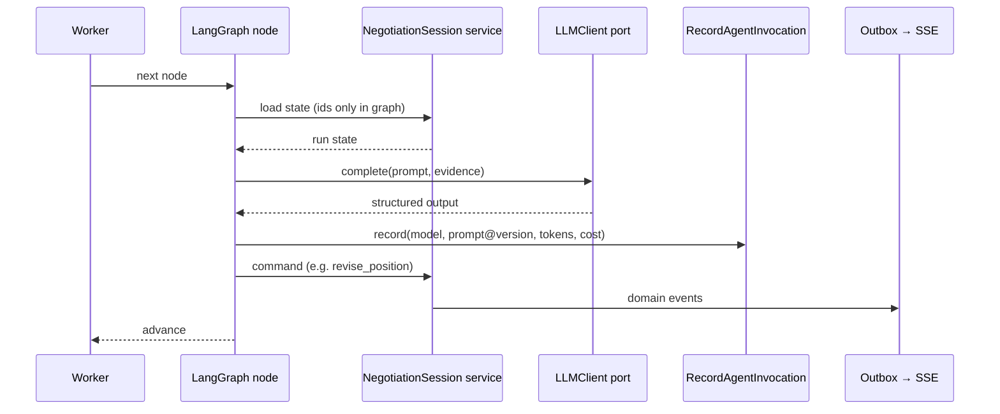

# SimulationOrchestration

## Module Status

**Status:** implemented (2026-11-06) — contract frozen #205, wiring #216, durable runtime #217, proofing #218, readiness #219; lifecycle hardening #235
**Depends:** NegotiationSession (ACL — invokes domain commands), StakeholderModel (persona versions), EvidenceRetrieval (packs per turn)
**Last reviewed:** 2026-11-06
**Source session:** 87433e56-b1a2-4464-a232-2dc4fe6f9dfd

## Description

Executes the agent workflow graph as a background job, streams progress events to clients and
records the traceability envelope of every LLM call. Orchestrates sequencing; it never owns
negotiation state.

**Modeling Depth:** service (supporting subdomain)
**Subdomain Rationale:** Necessary plumbing; correctness deferred to NegotiationSession aggregates.
**Context Map:** anticorruption-layer → NegotiationSession (LangGraph invokes domain commands; domain state is never read from graph state).

## Contract Freeze (issue #205)

All public interfaces for this epic are frozen before implementation. The frozen surface lives in:

| Surface | File |
|---|---|
| Values, enums, graph state, budget and prompt records | `src/simulation_orchestration/application/values.py` |
| Commands and result DTOs | `application/commands.py`, `application/dto.py` |
| Service interfaces | `application/services.py` |
| Rules (`BudgetGuard`, `CheckpointPolicy`, `PauseBoundary`, `RetryPolicy`, `PromptVersioning`) | `application/rules.py` |
| LLM/graph/worker/negotiation ports | `application/ports.py` |
| Repository ports | `application/repositories.py` (re-exported by `infrastructure/repository/ports.py`) |
| Progress event schemas | `application/events.py` |
| Stable error codes | `application/errors.py` |
| Concrete HTTP router and schemas | `interfaces/http/router.py`, `interfaces/http/schemas.py` |
| Published ACL views | `interfaces/published.py` |
| Composition factory | `composition.py` |

**ADR-008 note:** this is a service-depth context, so there is no domain model. The `domain/`
directory is an empty layout marker; event payloads live in `application/events.py`, because the
modeling-depth validator forbids Python modules under `domain/`.

**Frozen API:** `POST /api/v1/runs/{run_id}:start` (202), `GET /api/v1/runs/{run_id}/stream`
(SSE), `POST /api/v1/runs/{run_id}:pause` (202), `POST /api/v1/runs/{run_id}:resume` (202),
`GET /api/v1/runs/{run_id}/usage`, `GET /api/v1/jobs/{job_id}`. Write routes require `runs:write`;
read/stream routes require `runs:read`.

**Error codes:** `SIMULATION_JOB_NOT_FOUND`, `SIMULATION_RUN_NOT_FOUND`,
`INVALID_JOB_TRANSITION`, `RUN_BUDGET_EXHAUSTED`, `UNKNOWN_MODEL`, `PROMPT_NOT_FOUND`,
`INVALID_PROMPT_TEMPLATE`.

**Freeze policy:** signatures, field names, enum values, route paths and status codes are
additive-only. Renaming or removing a frozen member requires a new freeze entry. Service and
repository bodies raise `NotImplementedError` naming their implementing issue until that issue
lands.

## Architecture

| Layer | Responsibility | Path |
|-------|--------------|------|
| **Domain** | — (none; ADR-008 forbids aggregates here) | `src/simulation_orchestration/domain/` |
| **Application** | `RunSimulationJob`, `StreamSimulationProgress`, `PauseOrResumeSimulation`, `RecordAgentInvocation` | `src/simulation_orchestration/application/` |
| **Infrastructure** | LangGraph graph, worker loop, LLM provider adapters, SSE broker, job repository | `src/simulation_orchestration/infrastructure/` |
| **Interfaces** | REST routers (pause/resume/usage), SSE endpoint, prompt templates | `src/simulation_orchestration/interfaces/` |

**The ownership rule (ADR-003):** the graph holds `{run_id, round, phase, next_actor, budget_used}`.
Every node calls an application service in `NegotiationSession`, which loads the aggregate, applies
the rule and persists. The graph is a sequencer, not a model.

## Related ADRs

| ADR | Relevance |
|---|---|
| ADR-003 Cross-Context Communication | Graph sequencing vs domain ownership — the central constraint |
| ADR-004 API Design | SSE with `Last-Event-ID` replay; `202` for long-running work |
| ADR-006 Cost Tracking | `AgentInvocation` is owned here and is the reproducibility record |
| ADR-008 Proportional Modeling Depth | Service depth: no domain model, persistence contract only |
| ADR-013 SimulationOrchestration Runtime Integration | Router+worker wiring; durable `0302` stores; boot-time model failure |
| Issue #236 pause/resume runtime | Loop re-reads status each node; resume re-queues rather than setting RUNNING |
| Issue #238 progress allocation | Store allocates `MAX(sequence)+1` under a per-run advisory lock; no read-then-write in the publisher |

## Diagrams

### Data Flow



### Entity Relationship (persistence, not aggregates)



### Job State

```mermaid
stateDiagram-v2
    [*] --> Queued
    Queued --> Running : worker picks up
    Running --> Paused : pause requested; in-flight turn commits, next node does not start
    Paused --> Queued : resume; worker claims and continues from the persisted checkpoint
    Running --> Completed : stopping condition met
    Running --> Failed : unrecoverable error
    Running --> BudgetExhausted : budget breach
    BudgetExhausted --> Running : budget raised
    Failed --> Queued : retry
    Completed --> [*]
```

### Key Use Case Sequence — RunSimulationJob (one node)



## Service + Persistence Contract

| Operation | Reads | Writes | Idempotent |
|---|---|---|---|
| `RunSimulationJob` | `simulation_orchestration_job`, domain state via commands | job row, progress events | yes — resumable from `checkpoint`, one turn per node |
| `StreamSimulationProgress` | `progress` event log | — (read) | yes — replayable by `Last-Event-ID` |
| `PauseOrResumeSimulation` | job row, run phase | job status | yes — pause is a flag checked at turn boundary |
| `RecordAgentInvocation` | model price table | `agent_invocation` | yes — unique on `invocation_id` |

**Persistence contract**

| Table | Essential columns | Notes |
|---|---|---|
| `simulation_orchestration_job` | `id, run_id, status, attempts, checkpoint, budget_used, error` | `checkpoint` = last committed round/turn |
| `simulation_orchestration_invocation` | `id, run_id, round, stakeholder, purpose, model, prompt_template, prompt_version, parameters jsonb, evidence_pack_ids[], input_tokens, output_tokens, cost_estimate, latency_ms, outcome, created_at` | Append-only; §ADR-006 |
| `simulation_orchestration_progress` | `id, run_id, sequence, kind, payload jsonb, created_at` | Monotonic `sequence`; SSE source |
| `simulation_orchestration_prompt` | `id, name, version, body, checksum` | Prompt template registry; version is persisted per invocation |

**Restart semantics:** a worker crash after a domain commit but before the checkpoint write replays
the same node; domain commands are idempotent on `(run_id, round, actor)` so the replay is a no-op
and the checkpoint catches up. A crash before the commit loses only the LLM cost, never state.

## Components

**Service depth (ADR-008): no aggregates, no value objects, no domain events.** The module is
defined by its application services and its persistence contract above.

| Component | Layer | Responsibility |
|---|---|---|
| ``RunSimulationJob` / `StreamSimulationProgress` / `PauseOrResumeSimulation` / `RecordAgentInvocation`` | application | Job execution, streaming, metering (catalog above) |
| `BudgetGuard`, `CheckpointPolicy`, `PauseBoundary`, `RetryPolicy`, `PromptVersioning` | application (rules) | Pre-call budget checks, safe-boundary pausing, bounded backoff, prompt versions |
| `SequentialWorkflowGraph` | infrastructure | Pure sequencing: nodes receive/return `GraphState`; architecture test forbids state mutation and domain imports |
| `JobStore`, `InvocationStore`, `ProgressStore`, `PromptRegistry` | infrastructure | Job/stream/metering persistence contract above |
| `LLMClient` port, SSE endpoint | interfaces | Provider-independent LLM adapter and event stream |

## Application Services (authoritative catalog)

| Service | Use case | Maps to FR |
|---|---|---|
| `RunSimulationJob` | Execute the agent workflow graph as a background job, emitting progress events and supporting pause/resume. | FR-027 |
| `StreamSimulationProgress` | Publish ordered progress events for a running simulation so clients observe rounds, turns and position changes as they commit. | FR-027 |
| `PauseOrResumeSimulation` | Pause a running job at a safe boundary and resume it later from persisted negotiation state without losing rounds or arguments. | FR-028 |
| `RecordAgentInvocation` | Persist the traceability envelope of every agent call: model, prompt template version, parameters, evidence pack ids and token cost. | FR-029 |

**Additional helpers (below the catalog):** `EnforceRunBudget` (ADR-006 guard before each call),
`RetryFailedNode` (bounded exponential backoff), `CollectUsageReport` (per-stakeholder/per-round view).

## API Endpoints

| Method | Path | Handler | Input | Output | Auth |
|---|---|---|---|---|---|
| POST | `/api/v1/runs/{run_id}:start` | `run_simulation_job` | `{}` | `202 {job_id}` | `runs:write` |
| GET | `/api/v1/runs/{run_id}/stream` | `stream_simulation_progress` | `Last-Event-ID` | `text/event-stream` | `runs:read` |
| POST | `/api/v1/runs/{run_id}:pause` | `pause_or_resume_simulation` | `{action: "pause"}` | `202 {status}` | `runs:write` |
| POST | `/api/v1/runs/{run_id}:resume` | `pause_or_resume_simulation` | `{action: "resume", budget?}` | `202 {status}` | `runs:write` |
| GET | `/api/v1/runs/{run_id}/usage` | `collect_usage_report` | — | tokens, cost, per-stakeholder breakdown | `runs:read` |
| GET | `/api/v1/jobs/{job_id}` | `get_job` | — | status, attempts, checkpoint, error | `runs:read` |

## Ubiquitous Language

| Term | Definition |
|---|---|
| Simulation Job | The queued/running execution that advances a run |
| Checkpoint | Last committed round/turn marker enabling resume |
| Progress sequence | Allocated by the store under a per-run lock; publisher sends sequence 0 |
| Agent Invocation | One metered LLM call with its full reproducibility envelope |
| Prompt Template Version | `name@version` identity persisted with each invocation |
| Progress Event | Ordered, replayable event published for streaming |
| Run Budget | `max_invocations` / `max_tokens` / `max_cost` guard per run |
| Safe Boundary | Turn boundary where pausing is permitted |

## Dependencies

**Depends On:**

| Module | What it provides |
|---|---|
| NegotiationSession | Domain commands (`OpenSimulationRun`, `TakeNegotiationTurn`, …) and state queries |
| StakeholderModel | Persona version + profile for prompt construction |
| EvidenceRetrieval | Evidence packs per claim, injected into prompts |
| GovernanceCompliance | Guard verdict before persistence |
| ClaimValidation | Verdicts injected into prompt context |

**Used By:**

| Consumer | What it provides |
|---|---|
| NegotiationSession | `invocation_id` linking an argument to its model call |
| GovernanceCompliance | Invocation metadata for provenance disclosure |
| DecisionBrief | Model/prompt versions cited in the disclaimer |

## Implementation Sequence

1. Job + progress tables, worker loop skeleton, `/healthz` integration
2. `RunSimulationJob` for a two-agent stub graph (proves sequencing without domain depth)
3. `RecordAgentInvocation` + price table + budget guard
4. `StreamSimulationProgress` SSE with `Last-Event-ID` replay
5. `PauseOrResumeSimulation` at turn boundary + crash/restart test
6. Full graph: mandate → select → open → rounds → close
7. Prompt template registry with versions
8. Retry/backoff + dead-letter handling
9. Usage report endpoint

## Patterns & OOP Mapping

| Component | Pattern | Rationale |
|---|---|---|
| Graph | **State machine (orchestration only)** | Nodes are steps; state lives in the domain |
| LLM provider | **Adapter / Port** (`LLMClient`) | Provider independence; test double for CI |
| Prompt assembly | **Builder** | Persona + evidence + learning + task, composed per purpose |
| Cost guard | **Strategy** (`InvocationCap`, `TokenCap`, `CostCap`) | Three budget dimensions, same interface |
| SSE fan-out | **Observer / pub-sub** | Progress events to N subscribers without coupling |
| No aggregates | — | ADR-008 service depth: persistence contract, not domain model |

**Explicitly rejected:** storing negotiation state in graph state. That would make pause/resume,
replay and audit depend on framework internals, and it was rejected in ADR-003.

## Wiring Contract

| Wiring point | Requirement | Proof |
|---|---|---|
| Router + worker | `app.include_router(simulation_orchestration_router)` and the worker is started by the app lifespan (or a documented companion process started in `compose.yaml`) | smoke test: `POST /runs/{id}:start` produces progress events without manual intervention |
| Composition | LLM provider, price table, budget defaults and prompt registry selected from settings; a missing price entry must fail at boot, not silently meter zero | boot test with an unknown model id |
| Persistence | Migration `0302` applied; jobs resumable across restart | kill-and-restart test |
| Broker sharing | Progress broker instance shared with the NegotiationSession SSE endpoint | integration test: one stream, two publishers |
| Metering | Every call writes `agent_invocation` with model, `prompt@version`, tokens, cost | usage endpoint reflects a live run |
| Ownership | Graph holds only ids/phase/budget; no domain state | architecture test on graph state schema |

**Runtime (ADR-013):** the router is mounted in `shared/app.py`, the background worker is started by
the lifespan, and `build_container` selects the scripted provider. `PERSISTENCE=postgres` uses the
`0302_simulation_orchestration` tables (plus `0303_simulation_lease` and
`0304_simulation_pause_reason`) through SQLAlchemy adapters; jobs, invocation envelopes,
progress events and prompt versions survive restart. Until the NegotiationSession Phase 4 graph
lands, a deterministic bootstrap node closes the run so `POST :start` produces
`run.started` → `run.completed` without a manual step.


### Collaborator reachability (W8)

Every row is a call-site obligation, not a description: the collaborator must be invoked from the named entry point, and its effect must be visible from outside the module. A collaborator with no row here is a defect in this document. A unit test of the collaborator is never proof of wiring — the proof drives the entry point and reads the effect. Enforced mechanically by
`.pi/scripts/ci/check_collaborator_reachability.py`, which fails CI when a collaborator is assigned in
`__init__` and never read.

| Collaborator | Invoked from | Observable effect | Fails when |
|---|---|---|---|
| `BudgetGuard.evaluate` | before each graph step / invocation | `budget_used` advances, `run.budget_exhausted` published, job paused | injected and never called (#237) |
| `RetryPolicy` | worker failure path | bounded attempts, then a dead-letter state, restart counter advances | no retry, no bound (#235) |
| `PauseBoundary` | pause endpoint + loop boundary | a run stops before the next node; `turn_committed` derived from persisted state | `turn_committed=True` hardcoded (#236) |
| `CheckpointPolicy` | each step | checkpoints written only at safe boundaries | injected and unused |
| lease on `claim_next` | claim path | a job whose lease expired is re-claimable | `QUEUED`-only claim, orphaned `RUNNING` jobs (#235) |
| `list_resumable` | boot recovery | orphaned jobs re-queued, count logged | defined in the port, never called |

### Atomic allocation (W9)

`ProgressPublisher` must not compute `latest_sequence + 1` in application code. The store allocates the
sequence (single `INSERT … SELECT COALESCE(MAX(sequence), 0) + 1 … RETURNING`, or a per-run lock) and a
test publishes concurrently and asserts `1..N` with no loss and no `IntegrityError` (#238).

### Liveness (W10)

`/readyz` reports `simulation_worker` from the task state, not from the container's existence, and
`simulation_worker_restarts_total` / `simulation_job_failures_total` exist. A dead worker makes readiness
non-`ok`; discovering it from "jobs stopped arriving" is a failure of this gate (#235).

## Acceptance Criteria

| # | Component | Criterion | Verify In |
|---|---|---|---|
| 1 | Graph purity | No graph node mutates domain state directly; all mutations go through application services | architecture test |
| 2 | Graph state | Graph state contains only ids/phase/budget — no positions, arguments or evidence | architecture test |
| 3 | Invocation envelope | Every LLM call produces exactly one `agent_invocation` row with model, prompt@version, tokens, cost | integration |
| 4 | Budget guard | Exceeding `max_cost`/`max_tokens`/`max_invocations` pre-check pauses the run and emits `RunBudgetExhausted`; no invocation is attempted after rejection | integration |
| 4a | Metering runtime | The temporary bootstrap graph records one metered envelope per turn; `budget_used` advances from the invocation store | integration |
| 5 | Pause boundary | Pause during a turn completes or discards the turn atomically; run state unchanged | integration |
| 6 | Resume | A paused run resumes at the next turn with identical prior state | integration |
| 7 | Crash recovery | Killing the worker mid-run and restarting neither duplicates arguments nor loses rounds | integration |
| 8 | SSE ordering | Events arrive in monotonic `sequence`; reconnect with `Last-Event-ID` replays without gaps or duplicates | integration |
| 9 | Prompt versioning | Changing a prompt template creates a new version; old invocations keep their version | unit |
| 10 | Provider independence | Swapping the LLM adapter requires no change outside `infrastructure/` | architecture test |
| 11 | Wiring | Worker started by lifespan or compose; `POST :start` emits progress with no manual step; unknown model id fails at boot | integration |

## Modeling Depth Note (ADR-008)

This bounded context is a **supporting subdomain** — model at service/CRUD depth. Keep
implementation to application services + persistence. Do NOT introduce new aggregates, value
objects, or domain events beyond what this exploration captured.

**Anti-corruption edges:**
- SimulationOrchestration → NegotiationSession — LangGraph invokes domain commands; domain state is
  never read from graph state.
