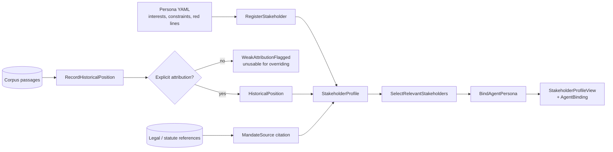
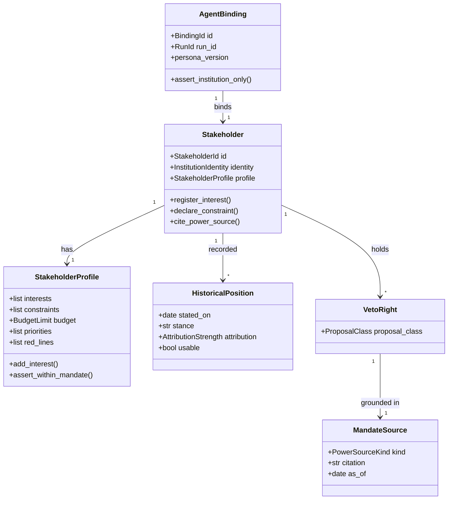
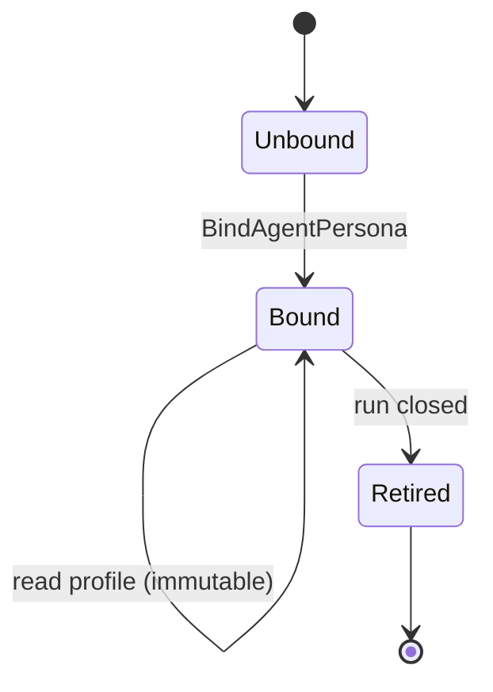
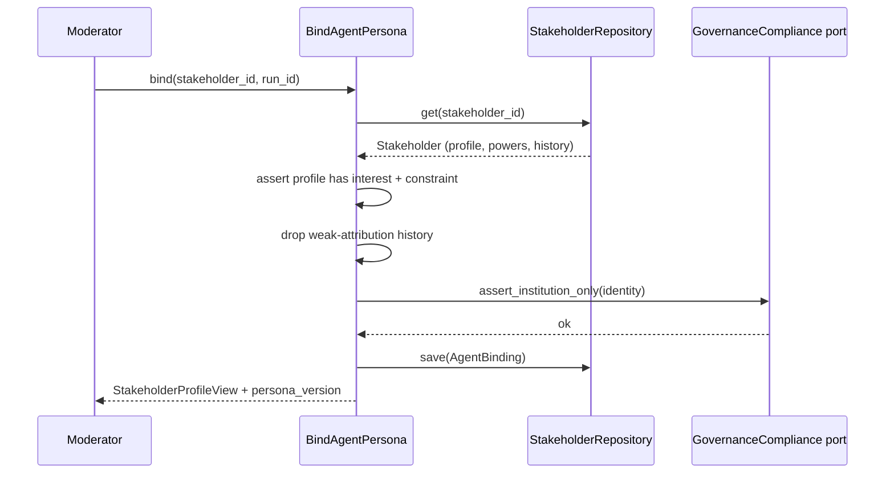

# StakeholderModel

## Module Status

**Status:** Contract frozen — implementation follows contract-freeze issue #102
**Depends:** EvidenceCorpus (historical positions are extracted from attributed corpus passages)
**Last reviewed:** 2026-11-06
**Source session:** 87433e56-b1a2-4464-a232-2dc4fe6f9dfd

## Description

Owns institutional identity: who the stakeholder is, what it wants, what limits it, and how that
becomes a negotiating agent persona. Guarantees institutions only, never persons.

**Modeling Depth:** tactical (core domain)
**Subdomain Rationale:** Distinct, defensible institutional identity is the core of the simulation's realism.
**Context Map:** partnership → NegotiationSession (Positions must reference stakeholder interests/constraints; both evolve together.)

## Architecture

| Layer | Responsibility | Path |
|-------|--------------|------|
| **Domain** | `Stakeholder`, `AgentBinding` aggregates; interests, constraints, powers, attribution rules | `src/stakeholder_model/domain/` |
| **Application** | `RegisterStakeholder`, `BindAgentPersona`, `SelectRelevantStakeholders`, `RecordHistoricalPosition` | `src/stakeholder_model/application/` |
| **Infrastructure** | SQLAlchemy repositories, YAML persona loader, corpus port for historical positions | `src/stakeholder_model/infrastructure/` |
| **Interfaces** | REST routers, `StakeholderProfileView` published to NegotiationSession | `src/stakeholder_model/interfaces/` |

## Contract Freeze (issue #102)

**Frozen:** 2026-11-06. Implementation issues consume these interfaces; changing a name, field or
signature is a contract change, not a refactor.

| Contract area | Location | Frozen surface |
|---|---|---|
| Domain values | `src/stakeholder_model/domain/values.py` | IDs, enums, institutions, interests, constraints, budgets, mandates, vetoes, power, attribution, positions |
| Aggregates | `src/stakeholder_model/domain/stakeholder.py`, `agent_binding.py` | `Stakeholder`, `StakeholderProfile`, `AgentBinding` fields and commands |
| Errors | `src/stakeholder_model/domain/errors.py` | stable codes for person representation, incomplete profile, unsourced authority, veto narrowing, missing aggregates |
| Events | `src/stakeholder_model/domain/events.py` | all eleven payloads from the event table below |
| Repository ports | `src/stakeholder_model/domain/repositories.py` | `StakeholderRepository`, `AgentBindingRepository`, `CorpusEvidencePort` |
| Domain policies | `src/stakeholder_model/domain/services.py` | `MaterialityScorer`, attribution strategies, persona position selection |
| Application DTOs | `src/stakeholder_model/application/{commands,dto}.py` | one request/result object per use case |
| Application ports | `src/stakeholder_model/application/ports.py` | transaction, clock, guard, persona factory |
| Application services | `src/stakeholder_model/application/services.py` | every use case with an `execute` method |
| Partner contract | `src/stakeholder_model/interfaces/published.py` | `StakeholderProfileView`, `AgentBindingView`, `InstitutionalAllowlistView` |
| HTTP | `src/stakeholder_model/interfaces/http/` | eight routes, scopes, request/response schemas |

**Stub policy:** behaviour methods raise `NotImplementedError` naming the issue that fills them.
Routers are concrete (no separate handler interface); the container shape is `interfaces/http/deps.py`.

## Related ADRs

| ADR | Relevance |
|---|---|
| ADR-001 Architecture Pattern | Partnership with NegotiationSession; no domain-layer coupling |
| ADR-002 Data Storage Strategy | Profile as JSONB with schema version; identity tables owned here |
| ADR-003 Cross-Context Communication | Publishes `StakeholderProfileView`; no events consumed from negotiation |
| ADR-007 Compliance Engine | Institutional allowlist originates here — the guard's source of truth |
| ADR-008 Proportional Modeling Depth | Tactical: powers and attribution are invariants, not fields |

## Diagrams

### Data Flow



### Entity Relationship



### Aggregate State (AgentBinding)



### Key Use Case Sequence — BindAgentPersona



## Components

### Aggregates

#### Stakeholder (aggregate root)

An institution in the Austrian healthcare system. Never a natural person — this is the first
invariant and the compliance foundation.

```python
# src/stakeholder_model/domain/stakeholder.py
@dataclass
class Stakeholder:
    id: StakeholderId
    identity: InstitutionIdentity
    profile: StakeholderProfile
    veto_rights: list[VetoRight] = field(default_factory=list)
    dependencies: list[Dependency] = field(default_factory=list)
    history: list[HistoricalPosition] = field(default_factory=list)
    events: list[DomainEvent] = field(default_factory=list)

    def __post_init__(self) -> None:
        if self.identity.is_person:
            raise PersonRepresentationForbidden(self.identity.name)

    def cite_power_source(self, power: VetoRight | MandateScope | BudgetLimit,
                          source: MandateSource) -> None:
        """Authority without a citable instrument is inadmissible."""
        if source.kind is PowerSourceKind.UNSPECIFIED:
            self.events.append(AuthorityClaimRejected(self.id, power, source))
            raise UnsourcedAuthority(self.id, power)
        power.source = source
        self.events.append(MandateSourceCited(self.id, type(power).__name__, source.citation))

    def record_historical_position(self, stance: str, attribution: AttributionStrength,
                                   stated_on: date, passage_id: PassageId) -> HistoricalPosition:
        position = HistoricalPosition.new(stance, attribution, stated_on, passage_id)
        if not attribution.is_explicit():
            self.events.append(WeakAttributionFlagged(self.id, passage_id, attribution))
        self.history.append(position)
        self.events.append(HistoricalPositionRecorded(self.id, position.id, attribution))
        return position

    def negotiating_power(self) -> NegotiatingPower:
        """Derived, never assigned. Recomputed from grounded inputs only."""
        return NegotiatingPower.derive(
            mandate_scope=self.profile.mandate_scope,
            budget=self.profile.budget,
            veto_rights=self.veto_rights,
            dependencies=self.dependencies,
        )
```

**Invariants:**

| # | Invariant | Illegal state prevented |
|---|---|---|
| 1 | A Stakeholder is always an institution; never represented by or named after a natural person | Simulating individual officials |
| 2 | A profile declares at least one interest and one constraint before activation | Positionless chatbot in the negotiation |
| 3 | Budget constraints and priorities sit within the declared mandate scope | Conceding authority the institution does not have |
| 4 | An `AgentBinding` is immutable for the duration of a run | Agent silently changing identity mid-negotiation |
| 5 | `NegotiatingPower` is derived from mandate scope, budget and vetoes; an agent may never assign it | Invented leverage that makes game theory fiction |
| 6 | A `Dependency` is directional and links only stakeholders registered in the same run | Coalition analysis over non-participants |
| 7 | A `VetoRight` applies to a proposal class, never a specific proposal | Ad-hoc blocking making outcomes arbitrary |
| 8 | Every veto, mandate scope and budget limit cites a `MandateSource`; unsourced authority is inadmissible | Invented legal competences and budget ceilings |
| 9 | A `HistoricalPosition` requires explicit attribution to the institution; mere mention does not establish a position | Inferring stances from passing references |
| 10 | Weak attribution cannot override a current explicit statement | Stale weak history outweighing the present position |

#### AgentBinding (aggregate root)

Immutable binding of one profile to one agent persona in one run.

```python
# src/stakeholder_model/domain/agent_binding.py
@dataclass(frozen=True)
class AgentBinding:
    id: BindingId
    run_id: RunId
    stakeholder_id: StakeholderId
    persona_version: str
    allowed_evidence_tiers: frozenset[AuthorityTier]
    red_lines: tuple[str, ...]

    def assert_institution_only(self) -> None:
        if not self.persona_version or self.stakeholder_id is None:
            raise BindingIncomplete(self.id)
```

**Domain-owned repository interfaces:**

```python
# src/stakeholder_model/domain/repositories.py
class StakeholderRepository(Protocol):
    async def get(self, stakeholder_id: StakeholderId) -> Stakeholder | None: ...
    async def save(self, stakeholder: Stakeholder) -> None: ...
    async def all_registered(self) -> list[Stakeholder]: ...

class AgentBindingRepository(Protocol):
    async def get_for_run(self, run_id: RunId, stakeholder_id: StakeholderId) -> AgentBinding | None: ...
    async def save(self, binding: AgentBinding) -> None: ...

class CorpusEvidencePort(Protocol):
    async def passages_about(self, identity: InstitutionIdentity) -> list[PassageView]: ...
```

### Value objects (entity-vs-VO justification)

| Value object | Immutable | Equal by state | Why a VO |
|---|---|---|---|
| `Interest` | yes | yes | Goal + weight + topic scope; no identity across time |
| `Constraint` | yes | yes | Hard limit statement; two identical limits are one limit |
| `BudgetLimit` | yes | yes | Amount + period + tolerance |
| `DecisionPriority` | yes | yes | Ordered ranking; value by content |
| `MandateScope` | yes | yes | Admissible range; bounded set of competences |
| `MandateSource` | yes | yes | Citation bundle (kind, citation, as_of) |
| `VetoRight` | yes | yes | Proposal class + grounding source |
| `Dependency` | yes | yes | Directed pair + strength |
| `NegotiatingPower` | yes | yes | Derived measurement, recomputed not accumulated |
| `AttributionStrength` | yes | yes | Classification of how firmly a source attributes |
| `InstitutionIdentity` | yes | yes | Canonical name, category, code |
| `PowerSourceKind` | yes | yes | Enum-like classification |

### Service classification

| Service | Layer | Why |
|---|---|---|
| `RegisterStakeholder` | application | Transaction boundary; loads YAML, validates, saves |
| `BindAgentPersona` | application | Coordinates repository + compliance port |
| `SelectRelevantStakeholders` | application | Moderator policy; scores materiality over profiles |
| `RecordHistoricalPosition` | application | Fetches corpus passages, applies attribution rules, saves |
| `MaterialityScorer` | domain service | Policy with two variants (topic overlap, weighted interest) |
| `AttributionRule` | domain service | Decides explicit vs reported vs mention |
| PersonaLoader (YAML) | infrastructure | File format adapter |

## Domain Events

| Event | Description | Trigger | Payload | Published By |
|---|---|---|---|---|
| `StakeholderRegistered` | Institution entered the registry with mandate and profile | `RegisterStakeholder` | `stakeholder_id, identity, interest_count, constraint_count` | StakeholderModel |
| `StakeholderProfileUpdated` | Interests, constraints or priorities changed; affects future runs only | `RegisterStakeholder` | `stakeholder_id, changed_fields[], profile_version` | StakeholderModel |
| `AgentPersonaBound` | Stakeholder bound to a persona for a run | `BindAgentPersona` | `binding_id, run_id, stakeholder_id, persona_version` | StakeholderModel |
| `HistoricalPositionRecorded` | A past stance was extracted and stored with provenance | `RecordHistoricalPosition` | `stakeholder_id, position_id, attribution, passage_id` | StakeholderModel |
| `MandateViolationDetected` | A proposed concession exceeded declared constraints or budget | `BindAgentPersona` | `stakeholder_id, constraint, proposed_value` | StakeholderModel |
| `MandateSourceCited` | An authority claim was grounded in a citable instrument | `RegisterStakeholder` | `stakeholder_id, power_type, citation` | StakeholderModel |
| `AuthorityClaimRejected` | A power was refused for lacking an admissible source | `RegisterStakeholder` | `stakeholder_id, power_type, reason` | StakeholderModel |
| `WeakAttributionFlagged` | History stored with weak attribution, unusable for overriding | `RecordHistoricalPosition` | `stakeholder_id, passage_id, attribution` | StakeholderModel |
| `NegotiatingPowerChanged` | Derived leverage changed, altering viable coalitions | `RegisterStakeholder` | `stakeholder_id, previous, current, drivers[]` | StakeholderModel |
| `VetoRightRegistered` | A blocking competence over a proposal class was declared | `RegisterStakeholder` | `stakeholder_id, proposal_class, mandate_source` | StakeholderModel |
| `DependencyRecorded` | Directional dependency between two institutions registered | `RegisterStakeholder` | `from_id, to_id, kind, strength` | StakeholderModel |

**ADR-008 triage:** all eleven pass at least one question; `MandateSourceCited`,
`AuthorityClaimRejected`, `VetoRightRegistered` and `WeakAttributionFlagged` are audit-critical.
`DependencyRecorded` is expert-relevant (structural knowledge for coalition analysis) but not
audit-critical — recorded without an audit obligation.

## API Endpoints

| Method | Path | Handler | Input | Output | Auth |
|---|---|---|---|---|---|
| GET | `/api/v1/stakeholders` | `list_stakeholders` | — | registry with profile summaries | `runs:read` |
| POST | `/api/v1/stakeholders` | `register_stakeholder` | `{identity, interests[], constraints[], budget, priorities[]}` | `201 {stakeholder_id}` | `admin` |
| PATCH | `/api/v1/stakeholders/{id}` | `update_profile` | partial profile | `{profile_version}` | `admin` |
| POST | `/api/v1/stakeholders/{id}/powers` | `cite_power_source` | `{power_type, proposal_class?, citation, kind, as_of}` | `{accepted: bool, reason?}` | `admin` |
| GET | `/api/v1/stakeholders/{id}/history` | `list_historical_positions` | `?usable_only` | positions with attribution + provenance | `runs:read` |
| POST | `/api/v1/stakeholders/{id}/history` | `record_historical_position` | `{stance, attribution, stated_on, passage_id}` | `201 {position_id, usable}` | `corpus:write` |
| POST | `/api/v1/runs/{run_id}/stakeholders:select` | `select_relevant_stakeholders` | `{mandate}` | `[{stakeholder_id, materiality}]` | `runs:write` |
| POST | `/api/v1/runs/{run_id}/stakeholders:bind` | `bind_agent_persona` | `{stakeholder_ids[]}` | `[{binding_id, persona_version}]` | `runs:write` |

## Ubiquitous Language

| Term | Definition | Aliases prohibited |
|---|---|---|
| Stakeholder | An institution of the Austrian healthcare system; never a natural person | actor, player, party, participant |
| Stakeholder Profile | Mandate, interests, constraints, budget, priorities | persona-spec, agent-config |
| Interest | Weighted goal scoped to policy topics | objective, preference |
| Constraint | Hard limit the institution cannot concede | red-line, restriction |
| Red Line | A proposal type the institution will not accept under any package | veto, blocker |
| Budget Limit | Numeric spending envelope within which proposals are acceptable | budget-cap, cost-ceiling |
| Mandate Scope | Admissible range of agreement; bounds every concession | competence, remit |
| Mandate Source | Citable instrument grounding a power claim | legal-basis, authority-ground |
| Veto Right | Power to block a proposal class outright | blocking-power, reserved-competence |
| Dependency | Directional relation between institutions | link, reliance |
| Negotiating Power | Derived leverage from scope, budget, vetoes, centrality | leverage, influence, weight |
| Attribution Strength | Explicit vs reported vs mere mention | confidence-of-attribution |
| Historical Position | Provenance-backed past stance, weighted below current events | past-statement, legacy-stance |
| Agent Binding | Immutable link of a profile to an agent in one run | persona-binding, agent-assignment |

## Dependencies

**Depends On:**

| Module | What it provides |
|---|---|
| EvidenceCorpus | Attributed passages used to ground `HistoricalPosition` (attribution strength read from `speaker_kind` + context) |

**Used By:**

| Consumer | What it provides |
|---|---|
| NegotiationSession | `StakeholderProfileView` (partner contract: positions must reference interests/constraints) |
| GovernanceCompliance | Institutional allowlist — the guard's canonical list of legitimate institutions |
| SimulationOrchestration | Persona version for invocation recording |
| DecisionBrief | `ActorSummary` (identity, goals, constraints, adopted positions) |

## Implementation Sequence

1. `InstitutionIdentity`, `Interest`, `Constraint`, `BudgetLimit`, `DecisionPriority` VOs
2. `Stakeholder` invariant tests: person representation refused, profile completeness
3. `MandateSource`, `PowerSourceKind`, `VetoRight`, `NegotiatingPower.derive`
4. YAML persona loader + 9 persona files (validation on load)
5. `RecordHistoricalPosition` with `AttributionRule` + `AttributionStrength`
6. `RegisterStakeholder` application service + repository
7. `SelectRelevantStakeholders` materiality scorer
8. `BindAgentPersona` + compliance port call
9. `StakeholderProfileView` published contract + architecture test (no domain leak)
10. REST routers + contract tests

## Patterns & OOP Mapping

| Component | Pattern | Rationale |
|---|---|---|
| Persona loading | **Factory** (`PersonaFactory.from_yaml`) | Complex construction with validation; invalid personas must be unrepresentable |
| `AttributionRule` | **Strategy** (`ExplicitAttribution`, `ReportedAttribution`, `MentionOnly`) | Three real cases with different consequences |
| Materiality selection | **Strategy** (`TopicOverlapScorer`, `WeightedInterestScorer`) | Two known selection policies; benchmark decides |
| Power derivation | **Pure function over VOs** | `NegotiatingPower.derive` — no state accumulation, so it cannot be "assigned" |
| `Stakeholder` | **Rich aggregate** | `cite_power_source`, `record_historical_position`, `negotiating_power`; no setters |
| Views | **DTO / read model** | `StakeholderProfileView` is a boundary object, not an entity |

## Wiring Contract

| Wiring point | Requirement | Proof |
|---|---|---|
| Router | `app.include_router(stakeholder_model_router)` in `src/shared/app.py` | boot test asserting registration |
| Composition | persona loader runs at startup and fails fast if any of the 9 personas is invalid (missing interest/constraint, personal name) | startup test: a malformed persona aborts boot |
| Persistence | Migration `0202` (stakeholder, profile, historical_position, mandate_source, agent_binding) applied | profiles survive restart |
| Downstream publication | `StakeholderProfileView` exposed to NegotiationSession; **institutional allowlist published to GovernanceCompliance** (the guard's source of truth) | integration test: guard recognises all 9 institutions |
| Events | Registrations, powers and weak attributions published through the outbox | `MandateSourceCited` / `AuthorityClaimRejected` rows present |
| Grounding data | Every veto/budget limit ships with a `MandateSource`; seeded via migration or operator endpoint, never defaulted | integration test: persona without grounding is refused at boot |

## Acceptance Criteria

| # | Component | Criterion | Verify In |
|---|---|---|---|
| 1 | Person representation | Constructing a Stakeholder with a personal name raises `PersonRepresentationForbidden` | unit |
| 2 | Incomplete profile | Activating a stakeholder with no interest or no constraint raises | unit |
| 3 | Unsourced authority | `cite_power_source` without a `MandateSource` raises `UnsourcedAuthority` and emits `AuthorityClaimRejected` | unit |
| 4 | Power derivation | Two stakeholders with identical scope/budget/vetoes derive identical `NegotiatingPower` | unit |
| 5 | Weak attribution | A position recorded from a mention-only source is stored with `usable == False` and emits `WeakAttributionFlagged` | unit |
| 6 | Weak vs explicit | A `usable == False` position never overrides an explicit current statement in persona assembly | unit |
| 7 | Binding immutability | Modifying an `AgentBinding` after creation is impossible (frozen dataclass / no update path) | unit + architecture |
| 8 | Veto class rule | A `VetoRight` for `statutory_benefit_change` cannot be narrowed to a single proposal id | unit |
| 9 | Persona cards | All 9 personas load, each with ≥1 interest, ≥1 constraint, and only institutional names | integration |
| 10 | Partner contract | `StakeholderProfileView` exposes no repository or ORM types | architecture test |
| 11 | Selection | The waiting-time question selects ≥7 of 9 institutions with materiality scores in `[0,1]` | integration |
| 12 | Wiring | Boot aborts on an invalid persona; the institutional allowlist is published to GovernanceCompliance and the guard recognises all 9 institutions | integration |

## Modeling Depth Note (ADR-008)

Tactical depth as a core subdomain: `Stakeholder` and `AgentBinding` aggregate roots, ten invariants
(powers must be grounded, history must be attributed), domain-owned repository protocols and triaged
events.

**Deliberate exclusion:** persona *text* is configuration, not domain state. The domain enforces that
a profile is complete and grounded; it does not model prose.
